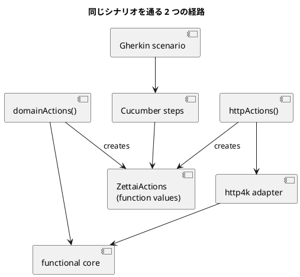

# 第 3 章 ドメインの定義とテスト

第 2 章のテストは HTTP の縦串をよく確かめますが、URL、status、HTML まで知っています。この章では「ユーザーが自分の ToDo リストを見られる」という業務の言葉を中心に戻します。

## 受け入れテストを改善する

業務の期待を Gherkin で書きます。

```gherkin
シナリオ: ToDo リストの項目を見る
  前提 ユーザー "uberto" がリスト "book" に次の項目を持っている
    | write chapter |
    | publish book  |
  もし ユーザーがリスト "book" を見る
  ならば 項目は次のとおりである
    | write chapter |
    | publish book  |
```

feature には業務の振る舞いだけがあります。domain / HTTP の実行マトリクスは step definitions が担当し、URL や status とともに feature から取り除きます。これでインフラの変更と業務仕様の変更を区別できます。DataTable を使うため、カンマを含む項目も 1 つの値として表せます。

## 高階関数を使う

テストが使う操作を、ドメインの型だけで定義します。

```kotlin
data class ZettaiActions(
    val name: String,
    val setUp: (User, ToDoList) -> Unit,
    val getToDoList: (User, ListName) -> List<ToDoItem>?,
)
```

`ZettaiActions` は関数値を保持する test adapter の契約です。constructor は関数を受け取る高階関数であり、継承ではなく値の差し替えで経路を組み立てます。プロダクションコードの DI コンテナではありません。

domain 経路は `web` を通らず、functional core の取得関数を直接呼びます。

```kotlin
fun domainActions(): ZettaiActions {
    val lists = mutableMapOf<User, List<ToDoList>>()
    return ZettaiActions(
        name = "domain",
        setUp = lists::add,
        getToDoList = { user, listName -> findToDoList(lists, user, listName)?.items },
    )
}
```

HTTP 経路は実際のパスを組み立てて `HttpHandler` を呼び、HTML から項目を読み戻します。両者の戻り値は同じ `List<ToDoItem>?` です。

## ドメインとインフラストラクチャの分離

2 つの経路は、同じ契約の別実装です。



domain 経路だけが失敗すれば、ドメインの振る舞いに問題があります。HTTP 経路だけが失敗すれば、パス変換、status、HTML のどこかに問題があります。両方を同じ期待で実行することで、adapter が業務判断を追加していないことを検証できます。

2 経路の組み立てと反復は step definitions に閉じ込めます。

```kotlin
private val actionPaths = listOf(domainActions(), httpActions())
```

各 step は `actionPaths` の両方へ同じ値を渡します。プロダクションコードにも Gherkin feature にも Cucumber の経路名は入りません。テストの実行方法をドメイン設計と業務仕様へ漏らさないためです。

## ドメインからテストを駆動する

step definitions は Gherkin の文字列を値型へ変換します。

```kotlin
val descriptions = items.asLists().flatten().filterNotNull()
val list = ToDoList(ListName(listName), descriptions.map { ToDoItem(it) })
actionPaths.forEach { it.setUp(owner, list) }
```

以後の検証は `String` ではなく `ToDoItem` のリスト同士で行います。HTTP 経路だけが HTML という外部表現を扱い、step definitions と domain 経路はドメインの値を扱います。

各 scenario で step definitions と action が新しく作られるため、可変のテストデータはシナリオ間で共有されません。順序に依存するテストを避けるため、状態の寿命も実行単位に合わせます。

## Gherkin を Cucumber で実行する

既存 Kotlin 版は DDT を Pesticide で実行します。Kotlin FP 版はユーザー指定に従い、Gherkin と Cucumber を使います。ライブラリの目的は違いますが、ここで守りたい性質は同じです。

- シナリオは業務の言葉で記述する。
- 実行経路の詳細を scenario から分離する。
- 1 つの期待を domain / HTTP の双方で実行する。

Cucumber は業務 scenario を 1 回実行し、step definitions が各操作を domain / HTTP の両方へ適用します。検証時は `withClue` に経路名を渡すため、失敗した経路を識別できます。

```text
RunCucumberTest > ToDo リストを見る > ToDo リストの項目を見る PASSED
```

この選択では Pesticide の actor DSL を再現しません。Cucumber が持つ feature、step definitions、scenario lifecycle をそのまま使い、Zettai 固有なのは小さな `ZettaiActions` 契約と 2 つの adapter だけにします。

## まとめ

- HTTP 詳細を feature から除き、業務の言葉で受入仕様を書きました。
- `ZettaiActions` を境に domain / HTTP の実行方法を差し替えました。
- 同じ業務 scenario の各操作を 2 経路へ適用し、adapter が振る舞いを変えないことを確かめました。
- 経路選択と可変なテスト状態を test code に閉じ込めました。
- Pesticide の DSL を移植せず、Cucumber の標準的な構造へ委ねました。

次章では、取得関数を渡すだけだった依存関係を発展させ、ドメインと adapter のモデリングを進めます。

## この章で書いたコード

- feature: `apps/kotlin-fp/zettai/zettai-step2-http-domain/src/test/resources/features/see_todo_list.feature`
- Cucumber steps: `apps/kotlin-fp/zettai/zettai-step2-http-domain/src/test/kotlin/zettai/acceptance/ZettaiSteps.kt`
- adapter 契約: `apps/kotlin-fp/zettai/zettai-step2-http-domain/src/test/kotlin/zettai/acceptance/ZettaiActions.kt`
- domain / HTTP adapter: `apps/kotlin-fp/zettai/zettai-step2-http-domain/src/test/kotlin/zettai/acceptance/ScenarioActions.kt`

## 参照

- Uberto Barbini『From Objects to Functions』第 3 章
- [Cucumber documentation](https://cucumber.io/docs/cucumber/)
