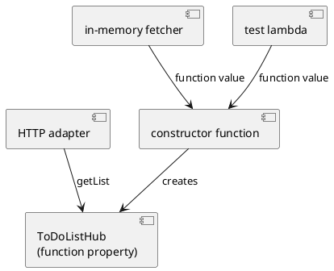

# 第 4 章 ドメインとアダプタのモデリング

第 3 章では、Cucumber の同じシナリオを domain / HTTP の 2 経路で実行しました。ただし、プロダクションコードで外部の取得方法を組み立てる場所はまだ 1 つの関数だけです。この章では、関数を値として渡す Kotlin の機能を使い、ドメインの操作と adapter の配線を分けます。

## ToDo リストを変更するための新しいストーリーを始める

これから ToDo リストの作成や項目追加へ進みます。その前に、読み取り側の依存関係を整理します。HTTP handler がデータの置き場所を知っていると、変更操作を加えるたびに web と storage の都合が絡みます。

必要な契約は「利用者とリスト名を受け取り、見つかればリストを返す」だけです。

```kotlin
typealias ToDoListFetcher = suspend (User, ListName) -> ToDoList?
```

interface を 1 つ作ることもできます。しかし、この契約には関数が 1 つしかありません。Kotlin の関数型なら、実装クラス、匿名クラス、mock framework を追加せず、必要な振る舞いだけを渡せます。

`suspend` は「必ず別 thread で動く」という意味ではありません。後の章で I/O を接続できる契約にしておき、現在の in-memory 実装は値を返すだけにします。同期 http4k と接続する `runBlocking` は web の最外周に残します。

## 関数型の「依存性の注入」を使う

アプリケーションが公開する操作を、関数プロパティを持つ値で表します。

```kotlin
data class ToDoListHub(
    val getList: ToDoListFetcher,
)
```

Hub を組み立てるのは constructor function です。

```kotlin
fun todoListHub(fetchList: ToDoListFetcher): ToDoListHub =
    ToDoListHub(getList = fetchList)
```

`todoListHub` は関数を受け取る関数なので、高階関数です。DI container が型を走査するのではなく、呼び出し側が依存を値として明示します。テストではラムダをそのまま渡せます。

```kotlin
val hub = todoListHub { actualUser, actualName ->
    if (actualUser == user && actualName == listName) expected else null
}
```

in-memory adapter も同じ契約を返します。実装は application ではなく `zettai.adapter.inmemory` に置き、外側から application の port を実装します。

```kotlin
fun inMemoryFetcher(lists: Map<User, List<ToDoList>>): ToDoListFetcher {
    val snapshot = lists
        .mapValues { (_, todoLists) ->
            todoLists.map { todoList ->
                todoList.copy(items = todoList.items.toList())
            }
        }
        .toMap()

    return { user, listName -> findToDoList(snapshot, user, listName) }
}
```

受け取った map と list は作成時に copy します。外側の `MutableMap` が後から変わっても、注入済み adapter の観測結果は変わりません。read-only 型を使うだけでなく、可変な参照を境界で切るところまでが immutable な設計です。

HTTP adapter は fetcher を直接受け取らず、Hub の操作を呼びます。

```kotlin
fun zettaiHttpApp(hub: ToDoListHub): HttpHandler = routes(
```

```kotlin
val todoList = runBlocking { hub.getList(user, listName) }
```

テストは、値を返す Hub と常に `null` を返す Hub を同じ HTTP adapter へ渡します。200 と 404 が切り替われば、web が storage の実装へ結合していないことを確認できます。



依存方向は `web -> application -> domain` と `adapter.inmemory -> application / domain` です。差し替えるのは Hub に渡す driven adapter（in-memory fetcher / test lambda）で、HTTP は同じ Hub を利用する driving adapter です。domain は http4k、coroutine runner、Hub を知りません。小さな関数契約が境界にあるため、内側の値と状態変換を外部 framework なしでテストできます。

## 関数型コードをデバックする

関数値を渡す設計では、呼び出し先のクラス名から処理を追う方法が使いにくく見えます。代わりに、関数の入力と出力を観測します。

```kotlin
hub.getList(user, listName) shouldBe expected
hub.getList(User("alice"), listName) shouldBe null
```

mock framework の呼び出し履歴を読む必要はありません。問題を三つの境界へ分けられます。

1. constructor function へ意図した fetcher を渡したか。
2. Hub が受け取った `User` と `ListName` をそのまま fetcher へ渡したか。
3. HTTP adapter が Hub の結果を正しい status と HTML に変換したか。

それぞれを値の比較で確かめると、失敗の場所が狭くなります。`ToDoListHub` 自体は immutable な data class なので、デバッガで見ても「どの依存を持つか」がフィールドとして現れます。

package 境界もテストします。`zettai.domain` から `zettai.application`、`zettai.web`、http4k、coroutine、Arrow を import していないことを `check` に含めました。DI の図だけが正しくても、import が逆流すれば実装は正しくありません。

## 関数型ドメインモデリング

依存関係を整理したので、これから変更する値も太くします。ToDo 項目には期日と状態があります。

```kotlin
enum class ToDoStatus {
    Todo,
    InProgress,
    Done,
    Blocked,
}
```

```kotlin
data class ToDoItem(
    val description: String,
    val dueDate: LocalDate? = null,
    val status: ToDoStatus = ToDoStatus.Todo,
)
```

状態を `String` にすると、`"done"`、`"Done"`、`"DONE"` が別の値になります。enum なら、この章で許した有限個の状態以外は作れません。`dueDate` が nullable なのは、期日なしが正常な業務値だからです。一方、fetcher の nullable は「リストが見つからない」という結果であり、同じ `null` でも意味が違います。取得失敗の型は第 7 章で Arrow の typed error に置き換えます。

既定値を置いたため、これまでの `ToDoItem("write chapter")` はそのまま動きます。状態遷移の規則はまだ実装しません。第 6 章でコマンドを導入するまで、型に場所を作るだけに留めます。章の説明より先にドメインを完成させないためです。

## まとめ

- 1 操作だけの依存を `ToDoListFetcher` という関数型で表しました。
- 関数プロパティを持つ `ToDoListHub` を constructor function で組み立てました。
- in-memory / test fetcher を値として差し替え、同じ Hub を HTTP adapter へ接続しました。
- copy によって adapter 作成後の外部 mutation を切り離しました。
- `ToDoItem` に期日と有限状態を追加し、振る舞いの先回りは避けました。

次章では変更後の値を直接上書きせず、何が起きたかをイベントとして残します。イベント列を再帰と `fold` で状態へ畳み込み、関数合成に現れる法則を property test で確かめます。

## この章で書いたコード

- ドメイン値: `apps/kotlin-fp/zettai/zettai-step3-domain-events/src/main/kotlin/zettai/domain/ToDoList.kt`
- Hub: `apps/kotlin-fp/zettai/zettai-step3-domain-events/src/main/kotlin/zettai/application/ToDoListHub.kt`
- in-memory adapter: `apps/kotlin-fp/zettai/zettai-step3-domain-events/src/main/kotlin/zettai/adapter/inmemory/InMemoryToDoListFetcher.kt`
- HTTP adapter: `apps/kotlin-fp/zettai/zettai-step3-domain-events/src/main/kotlin/zettai/web/ZettaiHttpApp.kt`
- テスト: `apps/kotlin-fp/zettai/zettai-step3-domain-events/src/test/kotlin/zettai/`

## 参照

- Uberto Barbini『From Objects to Functions』第 4 章
- Michał Płachta『Grokking Functional Programming』Kotlin 版。関数を値として渡し、小さな純粋関数を合成する方針を参照しました

