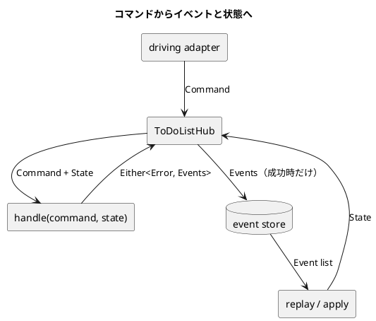

# 第 6 章 コマンドを実行してイベントを生成する

前章では、保存済みのイベントから現在状態を導出しました。しかし、イベントを作っていたのはテストだけです。この章では利用者の意図をコマンドにし、コマンドと現在状態から新しいイベントを決めます。

## 新しい ToDo リストの作成

最初の要求は、新しいリストを作ることです。同じ名前のリストがすでにあれば拒否しなければなりません。項目の追加、項目の状態変更も Hub の command entry point へ集めます。この章で作るのは domain と application の部分で、公開済みの HTTP route はリストを読む GET だけのままです。

できる操作だけでなく、次の拒否もテストから書きました。

- 既存リストの再作成
- 存在しないリストへの項目追加
- 存在しない項目の状態変更
- 許されない状態遷移

成功例だけなら、すべての操作を許す実装でも Green になります。拒否例は、ドメインの境界を決めるテストです。

## コマンドを使って状態を変更する

利用者の意図を closed な型で表します。

```kotlin
sealed interface ToDoListCommand {
    val user: User
    val listName: ListName
}
```

```kotlin
data class CreateToDoList(
    override val user: User,
    override val listName: ListName,
) : ToDoListCommand

data class AddToDoItem(
    override val user: User,
    override val listName: ListName,
    val item: ToDoItem,
) : ToDoListCommand

data class ChangeItemStatus(
    override val user: User,
    override val listName: ListName,
    val description: String,
    val newStatus: ToDoStatus,
) : ToDoListCommand
```

コマンドとイベントは似ていますが、時制と責務が違います。

| | コマンド | イベント |
| :--- | :--- | :--- |
| 意味 | これから行いたい意図 | すでに起きた事実 |
| 名前 | `CreateToDoList` | `ListCreated` |
| 拒否 | できる | しない |
| 保存 | 原則として保存しない | 履歴として保存する |

コマンドは検証され、この章の handler では成功したときだけ 1 件のイベントになります。一般には 1 コマンドから 0 件以上へ拡張できます。イベントは replay の入力なので、適用時に同じ業務判断を繰り返しません。

## 状態とイベントによるドメインのモデリング

状態変更を実装する前に、4 × 4 の遷移表を決めました。

| 現在 | → Todo | → InProgress | → Done | → Blocked |
| :--- | :---: | :---: | :---: | :---: |
| Todo | 拒否 | 許可 | 許可 | 拒否 |
| InProgress | 拒否 | 拒否 | 許可 | 許可 |
| Done | 拒否 | 拒否 | 拒否 | 拒否 |
| Blocked | 拒否 | 許可 | 拒否 | 拒否 |

16 組のうち許可は 5 組、拒否は 11 組です。表をそのまま値へ移します。

`Done` からは戻せません。誤って完了した場合も履歴を書き換えず、別の description で新しい項目を作る業務規則とします。これは Zettai の規則であり、ToDo アプリ一般の規則ではありません。`Todo` から `Blocked` へ直接移せないのは、まだ着手していない項目を「妨げられている」とは扱わず、まず `InProgress` にするためです。

```kotlin
private val allowedTransitions = mapOf(
    ToDoStatus.Todo to setOf(ToDoStatus.InProgress, ToDoStatus.Done),
    ToDoStatus.InProgress to setOf(ToDoStatus.Done, ToDoStatus.Blocked),
    ToDoStatus.Done to emptySet(),
    ToDoStatus.Blocked to setOf(ToDoStatus.InProgress),
)

fun ToDoStatus.canTransitionTo(next: ToDoStatus): Boolean =
    next in allowedTransitions.getValue(this)
```

テストは代表例ではなく全 16 組を走査し、許可数が 5 であることも確認します。状態を追加したのに表やテストの列を追加し忘れる、といった穴を見つけやすくなります。

成功した状態変更は、新しいイベントになります。

```kotlin
data class ItemStatusChanged(
    override val user: User,
    override val listName: ListName,
    val description: String,
    val newStatus: ToDoStatus,
) : ToDoListEvent
```

`apply` は元の状態を書き換えず、対象項目を `copy` した新しい状態を返します。テストでは適用前と適用後を同時に保持し、古い値が変化していないことを確認しました。

## 関数型ステートマシンを記述する

関数型ステートマシンの中心は、コマンドと現在状態を受け取ってイベントを返す純粋関数です。

```kotlin
fun handle(
    command: ToDoListCommand,
    state: ToDoListState,
): Either<ZettaiError, List<ToDoListEvent>> =
    either {
        when (command) {
            is CreateToDoList -> {
                ensure(state.listFor(command.user, command.listName) == null) {
                    ListAlreadyExists(command.user, command.listName)
                }
                listOf(ListCreated(command.user, command.listName))
            }

            is AddToDoItem -> {
                ensureNotNull(state.listFor(command.user, command.listName)) {
                    ListNotFound(command.user, command.listName)
                }
                listOf(ItemAdded(command.user, command.listName, command.item))
            }

            is ChangeItemStatus -> {
                val list = ensureNotNull(state.listFor(command.user, command.listName)) {
                    ListNotFound(command.user, command.listName)
                }
                val item = ensureNotNull(
                    list.items.firstOrNull { it.description == command.description },
                ) {
                    ItemNotFound(command.user, command.listName, command.description)
                }
                ensure(item.status.canTransitionTo(command.newStatus)) {
                    InvalidTransition(command.description, item.status, command.newStatus)
                }
                listOf(
                    ItemStatusChanged(
                        command.user,
                        command.listName,
                        command.description,
                        command.newStatus,
                    ),
                )
            }
        }
    }
```

`either { }` の中で `ensure` の条件が偽になると、渡した error で計算を打ち切り、関数は `Left` を返します。`ensureNotNull` も同じように打ち切りますが、値が null でなければその値を返すので、`val list = ensureNotNull(...)` と受け取れます。最後の式まで到達したときだけ、その値が `Right` になります。仕組みは次章で説明します。

状態変更では、リスト、項目、遷移規則の順に検証します。この章では description を項目の識別子とみなし、同じ description の項目を重複して追加する場合は扱いません。handler は重複を拒否しないので、重複したときは最初の項目だけが状態変更の対象になります。

この関数は clock、database、HTTP を見ません。失敗時にも例外や副作用を起こさず、型付きの値を返します。成功時のイベントを保存する責務は application layer に残します。

### 既存 Kotlin 版との違い

既存 Kotlin 版の第 6 章は、拒否を空の event list で表し、第 7 章で自作の `Outcome` に置き換えます。Kotlin FP 版は Arrow を最初から使えるので、この章から `Either` で返します。

| | 既存 Kotlin 版（第 6 章） | Kotlin FP 版 |
| :--- | :--- | :--- |
| 拒否の表し方 | 空の `List<ToDoListEvent>` | `Left(ZettaiError)` |
| 拒否の理由 | 失われる | error type と値で残る |
| 検証の書き方 | `if` と早期 return | Raise DSL の `ensure` / `ensureNotNull` |

空の list は「何も起きなかった」と「拒否した」を区別できません。既存 Kotlin 版はこの問題を第 7 章で解きますが、FP 版では第 7 章を「なぜ `Either` でよいのか」を法則から確かめる章にします。

## ハブと接続する

Hub は driving port と driven port の間をつなぎます。port は interface ではなく suspend function type です。

```kotlin
typealias ToDoListFetcher =
    suspend (User, ListName) -> Either<ZettaiError, ToDoList>

typealias StateFetcher = suspend () -> ToDoListState

typealias EventPersister = suspend (List<ToDoListEvent>) -> Unit
```

```kotlin
data class ToDoListHub(
    val getList: ToDoListFetcher,
    val execute: suspend (ToDoListCommand) -> Either<ZettaiError, List<ToDoListEvent>>,
)
```

constructor function は、判定に成功した場合だけイベントを保存します。

```kotlin
fun todoListHub(
    fetchList: ToDoListFetcher,
    fetchState: StateFetcher,
    persist: EventPersister,
): ToDoListHub =
    ToDoListHub(
        getList = fetchList,
        execute = { command ->
            either {
                val events = handle(command, fetchState()).bind()
                persist(events)
                events
            }
        },
    )
```

`bind()` が `Left` を受け取ると、その場で同じ失敗を返し、`persist` には到達しません。テストでは成功時に 1 回だけ保存されること、拒否時には保存されないことを確認しています。

Kotlin の末尾 lambda は最後の parameter に束縛されます。parameter を 3 つに増やしたので、前章までの `todoListHub { ... }` という呼び出しは `fetchList` ではなく `persist` に渡る形になり、型が合わずに compile error になります。呼び出し側は `fetchList = { ... }` と名前付き引数を使います。小さな function type でも、引数順は API の一部です。

command を実行する Hub では `fetchState` と `persist` を必須にします。空状態と no-op persister を既定値にすると、配線漏れでも成功を返しながら event を失うためです。

in-memory adapter も同じ port を実装します。外部から受け取った collection と保存 batch は copy し、後から可変参照を変更されても状態が変わらないことをテストしました。この章の store は単一実行用であり、並行 command の atomicity は保証しません。PostgreSQL への永続化と、command 全体の transaction boundary は後の章で扱います。

```kotlin
data class InMemoryEventStore(
    val fetchState: StateFetcher,
    val persist: EventPersister,
)
```

## コマンドとイベントを深く知る

全体の一方向の流れは次のとおりです。



コマンドは状態を直接変更しません。純粋な `handle` がイベントを決め、そのイベントを保存し、必要なときに `replay` が状態へ畳み込みます。この分離には型とコードが増える代償があります。一方、業務上の拒否判断、保存する事実、現在状態の導出が混ざりません。

## まとめ

- 利用者の意図を三つの sealed command で表しました。
- 4 × 4 の遷移表を先に決め、全 16 組をテストしました。
- `handle(command, state)` を副作用のない関数型ステートマシンにしました。
- 成功は immutable event、拒否は `Either.Left` として返しました。
- Hub は成功したイベントだけを driven port へ保存します。
- in-memory adapter の可変 alias を境界で切りました。

次章では、この章ですでに登場した `Either` と四つの error type に焦点を当てます。なぜ `null` や空 list よりも情報を失わず、どう合成できるのかを法則から確かめます。

## この章で書いたコード

- コマンド: `apps/kotlin-fp/zettai/zettai-step4-command-errors/src/main/kotlin/zettai/domain/commands/ToDoListCommand.kt`
- ステートマシン: `apps/kotlin-fp/zettai/zettai-step4-command-errors/src/main/kotlin/zettai/domain/commands/CommandHandler.kt`
- 遷移規則: `apps/kotlin-fp/zettai/zettai-step4-command-errors/src/main/kotlin/zettai/domain/ToDoStatusTransition.kt`
- Hub: `apps/kotlin-fp/zettai/zettai-step4-command-errors/src/main/kotlin/zettai/application/ToDoListHub.kt`
- adapter: `apps/kotlin-fp/zettai/zettai-step4-command-errors/src/main/kotlin/zettai/adapter/inmemory/InMemoryAdapters.kt`

`apps/kotlin-fp/zettai/` で第 6・7 章の module test を実行できます。

Unix / Nix shell:

```text
bash ./gradlew :zettai-step4-command-errors:test
```

Windows PowerShell:

```text
.\gradlew.bat :zettai-step4-command-errors:test
```

## 参照

- Uberto Barbini『From Objects to Functions』第 6 章
- Michał Płachta『Grokking Functional Programming』Kotlin 版。immutable data と副作用を境界へ押し出す構成を参照しました

