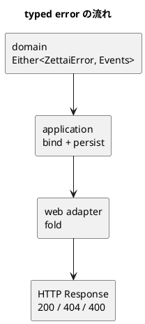

# 第 7 章 関数型手法によるエラーハンドリング

`null` は「値がない」ことだけを表し、理由を説明しません。空の event list も「何も起きなかった」と「操作を拒否した」を区別できません。この章では、失敗の理由を closed な型へ載せ、Arrow の `Either` で成功と失敗を合成します。

## より適切なエラー処理

Zettai で区別したい失敗は四つです。

| 失敗 | error type | HTTP |
| :--- | :--- | :---: |
| リストが見つからない | `ListNotFound` | 404 |
| リストがすでにある | `ListAlreadyExists` | 400 |
| 項目が見つからない | `ItemNotFound` | 404 |
| 状態遷移が許されない | `InvalidTransition` | 400 |

```kotlin
sealed interface ZettaiError {
    val message: String
}
```

```kotlin
data class ListNotFound(
    val user: User,
    val listName: ListName,
) : ZettaiError {
    override val message: String = "ToDo list not found: ${user.name}/${listName.name}"
}

data class ListAlreadyExists(
    val user: User,
    val listName: ListName,
) : ZettaiError {
    override val message: String = "ToDo list already exists: ${user.name}/${listName.name}"
}
```

```kotlin
data class ItemNotFound(
    val user: User,
    val listName: ListName,
    val description: String,
) : ZettaiError {
    override val message: String =
        "ToDo item not found: ${user.name}/${listName.name}/$description"
}

data class InvalidTransition(
    val description: String,
    val from: ToDoStatus,
    val to: ToDoStatus,
) : ZettaiError {
    override val message: String = "Invalid transition for $description: $from -> $to"
}
```

message だけでなく、判断に使った値も data class に残します。テストは文字列を解析せず、`InvalidTransition(description, from, to)` という構造を比較できます。

例外は型 signature に現れず、Kotlin の `Result` は失敗を `Throwable` に固定します。ここで欲しいのは「業務上あり得る失敗の集合」です。そのため `Either<ZettaiError, A>` を使います。`Left` が失敗、`Right` が成功です。

## ファンクタと圏を学ぶ

`Either<ZettaiError, A>` を、失敗または値を持つ文脈と考えます。成功値だけを変換する操作が `map` です。

```text
Right(2).map { it + 3 }       -> Right(5)
Left(error).map { it + 3 }    -> Left(error)
```

`map` が予測可能に合成できるには、二つの法則が必要です。

1. 恒等則: `value.map { it } == value`
2. 合成則: `value.map(f).map(g) == value.map { g(f(it)) }`

この法則を満たす `map` を持つ構造をファンクタと呼びます。名前より重要なのは、処理を分割または合成しても結果が変わらないことです。

Kotlin FP 版では、固定例を数件並べるのではなく Kotest property testing で `Right<Int>` と、四つの error type すべての `Left` を生成します。

```kotlin
val outcomes: Arb<Either<ZettaiError, Int>> = Arb.choice(
    Arb.int().map { it.right() },
    errors.map { it.left() },
)
val intFunctions: Arb<(Int) -> Int> =
    Arb.bind(Arb.int(), Arb.int()) { k, c -> { x: Int -> x * k + c } }
val showFunctions: Arb<(Int) -> String> =
    names.map { prefix -> { x: Int -> "$prefix$x" } }
```

`errors` は四つの error type を `Arb.choice` で混ぜた生成器です。`Arb.int()` は `Int.MIN_VALUE` や `Int.MAX_VALUE` のような端の値も生成します。合成則は任意の関数について成り立つべきなので、`f` と `g` も固定せずに生成します。

```kotlin
"Either map の恒等則が成り立つ" {
    checkAll(outcomes) { outcome ->
        collect(outcome.label())
        outcome.map { it } shouldBe outcome
    }
}
```

```kotlin
"Either map の合成則が成り立つ" {
    checkAll(outcomes, intFunctions, showFunctions) { outcome, f, g ->
        collect(outcome.label())
        outcome.map(f).map(g) shouldBe outcome.map { g(f(it)) }
    }
}
```

`collect` は生成した入力を分類して数えます。`Right` と四つの `Left` がどれも実際に生成されたことを、テスト結果の統計で確かめられます。

`List.map`、nullable value の `?.let`、`Either.map` は対象こそ違いますが、「文脈を保ったまま中の値を変換する」という同じ形を持ちます。圏論全体を先に学ばなくても、法則をテストし、リファクタリングの根拠として使えます。

## ファンクタを使ったエラーハンドリング

Arrow は `Either` の生成、変換、畳み込みを提供します。adapter は値を見つけたら `right()`、見つからなければ具体的な error を `left()` にします。

```kotlin
return { user, listName ->
    val found = snapshot[user]?.firstOrNull { it.listName == listName }

    found
        ?.copy(items = found.items.toList())
        ?.right()
        ?: ListNotFound(user, listName).left()
}
```

application port の戻り値にも失敗が現れます。第 5 章のモジュールでは、port は見つからないことを `null` で表していました。

<!-- code-check: ignore 第 5 章のモジュールにある変更前の型 -->

```kotlin
typealias ToDoListFetcher = suspend (User, ListName) -> ToDoList?
```

この章で戻り値を `Either` に変えました。

```kotlin
typealias ToDoListFetcher =
    suspend (User, ListName) -> Either<ZettaiError, ToDoList>
```

既存 Kotlin 版の第 7 章は、この型の変更が 6 ファイルに波及したことを測っています。Kotlin FP 版で、第 5 章のモジュールにあったファイルのうち `ToDoListFetcher` の型変更を受けて直したのは、次の 5 ファイルでした。

| ファイル | 変更の内容 |
| :--- | :--- |
| `application/ToDoListHub.kt` | port の型定義 |
| `adapter/inmemory/InMemoryToDoListFetcher.kt` | `null` を `ListNotFound(...).left()` に。この章で event store と合わせて `InMemoryAdapters.kt` に統合 |
| `web/ZettaiHttpApp.kt` | `?:` を `fold` に。404 / 400 の振り分けを追加 |
| `application/ToDoListHubTest.kt` | fake の戻り値を `Either` に |
| `web/ZettaiHttpAppTest.kt` | `null` を返していた fake を `right()` / `left()` に。error の写像を追加 |

このほかに、adapter の unit test（`InMemoryAdaptersTest.kt`）を新しく作り、期待値を `right()` / `left()` で書きました。既存 Kotlin 版との差は、受け入れテストの扱いです。既存 Kotlin 版では受け入れテストの action 2 ファイルが変わりました。FP 版のこの module は受け入れテストを持たないので、その 2 ファイルに当たる変更がありません。どちらの版でも、fetcher の型変更は domain の型、イベントの畳み込み、遷移表に波及していません。この章の module で domain のファイルが変わっているのは、command と `ItemStatusChanged` を追加したためです。

呼び出し側は `null` convention や、どの例外が飛ぶかを推測する必要がありません。`Either` を受け取った時点で、失敗を処理するか次へ伝播する必要があります。

一方で、あらゆる値を `Either` に入れるわけではありません。`ToDoList` や `ToDoItem` は普通の immutable data のままです。失敗し得る operation の境界だけが `Either` を返します。

## Arrow `Either` / Raise を使って実装する

原著が説明する `Outcome` に相当する役割を、この Kotlin FP 版では Arrow の `Either` が担います。そのため原著の Outcome 節を「Arrow `Either` / Raise を使って実装する」と読み替え、自作 container は追加しません。既存ライブラリの検証済み抽象を使い、Zettai 固有の error type と業務規則へ集中します。

既存 Kotlin 版が自作した `Outcome` と、Arrow の `Either` の対応は次のとおりです。

| | 既存 Kotlin 版 `Outcome` | Arrow `Either` |
| :--- | :--- | :--- |
| 型 | `Outcome<out E, out T>` | `Either<out A, out B>` |
| 成功 / 失敗 | `Success` / `Failure` | `Right` / `Left` |
| 成功値の変換 | `map` | `map` |
| 失敗し得る処理の連結 | `transform`（失敗の型は `Any?` に広がる） | `flatMap`、または DSL の中の `bind()` |
| 失敗時の代替値 | 拡張関数 `orElse(default)` | 拡張関数 `getOrElse { error -> ... }` |
| 両方の分岐の畳み込み | `fold` | `fold` |
| 用意したもの | 型と操作をすべて自作し、テストする | 依存を 1 つ追加する |

既存 Kotlin 版は `orElse` をメンバー関数にしたとき、共変な `T` を引数に取るために `@UnsafeVariance` を付け、`Failure` で実行時に `ClassCastException` を踏みました。Arrow の `getOrElse` は拡張関数として提供されているので、FP 版の読者が同じ失敗を踏むことはありません。その代わり、型がどう共変になっているかを自分で設計する経験も得られません。これがライブラリに委ねたときの選択差です。

### Raise で fail-fast な検証を書く

Arrow の `either { }` は、`Either` を組み立てる Raise DSL です。`ensure` と `ensureNotNull` は条件を満たさない場合に、指定した `ZettaiError` で計算を終了します。

```kotlin
is CreateToDoList -> {
    ensure(state.listFor(command.user, command.listName) == null) {
        ListAlreadyExists(command.user, command.listName)
    }
    listOf(ListCreated(command.user, command.listName))
}
```

```kotlin
val item = ensureNotNull(
    list.items.firstOrNull { it.description == command.description },
) {
    ItemNotFound(command.user, command.listName, command.description)
}
ensure(item.status.canTransitionTo(command.newStatus)) {
    InvalidTransition(command.description, item.status, command.newStatus)
}
```

if 文ごとに `Left` を return するより、成功経路を上から読めます。Raise は内部では計算を非局所的に打ち切りますが、その脱出は `either { }` の外へ漏れません。関数の外から見える契約は、戻り値の `Either<ZettaiError, List<ToDoListEvent>>` だけです。

ただし、`either { }` の中で `Throwable` を catch してはいけません。Raise の打ち切りまで捕まえてしまい、失敗が成功のように扱われます。`runCatching` も同じ理由で避けます。

Hub では `bind()` を使い、domain error を保存処理の手前で短絡させます。`bind()` は DSL で書いた `flatMap` です。次の `either { }` は、`handle(command, fetchState()).flatMap { events -> persist(events); events.right() }` と同じ意味になります。

```kotlin
execute = { command ->
    either {
        val events = handle(command, fetchState()).bind()
        persist(events)
        events
    }
},
```

この順序には observable な契約があります。成功なら event batch を一度保存し、`Right(events)` を返します。失敗なら同じ `Left` を返し、保存は一度も呼びません。

### HTTP 境界で畳み込む

HTTP adapter は application の `Either` を transport の response へ畳み込みます。

```kotlin
hub.getList(user, listName).fold(
    ifLeft = ::toResponse,
    ifRight = {
        Response(Status.OK)
            .header("Content-Type", "text/html; charset=utf-8")
            .body(renderHtml(it))
    },
)
```

error の変換は sealed hierarchy を網羅する `when` です。この章の時点で公開している route は GET だけなので、実際の利用者経路で発生するのは読み取り側の error です。400 の分類は command route に備えた adapter mapping であり、四つの error type を注入する表駆動の unit test で確認しています。`ListAlreadyExists` を 409 Conflict ではなく 400 にしているのは、原著の分類に合わせたためです。

```kotlin
private fun toResponse(error: ZettaiError): Response =
    Response(statusOf(error))
        .header("Content-Type", "text/plain; charset=utf-8")
        .header("X-Content-Type-Options", "nosniff")
        .body(error.message)

private fun statusOf(error: ZettaiError): Status =
    when (error) {
        is ListNotFound,
        is ItemNotFound,
        -> Status.NOT_FOUND

        is ListAlreadyExists,
        is InvalidTransition,
        -> Status.BAD_REQUEST
    }
```

error の message には URL path から取り出した利用者名とリスト名が入ります。成功時の HTML は escape していますが、error を Content-Type なしで返すと、ブラウザが内容から HTML と推測するおそれがあります。そのため plain text であることを明示し、`nosniff` で推測を止めます。

`else` を置かないため、新しい error type を追加すると未対応の変換が compile error になります。`runBlocking` は synchronous な http4k `HttpHandler` と suspend port をつなぐ driving adapter の境界だけに置き、domain と application には coroutine runner を持ち込みません。

### 依存方向を守る

Arrow Core は domain の typed error と application の合成に使います。一方、http4k と coroutine runner は web adapter に閉じ込めます。architecture test は次の依存がないことを import から検査します。

- domain から application、adapter、HTTP、coroutine への依存
- application から driving / driven adapter、HTTP、coroutine への依存
- driving adapter（web）から driven adapter への依存
- driven adapter から driving adapter、HTTP、coroutine への依存



失敗の値は内側で定義され、外側の adapter が利用者向け表現へ変換します。domain は HTTP status を知りません。

## まとめ

- 四つの業務エラーを sealed hierarchy と data class で区別しました。
- `Either<ZettaiError, A>` により、成功と失敗を function signature に表しました。
- `map` の恒等則と合成則を Kotest property testing で検証しました。
- 原著の `Outcome` の役割には Arrow `Either` を使い、自作 container を増やしませんでした。
- Raise の `ensure`、`ensureNotNull`、`bind` で fail-fast な成功経路を書きました。
- HTTP 境界で `fold` し、error type を 404 と 400 へ網羅的に変換しました。
- suspend と HTTP の橋渡しは driving adapter に限定しました。

次章では read model を分け、表示のための query と変更のための command を別の流れとして扱います。

## この章で書いたコード

- error type: `apps/kotlin-fp/zettai/zettai-step4-command-errors/src/main/kotlin/zettai/domain/errors/ZettaiError.kt`
- command handler: `apps/kotlin-fp/zettai/zettai-step4-command-errors/src/main/kotlin/zettai/domain/commands/CommandHandler.kt`
- Hub: `apps/kotlin-fp/zettai/zettai-step4-command-errors/src/main/kotlin/zettai/application/ToDoListHub.kt`
- HTTP adapter: `apps/kotlin-fp/zettai/zettai-step4-command-errors/src/main/kotlin/zettai/web/ZettaiHttpApp.kt`
- property test: `apps/kotlin-fp/zettai/zettai-step4-command-errors/src/test/kotlin/zettai/domain/errors/EitherFunctorLawTest.kt`

`apps/kotlin-fp/zettai/` で、この章の property test だけを実行できます。

Unix / Nix shell:

```text
bash ./gradlew :zettai-step4-command-errors:test --tests "zettai.domain.errors.*"
```

Windows PowerShell:

```text
.\gradlew.bat :zettai-step4-command-errors:test --tests "zettai.domain.errors.*"
```

## 参照

- Uberto Barbini『From Objects to Functions』第 7 章
- Michał Płachta『Grokking Functional Programming』Kotlin 版。`Either`、typed error、functor law、property-based testing の説明を参照しました
- [Arrow Either](https://arrow-kt.io/learn/typed-errors/either-and-ior/)
- [Arrow Raise](https://arrow-kt.io/learn/typed-errors/working-with-typed-errors/)
- [Kotest property testing](https://kotest.io/docs/proptest/property-based-testing.html)

