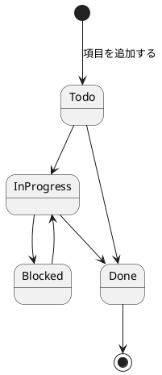

# 第 6 章 コマンドを実行してイベントを生成する

第 5 章では、起きたことの列から状態を作りました。ただし、起きたことは準備として渡しただけです。この章では、利用者の意図を受け取り、**いまの状態を見て、何を起こすかを決めます。**

この章のコードは `zettai-step4-commands` にあります。第 5 章の step を複製して始めました。`effect` の版は 4.1.6 です。章ごとに step を分けるのは、後の章の変更で、前の章の抜粋が実装から消えないようにするためです。

## 新しいToDoリストの作成

目標のシナリオは、「作ったリストに足した項目が、順に見える」です。

```typescript
  it("shows the items added to a newly created list in order", () =>
    route(history, async (zettai) => {
      const uberto = listOwner(zettai, "uberto")

      await uberto.creates("trip")
      await uberto.adds("trip", "passport")
      await uberto.adds("trip", "tickets")

      await uberto.canSee("trip", ["passport", "tickets"])
    }))
```

第 5 章までのシナリオは、見るだけでした。今回は、利用者が**状態を変えます。** そのために、driver に操作を 1 つ足します。

```typescript
  // 断られたコマンドは、失敗にします。
  readonly send: (command: ToDoListCommand) => Promise<void>
```

この章は、内側の domain から作ります。シナリオを通すのは、ハブができた後です。

## コマンドを使って状態を変更する

利用者の意図を**コマンド**と呼びます。名前は命令形です。

```typescript
export type ToDoListCommand = CreateToDoList | AddToDoItem | ChangeItemStatus
```

コマンドとイベントは、形がよく似ています。違いは、**コマンドは断られることがあり、イベントは断れない**ことです。イベントは、もう起きたことだからです。

コマンドを処理する関数は、コマンドと現在の状態を受け取り、起こすイベントか、断る理由を返します。

```typescript
// 受け付けたら起こす出来事を、断るなら理由を返します。
export type Decision = Result.Result<ReadonlyArray<ToDoListEvent>, ZettaiError>
```

`Result` は、成功か失敗のどちらかを表す Effect の型です。**失敗の理由が、型に現れます。** 断る理由は 4 つです。

```typescript
export type ZettaiError = ListAlreadyExists | ListNotFound | ItemNotFound | InvalidTransition
```

各理由は、`_tag` と、理由を説明する値を持ちます。たとえば、許されない状態の変更は、項目の説明と、前後の状態を持ちます。

```typescript
export interface InvalidTransition {
  readonly _tag: "InvalidTransition"
  readonly description: string
  readonly from: ToDoStatus
  readonly to: ToDoStatus
}
```

この章の失敗は、断る理由を返すところまでです。HTTP の応答への対応と、取得の失敗は、第 7 章で扱います。

### テストは理由ごとに書く

「失敗する」だけを確かめると、別の理由で失敗していても通ります。理由と中身まで比べます。

```typescript
  it("rejects a list that does not exist", () => {
    expect(handle(addToDoItem(uberto, book, item), emptyState)).toEqual(
      Result.fail({ _tag: "ListNotFound", user: "uberto", listName: "book" })
    )
  })
```

## 状態とイベントによるドメインのモデリング

### 状態の変更を、イベントにする

項目の状態が変わったことを表すイベントを足します。

```typescript
export interface ItemStatusChanged {
  readonly _tag: "ItemStatusChanged"
  readonly user: User
  readonly listName: ListName
  readonly description: string
  readonly newStatus: ToDoStatus
}
```

型の和にこのイベントを足して、`apply` を直す前に型検査を実行すると、次のように失敗します。

```bash
error TS2366: Function lacks ending return statement and return type does not include 'undefined'.
```

`apply` は戻り値の型を書いた `switch` です。分岐が足りないと、「値を返さずに終わる道がある」というエラーになります。**どこを直せばよいかを、型検査が教えます。**

項目は、説明で指定します。同じ説明の項目が複数ある場合は、**最初の 1 件だけ**を変えます。2 件目の状態を変える方法は、この版にはありません。

```typescript
// 同じ説明の項目が複数あれば、最初の 1 件だけを変えます。項目が無ければ undefined です。
const withStatus = (
  items: ReadonlyArray<ToDoItem>,
  { description, newStatus }: ItemStatusChanged
): ReadonlyArray<ToDoItem> | undefined => {
  const index = items.findIndex((item) => item.description === description)
  const target = items[index]
  return target === undefined ? undefined : items.with(index, { ...target, status: newStatus })
}
```

`apply` は、第 5 章と同じく、**対象が無いイベントを無視します。** 拒否するのは、コマンドを処理する側だけです。畳み込みを、失敗しない関数に保つためです。

### 状態の移り方を、表にする

項目の状態は、どこからどこへでも移れるわけではありません。



現在の状態ごとに、移れる状態を並べます。

```typescript
// 現在の状態ごとに、移れる状態を並べます。同じ状態への遷移は、どこにもありません。
const nextStatuses: Record<ToDoStatus, ReadonlyArray<ToDoStatus>> = {
  Todo: ["InProgress", "Done"],
  InProgress: ["Done", "Blocked"],
  Done: [],
  Blocked: ["InProgress"]
}

export const canTransitionTo = (from: ToDoStatus, to: ToDoStatus): boolean =>
  nextStatuses[from].includes(to)
```

4 つの状態の組は 16 通りです。**許す 5 通りと、拒否する 11 通りを、別のテストにします。** 許す側だけを確かめると、「何でも通す」実装でも成功するからです。期待する一覧は、実装の表を写さず、設計の図から書きます。

```typescript
  it.each(allowed)("allows %s -> %s", (from, to) => {
    expect(canTransitionTo(from, to)).toBe(true)
  })

  it.each(rejected)("rejects %s -> %s", (from, to) => {
    expect(canTransitionTo(from, to)).toBe(false)
  })
```

### 状態を足すと、どこで止まるか

`Record<ToDoStatus, …>` は、状態の分だけキーが要ります。状態を 1 つ足すと、表で型検査が失敗します。

最初に書いたテストは、「組が 16 通りある」ことを確かめていました。ところが、状態を足して、表に**空の行**を書くと、**型検査もテストもすべて通りました。** テストは、新しい状態を知らないままだからです。

そこで、テストの側にも、型で網羅する一覧を置きます。

```typescript
// 状態を足すと、ここが型エラーになります。足した後は、下の一覧に無い組でテストが失敗します。
const everyStatus: Record<ToDoStatus, true> = {
  Todo: true,
  InProgress: true,
  Done: true,
  Blocked: true
}
```

```typescript
    const names = Object.keys(everyStatus)
    const expected = names.flatMap((from) => names.map((to) => `${from}>${to}`))

    const checked = [...allowed, ...rejected].map(([from, to]) => `${from}>${to}`)

    expect(checked.toSorted()).toEqual(expected.toSorted())
```

同じ壊し方は、まず型検査で止まります。一覧に状態を足すと、今度はこのテストが失敗します。新しい状態への組を、許すか拒否するか、書くまで通りません。

## 関数型ステートマシンを記述する

コマンドの処理は、1 つの純粋な関数です。

```typescript
// コマンドと現在の状態から、結果を決めます。何も保存しない、純粋な関数です。
export const handle = (command: ToDoListCommand, state: ToDoListState): Decision => {
  switch (command._tag) {
    case "CreateToDoList":
      return create(command, state)
    case "AddToDoItem":
      return add(command, state)
    case "ChangeItemStatus":
      return changeStatus(command, state)
  }
}
```

状態の変更は、確かめることが 3 段あります。リストがあるか、項目があるか、その状態へ移れるか。

```typescript
  return existingList(state, user, listName).pipe(
    Result.flatMap((list): Decision => {
```

`Result.flatMap` は、前の段が成功した場合だけ、次の段を実行します。**最初に失敗した理由が、そのまま結果になります。**

`handle` は何も保存しません。同じ引数には、いつも同じ結果を返します。サーバーも保管も無しで、すべての分岐をテストできます。

### 決めたイベントは、必ず効く

`handle` と `apply` は、別々の関数です。`apply` は対象の無いイベントを黙って無視するので、2 つの条件がずれると、**受け付けたのに何も変わらない**ことが起こりえます。これを性質テストにします。試行回数は 500 回です。

```typescript
    for (const event of decided.success) {
      const next = apply(state, event)
      // apply は、対象の無い出来事を黙って無視します。handle が出す出来事は、必ず効きます。
      expect(next).not.toEqual(state)
      state = next
    }
```

コマンドの列を生成し、受け付けたイベントを順に適用して、毎回状態が変わることを確かめます。無いリストへの追加を受け付けるように壊すと、このテストが失敗しました。

拒否ばかりの列では、このテストは何も確かめずに通ります。そこで第 5 章と同じく、**生成した列で、3 種類のコマンドが受け付けられることと、4 つの理由がすべて起きることをテストにします。** リスト名を 8 文字以上のでたらめな文字列に変えると、このテストが失敗しました。

### 分岐の漏れは、いつ型で止まるか

コマンドを 1 種類足すと、`handle` で型検査が失敗します。`apply` と同じ仕組みです。

ただし、**この仕組みは、戻り値の型を書いていることに頼っています。** 試すと、次のようになりました。

| 書き方 | 分岐が足りないとき |
| :--- | :--- |
| 戻り値の型を書いた関数（`handle`、`apply`） | その関数で型検査が失敗する |
| `handle` の戻り値の型を消す | 関数では止まらず、結果を使う場所（ハブとテスト）で失敗する |
| 戻り値の型が無い関数や、`void` を返す関数で、結果を型のある場所に渡さない | **型検査も lint も通る** |

3 行目は、小さな確認用のコードで確かめました。分岐する関数には、戻り値の型を書きます。値を返さない `switch` は、この方法では守れません。

### 純粋な核は、Effect に依存しない

ここまでに作った、イベント、コマンド、状態、状態の移り方、コマンドの処理を、この版の**核**と呼びます。核は `Result` と `Option` を使いますが、**実行を表す `Effect` の型は読み込みません。** 型検査はこれを守らないので、テストで固定します。

```typescript
// 核は、実行を表す Effect の型を読み込みません。Result と Option は使います。
describe("pure core", () => {
```

`handle` に `Effect` の読み込みを足すと、型検査は通り、このテストが失敗しました。核のファイルが核の外を読み込まないことも、同じテストで確かめます。

## ハブと接続する

### 依存は 3 つになる

コマンドを実行するには、いまの状態を読み、決まったイベントを保存する必要があります。ハブの依存は 3 つになります。

```typescript
// ハブが外に頼る操作です。保管を読み書きするので、どれも実行するまで起きない Effect で表します。
export type ToDoListFetcher = (
  user: User,
  listName: ListName
) => Effect.Effect<Option.Option<ToDoList>>

export type StateFetcher = () => Effect.Effect<ToDoListState>

export type EventPersister = (events: ReadonlyArray<ToDoListEvent>) => Effect.Effect<void>
```

第 4 章の取得は、普通の関数でした。保存ができるようになると、**同じ引数でも、呼ぶ時点で結果が変わります。** 保管の読み書きは、第 1 章で見た「実行するまで起きない値」で表します。

依存は、第 4 章の決定どおり、関数の引数で渡します。数が増えたので、1 つのオブジェクトにまとめます。

```typescript
// 依存は、関数の引数で受け取ります。
export const makeHub = ({ fetchList, fetchState, persist }: ToDoListPorts): ToDoListHub => ({
  getList: fetchList,
  // 状態を取り出し、handle で決め、受け付けた出来事だけを保存します。
  execute: (command) =>
    fetchState().pipe(
      Effect.flatMap((state) => Effect.fromResult(handle(command, state))),
      Effect.tap(persist)
    )
})
```

`Effect.fromResult` は、`Result` の失敗を、`Effect` の型付きの失敗にします。失敗すると後ろは実行されないので、**断られたコマンドは、何も保存しません。** ハブの型は、その失敗を持ちます。

```typescript
  readonly execute: (
    command: ToDoListCommand
  ) => Effect.Effect<ReadonlyArray<ToDoListEvent>, ZettaiError>
```

保存を決定より前に動かすように壊すと、保存の内容を確かめるテストが失敗しました。

### 実行を忘れると

`execute` は `Effect` を返すだけで、呼んだだけでは何も保存しません。実行を忘れた書き方を試しました。

| 書き方 | 型検査 | lint | テスト |
| :--- | :--- | :--- | :--- |
| `hub.execute(command)` だけを書く | **止める** | 通る | 何も作られないまま通る |
| `await hub.execute(command)`（`runPromise` を忘れる） | **止める** | 通る | 何も作られないまま通る |
| `const unused = hub.execute(command)` | **通る** | 通る | 何も作られないまま通る |

2 行目に注意してください。`await` を書くと実行したように見えますが、`Effect` は `Promise` ではないので、`await` しても実行されません。止めたのは、Effect の診断です。

```bash
error TS377001: This Effect value is neither yielded nor used in an assignment. effect(floatingEffect)
```

この診断は、**値が捨てられていること**を指摘します。変数に入れると、使っていなくても通ります。

### メモリ上の保管

保管の実体は、イベントの配列を持つアダプタです。domain ではなく、`application` に置きます。

```typescript
// 出来事をメモリに持つ保管です。状態は持たず、読むたびに出来事を畳み込みます。
export const makeInMemoryStore = (history: ReadonlyArray<ToDoListEvent>): ToDoListPorts => {
  // 呼び出し側の配列は書き換えないように、写しを持ちます。
  const events = [...history]
  const fetchState = () => Effect.sync(() => replay(events))
```

読むたびに、すべてのイベントを畳み込みます。性能は測っていません。サーバーを停止すると、イベントは消えます。永続化は第 9 章で扱います。

### 同時に届いたコマンドは、守らない

`execute` は、読む、決める、保存する、の 3 段です。**この 3 段の間に、別のコマンドが入れないようには、していません。** 同じリストを作るコマンドを 2 つ同時に実行して確かめました。

| 保管 | 結果 |
| :--- | :--- |
| この章のメモリ上の保管 | 1 つは受け付けられ、1 つは `ListAlreadyExists` |
| 状態の読み取りが 5 ミリ秒待つようにした保管 | **2 つとも受け付けられた** |

1 行目は、守られているからではありません。この保管は途中で待たないので、今回の実行では、2 つが交互に進まなかっただけです。読み取りに待ちが入ると、両方が「まだ無い」状態を見ます。データベースを使うと、読み取りは待ちます。この問題は、第 10 章で扱います。

### 受け入れテストをつなぐ

domain の経路は、ハブにコマンドを送り、ハブから読みます。HTTP の経路は、画面からの操作がまだ無いので、**コマンドはハブに送り、結果は HTTP で読みます。**

```typescript
        // コマンドを送る先と、サーバーが読む先は、同じハブです。
        const hub = makeHub(makeInMemoryStore(history))
        const server = yield* serve(makeApp(hub), 0)
```

コマンドを別のハブに送るように壊すと、HTTP の経路の新しいシナリオが失敗しました。このシナリオで、HTTP の経路が確かめるのは、**保存した結果が画面に出ること**までです。画面からコマンドを送る経路は、第 11 章で作ります。項目の状態は画面に出さないので、状態の変更は、受け入れシナリオでは確かめていません。

web の側の変更は、`getList` が `Effect` を返すようになったことへの対応です。

```typescript
export const makeApp =
  (hub: ToDoListHub): App =>
  (request) =>
    Effect.suspend(() =>
      Result.match(extractListRequest(request), {
        onFailure: (failure) => Effect.succeed(failureResponse(failure)),
        onSuccess: showList(hub)
      })
    )
```

## コマンドとイベントを深く知る

2 つの違いを、この章のコードで整理します。

| 項目 | コマンド | イベント |
| :--- | :--- | :--- |
| 意味 | 利用者の意図 | 起きた事実 |
| 名前 | 命令形（`CreateToDoList`） | 過去形（`ListCreated`） |
| 断れるか | 断れる（`handle` が理由を返す） | 断れない（`apply` は無視するだけ） |
| 保存するか | しない | する |
| 状態との関係 | 状態を見て、何を起こすかを決める | 適用すると、次の状態になる |

同じ操作に 2 つの型が要るのは、**決めることと、記録することが、別の仕事だから**です。決める規則は後で変わることがあります。そのとき、過去のイベントを断り直すことはしません。今回の `handle` の規則を厳しくしても、保存したイベントの畳み込みは変わりません。

この版の `handle` が返すイベントは、いつも 1 件です。型は列にしています。1 つのコマンドから複数のイベントが起きる例は、第 11 章の名前の変更で扱う予定です。

## まとめ

この章では、次を確かめました。

- コマンドの処理は、コマンドと状態から、イベントか理由を返す純粋な関数にできる
- 16 通りの状態の移り方は、許す側と拒否する側を別々に確かめる。状態の追加は、テストの側にも型の一覧が無いと見逃す
- `switch` の分岐漏れが型で止まるのは、戻り値の型があるからである
- 純粋な核は、`Effect` の型を読み込まずに書けた。これは型ではなくテストで固定する
- `Effect` の実行忘れは診断が止める。ただし、変数に入れると止まらない
- 読んでから保存するまでは守られていない

`npm run check` は、テスト 55 ファイル 352 件が通ります（2026-11-28、Windows、Node 22.23.4）。

ただし、断る理由はまだ画面に届きません。取得の失敗も `Option` のままです。次の章では、失敗を型で運び、HTTP の応答に対応させます。

### 型で守れたこと・守れなかったこと

| 対象 | 型検査 | 守ったもの |
| :--- | :--- | :--- |
| コマンドやイベントを足して、`handle` や `apply` を直さない | **止める** | 戻り値の型を書いた `switch` |
| 状態を足して、移り方の表を直さない | **止める** | `Record` の型 |
| 状態を足して、表に空の行だけを書く | テストの一覧で**止める** | テストの側の `Record` と、組のテスト |
| 表の移り先の書き漏れ、書き過ぎ | **通る** | 16 通りのテスト |
| `handle` と `apply` の条件のずれ | **通る** | 性質テストと、理由ごとのテスト |
| 保存の順序の誤り | **通る** | ハブのテスト |
| 核が `Effect` の型を読み込む | **通る** | 読み込みの検査 |
| `execute` の実行忘れ | 値を捨てる場合は**止める**。変数に入れると通る | Effect の診断 |
| 同時に届くコマンド | **通る** | この章では無し |

### Effectに置き換えたこと・自作で残したこと

| 対象 | この章での扱い |
| :--- | :--- |
| 成功か失敗かを表す型 | Effect の `Result` を使う |
| 保管の読み書き | `Effect` で表し、`flatMap` と `tap` でつなぐ |
| 失敗の理由の型 | 自作する（`_tag` を持つ型の和）。第 7 章で、ほかの表し方と比べる |
| コマンドの処理、状態の移り方の表 | 自作する |
| 依存の注入 | 自作する（関数の引数） |
| メモリ上の保管 | 自作する |

## この章で書いたコード

- `apps/typescript-fp/zettai/zettai-step4-commands/src/domain/`（`commands.ts`、`errors.ts`、`events.ts`、`handle.ts`、`hub.ts`、`state.ts`、`status-transition.ts`）
- `apps/typescript-fp/zettai/zettai-step4-commands/src/application/in-memory-store.ts`
- `apps/typescript-fp/zettai/zettai-step4-commands/src/web/app.ts`
- `apps/typescript-fp/zettai/zettai-step4-commands/test/`（`handle.test.ts`、`status-transition.test.ts`、`status-change.test.ts`、`hub.test.ts`、`in-memory-store.test.ts`、`core-boundary.test.ts`、`acceptance/`）

## 参照

- Uberto Barbini『From Objects to Functions』第 6 章。章の題材と順序、コマンドと状態からイベントを決める考え方は本書に拠っています。本連載のコードはすべて書き起こした自作実装です
- [Effect の公式サイト](https://effect.website/)。この章の API は、版 4.1.6 の型定義と、テストの実行で確かめました
- [TypeScript Handbook の網羅性の検査](https://www.typescriptlang.org/docs/handbook/2/narrowing.html#exhaustiveness-checking)
