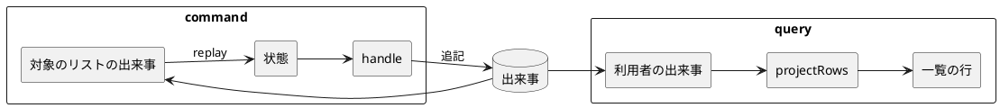

# 第 8 章 ファンクタを使ってイベントを射影する

第 7 章までで、1 つのリストを表示し、コマンドで変更できるようになりました。この章では、**利用者のリストの一覧**を、項目数と完了数をつけて表示します。コマンドを決めるための状態とは、別の形を出来事から作ります。

この章のコードは `zettai-step6-projection` にあります。第 7 章の step を複製して始めました。`effect` の版は 4.1.6、性質テストの道具は fast-check 4.11.0 です。

## イベントを射影する

一覧の画面が欲しいのは、次の形です。

```typescript
// 一覧の画面が欲しい形です。コマンドを決めるための状態とは、別に持ちます。
export interface ToDoListRow {
  readonly listName: ListName
  readonly itemCount: number
  readonly doneCount: number
}
```

出来事の列を、目的の形に畳み込むことを**射影**と呼びます。第 5 章の `replay` も、状態という形への射影と言えます。畳み込み先を変えると、同じ出来事から別の形が作れます。

```typescript
type Lists = ReadonlyMap<ListName, ReadonlyArray<ToDoItem>>

// 状態の畳み込みと同じ出来事を、別の形に畳み込みます。Map は、キーを足した順を保ちます。
const step = (lists: Lists, event: ToDoListEvent): Lists => {
  switch (event._tag) {
    case "ListCreated":
      return new Map(lists).set(event.listName, [])
```

途中の形は、1 人の利用者の、リスト名と項目の表です。最後に、行に変えます。

```typescript
// 入力が利用者で絞られていなくても正しく動くように、ここでも絞ります。
export const projectRows = (
  user: User,
  events: ReadonlyArray<ToDoListEvent>
): ReadonlyArray<ToDoListRow> =>
  [...events.filter((event) => event.user === user).reduce(step, new Map())].map(toRow)
```

行は、リストを作った順に並びます。`Map` は、キーを最初に足した順を保つからです。同じリストを作り直しても、位置は変わりません。この順序は、テストで固定します。削除してから足し直すように壊すと、テストが失敗しました。

`projectRows` は、第 6 章の核に含めます。出来事を受け取って値を返すだけで、実行も保存もしません。

### 2 つの道筋を比べる

同じ出来事を、状態に畳み込んでから数えても、行は作れます。この 2 つの道筋が一致することを、性質テストで確かめます。試行回数は 500 回です。

```typescript
// 同じ出来事の列から、状態を作ってから数えた行です。射影とは別の道筋です。
const rowsFromState = (user: User, history: ReadonlyArray<ToDoListEvent>) =>
  [...(replay(history).get(user)?.values() ?? [])].map((list) => ({
```

ただし、**2 つは完全に独立ではありません。** 項目の状態を変える関数 `withStatus` は、両方で使っています。この関数の誤りは、比べても見つかりません。それは、第 6 章の状態の変更のテストで守ります。

### 生成する入力を、数える

最初は、第 5 章からの生成器で比べました。そのテストは通りました。しかし数えると、**500 列のうち、完了した項目を含む列は 0 件でした。** 完了が行に現れるには、リストの作成、項目の追加、その項目の状態の変更が、この順に同じ利用者で起きる必要があります。ランダムな列では、ほとんど起きません。性質テストは、**完了数を比べていないのに通っていました。**

「完了を含む列がある」ことを確かめるテストも置いていました。ところが、2,000 列のうち 1 列でもあれば通る条件だったので、見逃しました。

そこで、項目のあるリストを先に置き、状態の変更を多めに混ぜた列を生成します。

```typescript
export const busyEvents = fc
  .array(fc.oneof(event, finish), { maxLength: 12 })
  .map((history) => [...createdWith("uberto", "book", "milk", "eggs"), ...history])
```

そして、割合を条件にします。

```typescript
    const samples = fc.sample(busyEvents, { numRuns: TRIALS, seed: 1 })

    const withDone = samples.filter((history) =>
      projectRows(uberto, history).some((each) => each.doneCount > 0)
    )

    expect(withDone.length).toBeGreaterThan(TRIALS / 5)
```

3 つのシードで数えると、500 列のうち 241〜254 列が、完了した項目を含みました。**性質テストは、入力が目的の場合を含むことを、数で確かめます。**

射影を壊すと、次のテストが失敗しました。

| 壊し方 | 失敗したテスト（一部） |
| :--- | :--- |
| 利用者で絞らない | 2 つの道筋の一致、ほかの利用者の行が出ないこと |
| 状態の変更を無視する | 一致、完了数のテスト、受け入れシナリオ |
| 作り直したリストを末尾に移す | 一致、順序のテスト |

どの壊し方も、型検査は通ります。

## ファンクタに対するクエリの実行

### 一覧の問い合わせ

ハブに、一覧の問い合わせを足します。

```typescript
    // query は command の状態を通らず、出来事から画面の形を直接作ります。
    listRows: (user) => readUserEvents(user).pipe(Effect.map((events) => projectRows(user, events)))
```

`readUserEvents` は、利用者の出来事を返す `Effect` です。射影は、普通の関数です。**`map` を使うと、普通の関数を、実行の中の値にそのまま適用できます。** `projectRows` は `Effect` を知らないままです。

web は、行を HTML にします。ここでも `map` です。

```typescript
      case "ShowLists":
        return hub
          .listRows(page.user)
          .pipe(Effect.map((rows) => htmlResponse(renderRowsPage(page.user, rows))))
```

一覧の問い合わせには、型付きの失敗がありません。リストの無い利用者は、行の無い一覧になります。戻り値の型の `Effect<ReadonlyArray<ToDoListRow>>` に、エラーの型引数がないことで分かります。

### URL と受け入れシナリオ

`/todo/{user}` が一覧、`/todo/{user}/{listname}` が 1 つのリストです。第 7 章まで 404 だった `/todo/uberto` が、一覧になります。要求の読み取りは、どの画面かを型で返します。

```typescript
export type PageRequest =
  | { readonly _tag: "ShowList"; readonly user: User; readonly listName: ListName }
  | { readonly _tag: "ShowLists"; readonly user: User }
```

画面の種類を足すと、戻り値の型を書いた `show` の `switch` で型検査が失敗します。第 6 章と同じ仕組みです。

受け入れシナリオでは、項目を完了にした結果を、**初めて画面で確かめられます。** 完了数が一覧に出るからです。

```typescript
      await uberto.finishes("<trip>", "passport")

      await uberto.seesLists([
        ["shopping", 2, 0],
        ["empty", 0, 0],
        ["<trip>", 2, 1]
      ])
```

名前に `<` を含めたのは、エスケープを確かめるためです。一覧の画面のリスト名のエスケープを外すと、このシナリオが失敗しました。

## ファンクタの観点から考察する

この章の問い合わせは、入れ物が 2 段になっています。`Effect` の中に、配列があります。ファンクタは、**重ねてもファンクタ**です。`Effect` の `map` の中で、配列の `map` を使えば、2 段の中の値に関数を適用できます。

```typescript
const queryMap: QueryMap = (self, f) => self.pipe(Effect.map((rows) => rows.map(f)))
```

この重ねた `map` の恒等則と合成則を、第 7 章と同じく、結果と実行の記録で確かめます。

法則が見分けられるものには、限りがあります。

| 壊した `map` | 結果 |
| :--- | :--- |
| 最後の 1 件を落とす | 恒等則が失敗する |
| 最初の 1 件にだけ関数を適用する | **恒等則も合成則も通る** |

2 行目は、配列の形を変えず、関数を一部にしか適用しません。何もしない関数なら何も変わらず、2 回の適用と合成した 1 回の適用は、最初の 1 件で一致します。法則は、**すべての要素に適用することまでは確かめません。** これは、型を固定してテストしていることによる限界です。第 7 章の「関数を使わない `map`」と同じ理由です。

この版は、ファンクタを自作しません。配列と `Effect` の `map` を使い、**自分が書いた変換が、その上に乗っていること**を確かめます。

## コマンドクエリ責務分離(CQRS)

状態を変える操作（コマンド）と、状態を読む操作（クエリ）で、通る道と形を分けることを、**CQRS** と呼びます。

```typescript
// ドメインの入口です。command は状態を変え、query は読むだけです。
export interface ToDoListHub {
```

ハブが外に頼る操作も、出来事の読み取りと追記だけになりました。

```typescript
// ハブが外に頼る操作は、出来事の読み取りと追記だけです。状態と行は、ハブが出来事から作ります。
export type ListEventsReader = (
  user: User,
  listName: ListName
) => Effect.Effect<ReadonlyArray<ToDoListEvent>>
```



コマンドは、**対象のリストの出来事だけ**を読みます。第 6 章では、すべての出来事から状態を作っていました。現在の 3 つのコマンドは、対象のリストだけを見れば判断できます。この条件は、どちらの読み取りを呼んだかを記録するテストで固定します。利用者の出来事をすべて読むように壊すと、このテストが失敗しました。

```typescript
  it("reads only the events of the target list to decide a command", async () => {
```

### この版の CQRS がしないこと

**射影した結果は、保存しません。** 問い合わせのたびに、出来事から作ります（[ADR-062](../../../adr/ADR-062-typescript-projection-and-cqrs.md)）。

| 項目 | この版 | 射影を保存する場合 |
| :--- | :--- | :--- |
| 一覧が古くなる | 起きない | 起こりうる |
| 問い合わせの処理 | 利用者の出来事をすべて読む | 保存した行を読む |
| 射影の作り直し | 要らない | 形を変えると要る |

問い合わせの性能は測っていません。保存が要るかは、出来事の件数と、問い合わせの頻度しだいです。

## まとめ

この章では、次を確かめました。

- 同じ出来事の列から、畳み込み先を変えて、画面の形を直接作れる
- `map` を使うと、実行を知らない関数を、実行の中の値に適用できる
- 性質テストは、入力が目的の場合を含むかを数えないと、何も比べずに通る
- `map` の法則は、すべての要素に適用することまでは確かめない
- command と query は、通る道を分けた。射影は保存しない

`npm run check` は、テスト 103 ファイル 746 件が通ります（2026-11-28、Windows、Node 22.23.4）。

ここまでの出来事は、メモリの中にあります。サーバーを停止すると消えます。次の章では、PostgreSQL に保存します。

### 型で守れたこと・守れなかったこと

| 対象 | 型検査 | 守ったもの |
| :--- | :--- | :--- |
| 出来事を足して、射影を直さない | **止める** | 戻り値の型を書いた `switch` |
| 画面の種類を足して、`show` を直さない | **止める** | 同上 |
| 射影が利用者で絞らない | **通る** | 射影のテスト |
| 射影と状態の解釈が食い違う | **通る** | 一致の性質テスト（共有する関数の誤りは除く） |
| コマンドが余分な出来事を読む | **通る** | 呼び出しを記録するテスト |
| 一覧の画面のエスケープの欠落 | **通る** | HTTP の経路の受け入れシナリオ |
| 生成する入力が、目的の場合を含まない | **通る** | 割合のテスト |

### Effectに置き換えたこと・自作で残したこと

| 対象 | この章での扱い |
| :--- | :--- |
| ファンクタ | 配列と `Effect` の `map` を使う。自作しない |
| 射影 | 自作する（`reduce` と `map`） |
| command と query の分離 | 自作する（ハブの型と依存） |
| 画面と、その読み戻し | 自作する |

## この章で書いたコード

- `apps/typescript-fp/zettai/zettai-step6-projection/src/domain/`（`projection.ts`、`hub.ts`、`state.ts`）
- `apps/typescript-fp/zettai/zettai-step6-projection/src/web/`（`app.ts`、`html.ts`）
- `apps/typescript-fp/zettai/zettai-step6-projection/src/application/in-memory-store.ts`
- `apps/typescript-fp/zettai/zettai-step6-projection/test/`（`projection.test.ts`、`query-laws.test.ts`、`hub.test.ts`、`support/arbitraries.ts`、`acceptance/`）

## 参照

- Uberto Barbini『From Objects to Functions』第 8 章。章の題材と順序、出来事の射影と読み書きの分離の考え方は本書に拠っています。本連載のコードはすべて書き起こした自作実装です
- [Martin Fowler の CQRS](https://martinfowler.com/bliki/CQRS.html)
- [Effect の公式サイト](https://effect.website/)
