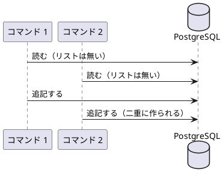
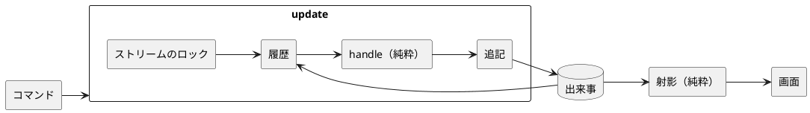

# 第 10 章 コンテキストを読み込み、コマンドを処理する

第 9 章で、イベントは PostgreSQL に残るようになりました。しかし、**状態を読んでから追記するまでの間に、別の更新が入れます。** 第 6 章では、読み取りが待つ保管を使って、同じリストを作る 2 つのコマンドが両方とも受け付けられることを確かめました。この章では、1 つのコマンドの「読む、判断する、追記する」を、1 つのトランザクションにします。

この章のコードは `zettai-step8-transaction` にあります。第 9 章の step を複製して始めました。版は、`effect` 4.1.6、`pg` 8.23.1 です。ライブラリは追加していません。

## モナドでデータベースにアクセスする

第 9 章の追記は、すでにトランザクションの中にありました。足りないのは、**読み取りが同じトランザクションの中に無い**ことです。



読み取りもトランザクションの中に入れれば足りるでしょうか。実際の PostgreSQL で確かめました。「読んで、無ければ作る」を 2 つ同時に実行する組を、20 組ずつ実行しました。2 つは、相手が読み終わるのを短い時間待ってから書きます。

| 守り方 | 同じリストの 2 つ | 別々のリストの 2 つ | 二重に作られたリスト |
| :--- | :--- | :--- | :--- |
| 何もしない（Read Committed） | 両方が作る 20 | 両方が作る 20 | **20** |
| `SERIALIZABLE` | 片方がエラー 20 | **片方がエラー 20** | 0 |
| ストリームごとのアドバイザリロック | 片方が「既にある」 20 | 両方が作る 20 | 0 |

1 行目は、**トランザクションに入れただけでは守れない**ことを示します。`SERIALIZABLE` は二重の作成を防ぎますが、この実行では、**競合していない別々のリストでも、片方が失敗しました。** 行のほとんど無い表での結果です。行が多い表では、割合が変わるかもしれません。確かめていません。

アドバイザリロックは、アプリケーションが決めた番号に掛けるロックです。**まだ行が無いリストにも掛けられます。**

```typescript
// 同じストリームの更新を、トランザクションの終わりまで 1 つずつにします。まだ行が無くても効きます。
const LOCK_STREAM = "SELECT pg_advisory_xact_lock(hashtextextended($1, 0))"
```

同じリストの 2 つ目のコマンドは、1 つ目の確定を待ってから読みます。追記後の状態を見るので、業務の規則で断られます。**競合の専用の失敗は要りません。** スキーマも変えていません。

## ContextReaderを使用したコマンドの処理

読み取りと追記を同じトランザクションにするには、2 つの操作が**同じ接続**を使う必要があります。原著と Kotlin 版は、文脈（接続）を受け取ってから実行する型 `ContextReader` を作り、`flatMap` でつなぎます。接続は、最後にまとめて渡します。

Effect には、同じ役割の仕組みがあります。`Effect<A, E, R>` の `R` は、実行に必要な文脈です。`Transaction` という依存を作って `R` に載せると、トランザクションの外で追記する式は、型検査が止めます。

```bash
error TS377004: This Effect requires a service that is missing from the expected Effect context: `Transaction`. effect(missingEffectContext)
```

ただし、確認用のコードでは、**トランザクションの中で取り出した値を持ち出し、後から渡し直す書き方は、型検査を通りました。** 型が確かめるのは「依存が渡されている」ことで、「いまがトランザクションの中である」ことではありません。

そこで、もう 1 つの形を考えます。この版の判断は `handle`、つまり**純粋な関数**です。途中で外の何かを読む必要はありません。それなら、文脈を外に出さず、**判断の関数を保管に渡せます。**

```typescript
// 対象のストリームを読み、decide で決め、追記するまでを、ほかの更新を挟まずに行います。
export type EventUpdater = <E>(
  streams: ReadonlyArray<StreamId>,
  decide: Decide<E>
) => Effect.Effect<ReadonlyArray<ToDoListEvent>, E>
```

`decide` は、履歴を受け取り、追記するイベントか、失敗を返します。

```typescript
export type Decide<E> = (
  history: ReadonlyArray<ToDoListEvent>
) => Result.Result<ReadonlyArray<ToDoListEvent>, E>
```

ハブのコマンドの処理は、次のようになります。

```typescript
    // 判断は保管に渡します。読み取りから追記までの間に、同じリストの更新は入れません。
    execute: (command) =>
      update([streamOf(command.user, command.listName)], (history) =>
        handle(command, replay(history))
      ),
```

ハブはトランザクションを知りません。接続も、ロックも出てきません。そして、第 9 章までの追記の依存 `persist` は無くしました。**読まずに追記する操作が、ハブの依存の型に無い**ので、書けません。

この版は、`ContextReader` も `Transaction` の service も使いません（[ADR-064](../../../adr/ADR-064-typescript-command-transaction.md)）。代償は、**判断の中で外の情報を読めない**ことです。判断に別のサービスの呼び出しが必要になれば、この形は使えません。

## トランザクションの境界を決める

PostgreSQL の実装は、第 9 章の部品を組み合わせます。ロック、読み取り、判断、追記を、順に実行します。

```typescript
  return Effect.gen(function* () {
    yield* lockStreams(client, entities)
    const history = yield* select(client, SELECT_BY_ENTITIES, entities)
    const events = yield* Effect.suspend(() => Effect.fromResult(decide(history)))
```

`Effect.gen` の中の `yield*` は、`flatMap` の連なりを、上から順に読める形にしたものです。`decide` が失敗を返すと、後ろは実行されず、トランザクションは取り消されます。`decide` が例外を投げた場合も同じです。`Effect.suspend` で包んでいるので、例外は defect になります。

守っていることは、あと 2 つあります。

**対象でないストリームには追記できません。** ロックして読んでいないリストへの追記は、守られていないからです。

```typescript
    if (!events.every((event) => belongsTo(event, streams))) {
      return yield* Effect.die(new Error("対象でないストリームへの追記です"))
    }
```

**ロックは、いつも同じ順に取ります。** 第 11 章の名前の変更は、2 つのリストを触ります。一方が a、b の順に、他方が b、a の順にロックすると、互いに相手を待ちます。

```typescript
// ロックは、いつも同じ順に取ります。順が違うと、互いに相手を待って行き詰まります。
const lockStreams = (client: PoolClient, entities: ReadonlyArray<string>) =>
  Effect.forEach(entities.toSorted(), (entity) => query(client, LOCK_STREAM, [entity]), {
    discard: true
  })
```

### メモリの保管

メモリの保管は、読み取りから追記までを、1 つの同期の処理にします。JavaScript では、同期の処理の途中に、ほかの処理は動きません。同じ契約のテストを、2 つの保管に当てます。

```typescript
  it("accepts only one of the same commands run at the same time", async () => {
```

ただし、**メモリの保管がこのテストを通っても、PostgreSQL が正しいことにはなりません。** 守り方がまったく違います。

## 設計で確かめたこと

原著のこの節は「設計を 2 回間違えた」です。この版では、設計を間違えたと言える出来事が起きなかったので、代わりに、壊して確かめたことを書きます。

| 壊し方 | 結果 |
| :--- | :--- |
| ロックを取らない | 3 回とも、同時実行のテストが失敗した |
| 読んだ後でロックを取る | 3 回とも、同時実行のテストが失敗した |
| 渡された順にロックを取る | 3 回とも、行き詰まりのテストが失敗した |
| 対象の確認を外す | 対象でない追記を拒むテストが失敗した |
| 業務の失敗でも接続を捨てる | **最初のテストは通った。** 直したテストは失敗した |

どれも型検査は通ります。同時実行の誤りは、型では見つかりません。3 回の実行で毎回失敗したことは、いつでも失敗することの保証ではありません。

最後の行は、テストの誤りでした。業務の失敗は、接続の故障ではありません。拒否のたびに接続を作り直すのは無駄です。最初は、接続の削除の通知を数えていました。通知を受け取る前にテストが数えていたと考えられますが、確かめていません。**接続の総数を比べる形に直すと、壊した実装で失敗しました。**

```typescript
// 借りた接続は、成功、失敗、中断のどれでも返します。
// defect と中断では、接続の状態が分からないので捨てます。業務の失敗では、返して使い続けます。
const isBroken = (exit: Exit.Exit<unknown, unknown>): boolean =>
  Exit.isFailure(exit) && (Cause.hasDies(exit.cause) || Cause.hasInterrupts(exit.cause))
```

第 7 章の線が、ここで効きます。**型付きの失敗と defect を分けたので、接続を捨てるかどうかを、失敗の種類で決められます。**

中断の振る舞いは、第 9 章と同じです。中断しても何も残りませんが、実行中の問い合わせが終わるまで待ちます。ロックを待つ時間の上限は、設定していません。

## データベースに対する射影のクエリ

読み取りの側は、変えていません。一覧と 1 つのリストは、トランザクションを使わずに、1 回の `SELECT` で読みます。1 回の `SELECT` は、その時点で確定したイベントだけを返します。更新の途中の状態は見えません。

その代わり、**画面を表示してから利用者が操作するまでに、状態は変わりえます。** コマンドは、画面で見た状態ではなく、実行した時点の状態で判断します。利用者が見た内容と、操作の対象がずれた場合を知らせる仕組みは、この版にはありません。

ロックは、更新だけが取ります。読み取りは、更新を待ちません。

## イベントソーシングによるドメインのモデリング

ここまでの章で、次の形になりました。



正しいと決めるのはイベントの列だけで、状態も一覧もそこから作ります。出来事を保存し、状態をそこから作る形を、**イベントソーシング**と呼びます。

整合性を守る単位は、ストリーム（利用者とリスト名の組）です。**ストリームをまたぐ規則は、このロックでは守れません。** たとえば「1 人の利用者は 10 個までリストを作れる」という規則を足すと、別々のストリームの更新が同時に通ります。その場合は、利用者を単位にしたストリームを `update` に加えるなど、単位を考え直す必要があります。この版には、そのような規則はありません。

## まとめ

この章では、次を確かめました。

- 読み取りと追記を同じトランザクションに入れるだけでは、同時の更新を防げない
- 判断が純粋な関数なら、文脈を外に出さず、判断を保管に渡せる
- ロックは、読む前に、決まった順で取る
- 型付きの失敗と defect の区別は、接続を捨てるかの判断にも使える
- 同時実行の誤りは、型検査を通る。実際のデータベースで確かめる

`npm run check` は、テスト 157 ファイル 1255 件が通ります（2026-11-28、Windows、Node 22.23.4）。所要時間は約 50 秒で、上限の 60 秒に近づいています。

状態を守れるようになりました。次の章では、画面から初めてコマンドを送ります。リストの名前を変えるフォームを作り、入力の誤りをまとめて利用者に返します。

### 型で守れたこと・守れなかったこと

| 対象 | 型検査 | 守ったもの |
| :--- | :--- | :--- |
| ハブが、読まずに追記する | **書けない** | ハブの依存の型に、その操作が無い |
| 保管の実装が、ロックを取らない、順を誤る | **通る** | 実際の PostgreSQL での同時実行のテスト |
| 対象でないストリームへの追記 | **通る** | 保管の実行時の確認と、契約のテスト |
| `Transaction` を `R` に載せて、外で追記する | **止める** | 型（この版は不採用） |
| 同じ形で、中の値を持ち出して使う | **通る** | 無し |
| 業務の失敗で接続を捨てる | **通る** | 接続数のテスト |

### Effectに置き換えたこと・自作で残したこと

| 対象 | この章での扱い |
| :--- | :--- |
| 文脈を後で渡す仕組み（`ContextReader`） | 作らない。`R` も使わず、判断の関数を渡す |
| 順に実行して、失敗で止める | `Effect.gen` と `flatMap` を使う |
| トランザクションの確定と取り消し | `Effect.acquireUseRelease` を使う |
| 同時実行の制御 | PostgreSQL のアドバイザリロックを、自分で SQL に書く |
| 接続を捨てる判断 | `Cause.hasDies` と `Cause.hasInterrupts` を使う |

## この章で書いたコード

- `apps/typescript-fp/zettai/zettai-step8-transaction/src/domain/`（`hub.ts`、`streams.ts`）
- `apps/typescript-fp/zettai/zettai-step8-transaction/src/adapter/postgres/event-store.ts`
- `apps/typescript-fp/zettai/zettai-step8-transaction/src/application/in-memory-store.ts`
- `apps/typescript-fp/zettai/zettai-step8-transaction/test/`（`postgres-store.test.ts`、`support/store-contract.ts`、`support/seed.ts`、`hub.test.ts`）

## 参照

- Uberto Barbini『From Objects to Functions』第 10 章。章の題材と順序、コマンドの処理をトランザクションにする考え方は本書に拠っています。本連載のコードはすべて書き起こした自作実装です
- [PostgreSQL のアドバイザリロック](https://www.postgresql.org/docs/current/explicit-locking.html#ADVISORY-LOCKS)
- [PostgreSQL のトランザクション分離](https://www.postgresql.org/docs/current/transaction-iso.html)
- [Effect の公式サイト](https://effect.website/)
