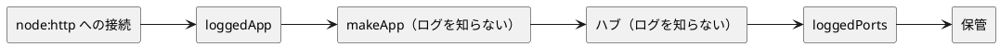

# 第 12 章 監視と関数型JSON

画面から名前を変えられるようになりました。動かし続けるには、**何が起きたかを後から追える**必要があります。第 7 章からは、500 の原因をどこにも残していませんでした。この章でログを足します。そして、ログが機密を漏らさないことを確かめます。

この章のコードは `zettai-step10-observability` にあります。第 11 章の step を複製して始めました。版は、`effect` 4.1.6、`pg` 8.23.1、fast-check 4.11.0 です。ライブラリは追加していません。

## アプリケーションを監視する

知りたいのは、次のことです。

- どの操作が呼ばれ、どう終わったか
- どれだけ時間がかかったか
- 失敗は、業務の失敗か、例外か、中断か

知らせてはいけないのは、利用者が書いた内容です。項目の説明、フォームの本文、クエリ、そして例外のメッセージです。例外のメッセージには、接続先などが混ざることがあります。

ログは、**decorator** として足します。操作を受け取り、同じ型の、ログを書く操作を返す関数です。第 4 章から依存を関数で渡してきたので、その関数を包めば足せます。ハブ、domain、web の本体は、変えません。



### どう終わっても、1 行を書く

`Effect.onExit` は、本体がどう終わっても処理を実行し、結果は変えません。`Exit` から、4 つの終わり方を区別できます。

```typescript
const outcomeOf = (exit: Exit.Exit<unknown, unknown>): string => {
  if (Exit.isSuccess(exit)) return "success"
  const die = exit.cause.reasons.find(Cause.isDieReason)
  if (die !== undefined) return `defect:${classOf(die.defect)}`
  const fail = exit.cause.reasons.find(Cause.isFailReason)
  return fail === undefined ? "interrupted" : tagOf(fail.error)
}
```

第 7 章の線が、ここでも使えます。業務の失敗は**種類の名前**を、defect は**例外のクラス名**を残します。値の中身もメッセージも残しません。

```typescript
// 例外は、クラス名だけを残します。メッセージとスタックトレースには、機密が混ざりえます。
const classOf = (defect: unknown): string =>
  defect instanceof Error ? defect.constructor.name : typeof defect
```

500 の応答は理由を出さないままで、ログには `defect:TypeError` のような行が残ります。これで原因の見当はつきます。ただし、**メッセージが無いので、特定できない場合があります。** これは代償です。

出力先が失敗しても、本体の結果は変えません。

```typescript
// 出力先の失敗で、本体の結果を変えないようにします。そのログの行は失われます。
const emit = (logging: Logging, record: LogRecord) =>
  Effect.sync(() => {
    logging.write(toLine(record))
  }).pipe(Effect.catchCause(() => Effect.void))
```

## 構造化されたロギング

文章のログは、後から機械で調べにくくなります。1 回の操作を、1 行の JSON にします。出力先と時刻は、引数で受け取ります。テストでは、行を配列に集めます。

```typescript
// 出力先と時刻は、引数で受け取ります。
export interface Logging {
  readonly write: (line: string) => void
  readonly now: () => number
}
```

Effect には `log` と `annotateLogs` があります。載せる内容は任意の値です。この版は、載せる項目を決めて固定したいので、記録の型を自作します（[ADR-066](../../../adr/ADR-066-typescript-logging-and-json-codec.md)）。

### 型は、余分な項目を止めなかった

記録の形は、操作の種類ごとの型の和です。最初は、「この型にある項目しか載せられない」と考えていました。**それは誤りでした。** 型に無い `description` を、記録を作る式に直接書き足しても、展開で足しても、**型検査は通りました。**

もっと気づきにくい漏れもありました。記録の `streams` の型は、利用者名とリスト名を持つ `StreamId` の配列です。ところが、TypeScript の型付けは構造的なので、**ほかの項目も持つオブジェクトを、`StreamId` として渡せます。** `JSON.stringify` は、型を知らず、持っている項目をすべて書きます。次のテストは、余分な項目に入れた文字列がログに出て、失敗しました。

```typescript
  it("writes only the user and the list name of a stream", async () => {
    const { lines, logging } = collecting()
    const ports = loggedPorts(makeInMemoryStore([]), logging)
    const wider = { user: uberto, listName: book, items: ["secret item"] }
```

そこで、**書き出す時点で、許可した項目名だけを通します。** `JSON.stringify` の第 2 引数に名前の一覧を渡すと、入れ子の中も、その名前の項目だけが出ます。

```typescript
export const toLine = (record: LogRecord): string => JSON.stringify(record, FIELDS)
```

型は、書く人が項目を考える助けにはなります。しかし、**漏れを防ぐ最後の守りは、実行時にあります。** この絞り込みも、名前で見るだけです。許可した名前の項目に機密を入れれば、出ます。

### 漏れないことを、テストにする

項目の説明は、生成した文字列に目印を付けて確かめます。作成、追加、名前の変更、読み取りを実行し、どの行にも目印が現れないことを見ます。試行回数は 200 回です。

```typescript
  it("never writes the description of an item", async () => {
    await fc.assert(
      fc.asyncProperty(fc.string({ unit: "grapheme", maxLength: 12 }), async (text) => {
```

要求のログは、メソッド、クエリを除いたパス、状態、所要時間だけです。フォームの本文は読みません。ビルドしたサーバーに、クエリとフォームの本文へ目印を付けた要求を送りました。標準出力には、目印も項目の説明も現れませんでした。

```bash
{"operation":"update","outcome":"success","durationMs":0,"streams":[{"user":"uberto","listName":"book"},{"user":"uberto","listName":"reading"}],"eventCount":5}
{"operation":"request","outcome":"success","durationMs":2,"method":"POST","path":"/todo/uberto/book/rename","status":302}
```

**利用者名、リスト名、パスは、ログに出ます。** 障害の対象を追うためです。これらは個人を特定しうる情報です。この版は、ログの保管やアクセスの管理を扱っていません。

アプリケーションに届く前の失敗（大きすぎる本文の 413 など）は、このログに残りません。

## JSONを関数型にする

JSON との変換には、書く向きと読む向きがあります。別々の関数にすると、片方だけを直してしまえます。2 つをまとめた型にします。

```typescript
// JSON との変換を、両方向まとめて持ちます。書く値の型 In と、読む値の型 Out は、別にできます。
export interface JsonCodec<In, Out> {
  readonly encode: (value: In) => unknown
  readonly decode: (json: unknown) => Result.Result<Out, unknown>
}
```

第 9 章の、行の書き方と読み方は、この型にまとめられます。

```typescript
// 保存する 1 行との変換を、両方向まとめます。書いて読むと戻ることは、性質テストで確かめます。
export const eventCodec: JsonCodec<ToDoListEvent, ToDoListEvent> = {
  encode: (event) => ({ event_type: event._tag, payload: encodePayload(event) }),
```

まとめても、**2 つの向きが対応していることは、型が保証しません。** 生成したイベントを書き、JSON の文字列を経由して読み戻し、元と同じになることを確かめます。試行回数は 500 回です。

```typescript
          const row = eventCodec.encode(event)
          // 保存するときと同じく、JSON の文字列を経由します。
          const stored = JSON.parse(JSON.stringify(row)) as unknown

          expect(eventCodec.decode(stored)).toEqual(Result.succeed(event))
```

### 往復が確かめていなかったもの

このテストは、最初から通りました。しかし、**期限を一度も書かない変換も、状態をいつも `Todo` にする変換も、通りました。** 生成する項目に、期限も `Todo` 以外の状態も無かったからです。

生成する項目に、状態と、あるかないかの期限を持たせました。そのうえで、**4 つの状態と、期限の有無の両方が生成されることを、テストにします。** 2 つの壊し方は、往復のテストで失敗するようになりました。

```typescript
const item = fc
  .record(
    {
      text: fc.constantFrom("milk", "eggs", "bread"),
      status: fc.constantFrom<ToDoStatus>("Todo", "InProgress", "Done", "Blocked"),
      due: dueDate
    },
```

第 8 章と同じ教訓です。**性質テストが確かめるのは、生成した値の範囲だけです。**

## プロファンクタとの出会い

`JsonCodec<In, Out>` の 2 つの型引数は、向きが違います。`In` は受け取る側、`Out` は返す側です。ある変換から別の型の変換を作るには、2 つの関数が要ります。

```typescript
// 書く前に pre を、読んだ後に post を適用した変換を作ります。pre は、向きが逆です。
export const dimap = <In, Out, In2, Out2>(
  codec: JsonCodec<In, Out>,
  pre: (value: In2) => In,
  post: (value: Out) => Out2
): JsonCodec<In2, Out2> => ({
  encode: (value) => codec.encode(pre(value)),
  decode: (json) => Result.map(codec.decode(json), post)
})
```

`post` は、`map` と同じ向きです。`pre` は、**新しい型から元の型への関数**で、逆向きです。受け取る側は逆向きに、返す側は同じ向きに変えられる型を、**プロファンクタ**と呼びます。法則は 2 つです。

- **恒等則:** 2 つとも何もしない関数なら、変わらない
- **合成則:** 2 回の `dimap` は、関数を合成した 1 回と同じ。書く側は逆の順に合成する

```typescript
          dimap(dimap(numbers, f.run, g.run), h.run, i.run),
          // 書く側の関数は逆の順に、読む側の関数は順に合成します。
```

### 法則が守らないこと

**書く側の関数を使わない `dimap` は、2 つの法則を両方満たします。** 法則は、`dimap` どうしを比べるので、両辺が同じように無視すると見分けられません。第 7 章の「関数を使わない `map`」と同じ理由です。壊して実行すると、失敗したのは次のテストだけでした。

```typescript
  // 法則を満たしても、書いて読むと元に戻るとは限りません。
  it("does not promise a round trip", () => {
    const lopsided = dimap(numbers, (n: number) => n + 1, id)

    expect(lopsided.decode(lopsided.encode(1))).toEqual(Result.succeed(2))
  })
```

このテストは、題名のとおり、**法則を満たしても往復は約束されない**ことを示します。`1` を書いて読むと `2` になります。2 つの関数が互いに逆であることは、法則とは別の条件です。

Effect の `Schema` も、両方向の変換を持ちます。この章では、`Schema` の変換をプロファンクタと呼びません。法則を確かめていないためです。`dimap` は、本体のコードでは使っていません。概念を確かめるための、小さな自作です。

## データベース呼び出しのロギング

保管の 3 つの操作は、1 つの関数でまとめて包みます。引数と戻り値の型が同じなので、**ハブから見て、ログの有無は分かりません。** 起動の入口で、組み立てに 1 段足します。

```typescript
  const app = makeApp(makeHub(loggedPorts(ports, logging)))
  const server = yield* serve(loggedApp(app, logging), port)
```

更新のログには、対象のストリーム、結果、追記した件数が残ります。業務の失敗は、`ListAlreadyExists` のような種類の名前になります。イベントの中身は残しません。

SQL の文と値、接続の待ち時間は、記録していません。データベースの中の処理を追うには、データベースの側の記録が必要です。

## まとめ

この章では、次を確かめました。

- ログは、同じ型の関数を返す decorator で足せる。本体は変えない
- 型は、ログに余分な項目が混ざることを止めない。書き出す時点で絞る
- 往復の性質テストは、生成する値が持たない項目を確かめない
- `dimap` の法則は、往復を保証せず、片方の関数の無視も見つけない

`npm run check` は、テスト 221 ファイル 1892 件が通ります（2026-11-28、Windows、Node 22.23.4）。所要時間は約 64 秒で、**この版が決めた上限の 60 秒を超えました。** 段ごとに測ると、テストが約 43〜48 秒、step ごとにビルドして実行する smoke が約 19〜20 秒でした。

このため、手元の `check` はテストと smoke を最新の step だけに絞り、全部の step は `check:all` として CI で実行する形にしました（[ADR-054](../../../adr/ADR-054-typescript-toolchain-and-check.md) の追記）。

次の章で、ここまでの設計を振り返ります。

### 型で守れたこと・守れなかったこと

| 対象 | 型検査 | 守ったもの |
| :--- | :--- | :--- |
| ログの記録に、型に無い項目を足す | **通る** | 書き出し時の項目名の絞り込み |
| 型より多くの項目を持つオブジェクトを渡す | **通る** | 同上 |
| 例外のメッセージを結果に載せる | **通る** | ログのテスト |
| 出力先の失敗を捕まえない | **通る** | 出力先が失敗するテスト |
| 行の書き方と読み方がずれる | **通る** | 往復の性質テスト（生成する値の範囲） |
| `dimap` が書く側の関数を無視する | **通る** | 往復を扱う 1 つの例（法則のテストは通る） |

### Effectに置き換えたこと・自作で残したこと

| 対象 | この章での扱い |
| :--- | :--- |
| どう終わっても実行する処理 | `Effect.onExit`、`Exit`、`Cause` を使う |
| ログの形と出力 | 自作する。`Effect.log` と `annotateLogs` は使わない |
| 行の形の検査 | `Schema` を使う |
| 両方向の変換と `dimap` | 自作する |

## この章で書いたコード

- `apps/typescript-fp/zettai/zettai-step10-observability/src/adapter/logging/logged.ts`
- `apps/typescript-fp/zettai/zettai-step10-observability/src/adapter/json/json-codec.ts`
- `apps/typescript-fp/zettai/zettai-step10-observability/src/adapter/postgres/codec.ts`、`src/main.ts`
- `apps/typescript-fp/zettai/zettai-step10-observability/test/`（`logging.test.ts`、`json-codec.test.ts`、`support/arbitraries.ts`）

## 参照

- Uberto Barbini『From Objects to Functions』第 12 章。章の題材と順序、ログの decorator と関数型の JSON の考え方は本書に拠っています。本連載のコードはすべて書き起こした自作実装です
- [MDN の JSON.stringify](https://developer.mozilla.org/en-US/docs/Web/JavaScript/Reference/Global_Objects/JSON/stringify)
- [Effect の公式サイト](https://effect.website/)
