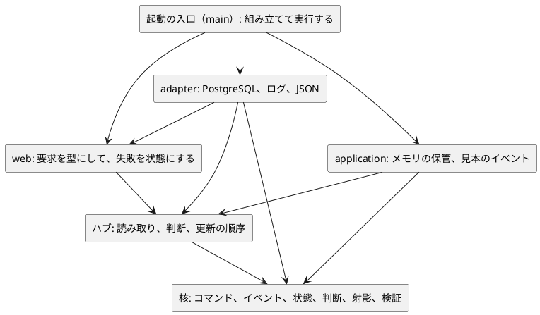

# 第 13 章 関数型アーキテクチャの設計

12 章かけて、リストを表示する関数から、イベントを PostgreSQL に残すアプリケーションまで作りました。この章では新しいコードを書きません。**最初に立てた問いに、実装と実測で答えます。**

> 型が実行時に消え、型付けが構造的な言語で、副作用・エラー・依存を `Effect<A, E, R>` の型に載せると、設計のどこが型で守られ、どこが規約とテストに残るか。

この章で「壊した」と書く実験は、断りがなければ、最後の step の `zettai-step10-observability` で 2026-11-28 に実行しました。型検査、lint、この step のテスト 329 件を実行し、実行後に元へ戻しました。版は、`effect` 4.1.6、TypeScript 7.0.2、`pg` 8.23.1、Node 22.23.4（Windows）です。

## シンプルさを追い求めて

最後の step の `src` は 26 ファイルです。空行と行コメントを除くと 1173 行でした。`effect` から読み込んでいるのは、`Result`、`Effect`、`Option`、`Exit`、`Cause`、`Brand`、`Data`、`Schema` の 8 つです。

使わなかったものも、設計の一部です。

| 使わなかったもの | 理由 |
| :--- | :--- |
| `Context.Service` と `Layer` | 依存は関数の引数で足りた（[ADR-058](../../../adr/ADR-058-typescript-dependency-by-function-argument.md)） |
| `effect` の HTTP と SQL のモジュール | 不安定な API の範囲を増やさず、`node:http` と `pg` を薄く包んだ（[ADR-056](../../../adr/ADR-056-typescript-http-with-stable-parts.md)、[ADR-063](../../../adr/ADR-063-typescript-postgresql-persistence.md)） |
| `Fiber` と `Stream` | 必要とする要件が無かった |
| `Effect.log` と `annotateLogs` | ログに載せる項目を固定したかった（[ADR-066](../../../adr/ADR-066-typescript-logging-and-json-codec.md)） |

**この選択は、問いの答えの範囲を決めます。** 依存を `R` に載せる設計は、最後のコードにありません。この連載の結果から、`R` を使った依存の組み立てが大きくなった場合のことは言えません。

シンプルにしたつもりで、足りなかった所もあります。状態は毎回イベントから作り直します。読み取りモデルは保存せず、イベントが増えた場合の時間は測っていません。

## システム全体の設計

依存は、外から内へ向きます。中心は純粋な関数で、`Effect` は境界に現れます。



矢印は、読み込む向きです。ログの decorator は web の型を読み込みますが、web はログを知りません。

境界には、型の約束が 3 つあります。

| 境界 | 型の約束 | 型の外で守るもの |
| :--- | :--- | :--- |
| HTTP から domain へ | コマンドの利用者名とリスト名は、ブランド型にする | 入力の文字列は、実行時に検査する。項目の説明はブランド型ではない |
| ハブから保管へ | 判断の関数は `Result` を返す | 読み取りから追記までをまとめることは、保管の実装と契約のテスト |
| データベースから domain へ | デコーダは、イベントの種類ごとに必要 | 行の中身は、`Schema` で実行時に検査する |

**型が実行時に消えるので、外から値が入る境界には、実行時の検査が要りました。** 出ていく境界でも同じでした。ログは、書き出す時点で項目を絞っています。

## コードへの翻訳

問いを、3 つの対象に分けて答えます。

### エラー（E）は、かなり型で守れた

要求を処理する関数の型は、失敗の型引数を持ちません。つまり `never` です。

```typescript
export type App = (request: Request) => Effect.Effect<Response>
```

ハブが返す型付きの失敗は、この型になる前に、すべて応答に変える必要があります。一覧の表示で失敗の処理を消すと、**型検査が失敗しました**（`TS2375`。テストも 11 件失敗しました）。

失敗の種類と状態の対応は、`Record` で書きます。

```typescript
const statusOf: Record<Failure, 400 | 404> = {
```

失敗の種類を 1 つ足して、状態を決めないと、`TS2741` になります。テスト 329 件はすべて通ったので、**止めたのは型検査だけです。**

ただし、これは書き方に依存します。第 7 章では、状態の対応を三項演算子で書くと、新しい失敗を足しても型検査とテストが通りました。また、**`E` に現れるのは、失敗として返したものだけです。** 例外は defect になり、型に現れません。どちらにするかの線は、人が引きます。この版は、業務の規則の失敗を `E` に、データベースの失敗を defect にしました（[ADR-060](../../../adr/ADR-060-typescript-typed-errors-and-defects.md)、[ADR-063](../../../adr/ADR-063-typescript-postgresql-persistence.md)）。

### 依存と資源（R）は、使った範囲では守れた

依存は、関数の引数で渡しました。引数を渡し忘れれば型の誤りになりますが、これは普通の関数の型検査です。

最後のコードで `R` に現れるのは、`Scope` です。接続の集まりと HTTP のサーバーを、`Effect.acquireRelease` で作るためです。起動の入口から `Effect.scoped` を外すと、**型検査が失敗しました。** 後始末の範囲を決め忘れたまま実行することは、型が止めます。

型が止めるのは、要求が解決されていないことです。**正しいもので解決したかは、別の話です。** 第 10 章では、トランザクションの接続を `R` のサービスにする案を試しました。範囲の外からの追記は型の誤りになりました。しかし、取り出したサービスを後から渡し直すコードは、型検査を通りました。この案は採らず、判断の関数を保管に渡しました（[ADR-064](../../../adr/ADR-064-typescript-command-transaction.md)）。

### 副作用は、型では分けられなかった

`Effect` は、作っただけでは実行されません。実行する呼び出しは、起動の入口、smoke の入口、要求ごとの実行の 3 か所です。

しかし、**`Effect` を使わない副作用は、どこにでも書けます。** 核の中の、イベントから状態を作る関数に、次の 2 つを別々に書き足しました。

| 書き足したもの | 型検査 | lint | テスト |
| :--- | :--- | :--- | :--- |
| `console.log`、現在時刻、乱数 | 通る | 通る | すべて通る |
| `void` を付けた、待たない `fetch` | 通る | 通る | すべて通る |

核の境界テストは、核のファイルが何を読み込むかを調べます。`Effect` の型や、核の外のファイルは見つけます。**読み込まずに使える `console` や `Date` は、調べていません。** lint の追加の規則で止められる可能性はありますが、この版では試していません。

核の関数が純粋なのは、**そう書いたから**です。型が保証した結果ではありません。

実行し忘れも、部分的にしか見つかりません。第 6 章では、`Effect` を作って捨てる文と、`await` しただけの文を、診断の `floatingEffect` が見つけました。**変数に入れて使わない場合は、見つけませんでした。**

### 構造的な型付けが残した穴

ブランド型は、利用者名とリスト名の取り違えと、検査していない文字列を渡すことを止めます。`readonly` は、その項目への代入を止めます。

どちらも、型の変換（`as`）を書かずに越えられました。TypeScript では、`readonly` やブランドを持つ型の値を、**より緩い、書き換えられる型の変数に代入できます。** 次の 3 行は型検査を通り、ブランド型の項目に空文字列が入りました。実験のために一時的に書いたもので、リポジトリのコードにはありません。

<!-- code-check: ignore 一時的な実験のコードで、リポジトリにはありません -->
```typescript
const stream: StreamId = { user: userOf("uberto"), listName: listNameOf("book") }
const loose: { user: string; listName: string } = stream
loose.listName = ""
```

第 12 章のログの漏れも、同じ性質の現れです。型より多くの項目を持つオブジェクトは、そのまま渡せます。**型は「少なくともこれを持つ」と約束し、「これしか持たない」とは約束しません。**

### どのテストも見ていない場所

起動の入口で、ログの decorator を 2 つとも外しました。**型検査、lint、テストは、すべて通りました。** `npm run check` の smoke は、別の入口を実行します。実際の組み立ては、サーバーを手で起動して確かめただけです。

部品が正しいことと、部品がつながっていることは、別に確かめる必要があります。

## 最後の考察

### 問いに答える

| 設計の対象 | 型が守った所 | 規約とテストに残った所 |
| :--- | :--- | :--- |
| エラー | 型付きの失敗の扱い忘れ。`Record` で書いた対応の抜け | 失敗と defect の線。網羅される書き方を選ぶこと |
| 依存と資源 | `Scope` の解決忘れ。引数の渡し忘れ | 正しい実装を渡すこと。起動の組み立て |
| 副作用 | `Effect` を返す関数と返さない関数の区別 | 核を純粋に保つこと。実行し忘れの一部 |
| データ | ブランド型の取り違え。`readonly` の項目への直接の代入 | 境界の検査。緩い型を通した書き換え。余分な項目 |
| 時間と並行 | この版の型では表していない | トランザクションとロック。実際の PostgreSQL を使うテスト |
| 法則 | 関数の型の形 | 結合律、ファンクタ則、モナド則、`dimap` 則の性質テスト |

一言にまとめます。**型が守ったのは、型に書いたものを、扱い忘れることです。型に書かなかったことと、書いても意味までは表せないことは、規約とテストに残りました。**

`Effect<A, E, R>` は、「この処理は、何を返し、どう失敗し、何を必要とするか」を型に書く場所を与えます。書く内容は決めてくれません。「この処理は、ほかに何もしない」と書く場所はありません。

これは、1 つの題材、1 つの実装、この版の設定での観察です。一般論の根拠にはなりません。

### 型を通り、別の手段で見つけたもの

| 見つかったこと | 章 | 見つけた手段 |
| :--- | :--- | :--- |
| 状態を足して遷移の表を空にしても、テストが通った | 6 | 壊す実験。テストの側にも状態の網羅を足した |
| 同じリストの同時の作成が、両方受け付けられた | 6、10 | 読み取りを遅らせた実行と、実際の PostgreSQL |
| 生成器が、完了した項目のあるイベントの列を作らなかった | 8 | 生成した値の割合を数えた |
| 読み取りの順序の指定を消しても、テストが通った | 9 | 壊す実験。**テストは足していない** |
| 接続を捨てるように壊しても、テストが通った | 10 | 壊す実験。テストを直した |
| 新しい名前の制限を読み取りに掛けても、テストが通った | 11 | 壊す実験。テストを足した |
| 余分な項目がログに出た | 12 | 失敗するテスト |
| 期限や状態を書かない変換が、往復のテストを通った | 12 | 壊す実験。生成器を直した |

型検査もテストも、**書いた範囲しか確かめません。** わざと壊して、失敗することを確かめるまで、テストが何を守っているかは分かりませんでした。

### ほかの版との対比

次の表の TypeScript 版以外の列は、各版の記事と ADR の記述に基づきます。この章のために、実行し直してはいません。

| 論点 | Scala 版 | Kotlin FP 版 | TypeScript FP 版 |
| :--- | :--- | :--- | :--- |
| 失敗の型 | `Either` | Arrow の `Either` | `Result` と `Effect` の `E` |
| 入力の誤りの蓄積 | `Validated` と `mapN` | `zipOrAccumulate` | 自作の合成 |
| 副作用の表し方 | `IO` の値 | `suspend` 関数 | `Effect` の値 |

Scala 版は、核と殻の分離を守ったのは `IO` の型ではなく、規律と設計だったと結論しています。`IO` を使わない副作用は、コンパイルを通ったからです。TypeScript FP 版でも、`Effect` を使わない副作用は型検査を通りました。Flix 版では、効果が型に載ります。この点は、言語が与えるもので、ライブラリを足しても同じにはなりませんでした。

### 扱わなかったこと

この設計を、そのまま公開の環境に出すことはできません。

| # | 扱わなかったこと | 状態 |
| :--- | :--- | :--- |
| 1 | 認証と認可 | 無い。パスの利用者名を信じるので、**誰でも誰のリストでも操作できる** |
| 2 | CSRF の対策 | 無い。別の `Origin` を付けた POST で、名前が変わることを確かめた |
| 3 | 問い合わせとロックの待ちの時間の上限 | 設定していない。中断は、実行中の問い合わせの終了を待つ |
| 4 | 読み取りモデルの保存、スナップショット | 無い。読むたびにイベントから作る |
| 5 | スキーマの移行と、イベントの形の版 | 無い。起動時に、無ければ表と索引を作る |
| 6 | 再試行、負荷の確認 | していない |
| 7 | ログの保管とアクセスの管理、相関 ID、分散トレース、メトリクス | 無い。ログには利用者名とリスト名が出る |
| 8 | 保存する読み取りの順序を確かめるテスト | 無い |
| 9 | サーバーの停止を確かめるテストの安定性 | 1 回だけ、想定と違うエラーで失敗した。原因は確かめていない |

## 連載を終えて

この版では、`Effect` に多くを任せたというより、**任せる範囲を章ごとに決めました。** 法則は自分のテストで確かめ、依存は関数の引数にし、ログの形は自分で固定しました。ライブラリを使うかどうかより、守りたいものがどの手段で守られるかを確かめることに、時間がかかりました。

次に同じ構成で作るなら、次の順で足します。

1. 核の中の `console`、時刻、乱数を禁止する検査
2. 起動の組み立てを通る smoke
3. 認証と CSRF の対策
4. 問い合わせとロックの待ちの時間の上限

どれも、この版では実施していません。

### 型で守れたこと・守れなかったこと

| 対象 | 型検査 | ほかに守ったもの |
| :--- | :--- | :--- |
| 型付きの失敗の扱い忘れ | **止まる** | テストも失敗した |
| 状態を決めない失敗の追加 | **止まる** | テストは通った |
| `Effect.scoped` の付け忘れ | **止まる** | テストは通った |
| 核の中の `console.log`、時刻、乱数、待たない通信 | 通る | 無い（lint とテストも通った） |
| 起動の入口からログを外す | 通る | 無い（手で起動して確かめる） |
| 緩い型を通した、ブランド型の項目の書き換え | 通る | 無い |

### Effectに置き換えたこと・自作で残したこと

| 対象 | 最後の形 |
| :--- | :--- |
| 副作用の値、型付きの失敗、資源の寿命 | `Effect`、`Result`、`acquireRelease` を使う |
| 保存した行の検査 | `Schema` を使う |
| ブランド型、あるかないかの値 | `Brand`、`Option` を使う |
| 依存の注入 | 自作する（関数の引数） |
| モノイド、検証の蓄積、`dimap`、ログの形 | 自作する |

## この章で書いたコード

この章では、コードを追加していません。参照した最後の step は、`apps/typescript-fp/zettai/zettai-step10-observability/` です。

## 参照

- Uberto Barbini『From Objects to Functions』第 13 章。章の題材と順序は本書に拠っています。本連載のコードはすべて書き起こした自作実装です
- [Effect の公式サイト](https://effect.website/)
- [TypeScript の公式ハンドブック（型の互換性）](https://www.typescriptlang.org/docs/handbook/type-compatibility.html)
