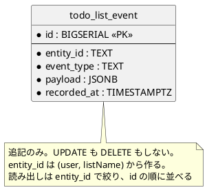

# データモデル設計 - Zettai

Zettai の永続化スキーマを定義します。第 9 章（Unit 5）で導入します。

## 方針: 状態を保存せず、出来事だけを保存する

第 5 章で、状態を上書きせず出来事として残す設計にしました。その帰結として、**データベースにも状態を保存しません**。

| 保存するもの | 保存しないもの |
| :--- | :--- |
| 出来事（`ListCreated`・`ItemAdded`・`ItemStatusChanged`） | ToDo リスト、ToDo 項目、その状態 |

現在の状態は、出来事を読み出して畳み込んで得ます（`replayFrom`）。表示用のモデルも同じく射影で得ます（`projectFrom`）。

### テーブルは 1 つだけ

普通の設計なら `todo_list` と `todo_item` のテーブルを作り、外部キーで繋ぎます。この設計ではどちらも作りません。



**関連するテーブルが無いので、外部キーもありません。** ER 図が 1 エンティティだけになるのは、イベントソーシングの帰結です。

## テーブル定義

### todo_list_event

| カラム | 型 | 制約 | 説明 |
| :--- | :--- | :--- | :--- |
| `id` | `BIGSERIAL` | PK | 追記順。**読み出しの順序を決める唯一の根拠** |
| `entity_id` | `TEXT` | NOT NULL | 出来事が属する対象。`{user}/{listName}` の形 |
| `event_type` | `TEXT` | NOT NULL | 出来事の種類（`ListCreated` など） |
| `payload` | `JSONB` | NOT NULL | 出来事の内容 |
| `recorded_at` | `TIMESTAMPTZ` | NOT NULL, DEFAULT `now()` | 記録した時刻 |

```sql
CREATE TABLE IF NOT EXISTS todo_list_event (
    id          BIGSERIAL PRIMARY KEY,
    entity_id   TEXT        NOT NULL,
    event_type  TEXT        NOT NULL,
    payload     JSONB       NOT NULL,
    recorded_at TIMESTAMPTZ NOT NULL DEFAULT now()
);

CREATE INDEX IF NOT EXISTS idx_todo_list_event_entity
    ON todo_list_event (entity_id, id);
```

### 判断したこと

**`id` を `BIGSERIAL` にしました。** 出来事の順序は追記順で決まります。`recorded_at` を順序の根拠にしません。同じ時刻に複数の出来事が記録されうるからです。

**`payload` を `JSONB` にしました。** 出来事の種類ごとにカラムを用意すると、出来事を追加するたびにスキーマ変更が必要になります。`JSONB` なら追加はアプリケーション側で済みます。第 12 章で JSON の扱いを扱うので、そこでシリアライズを整えます。

**`entity_id` を `{user}/{listName}` の複合文字列にしました。** `user` と `list_name` を別カラムにする案もありましたが、読み出しは常に両方で絞るため分ける利益がありません。将来 `user` だけで絞る必要が出たら、そのときにカラムを分けます。

**インデックスは `(entity_id, id)` の複合 1 つだけです。** 読み出しのパターンが「ある対象の出来事を追記順に全部」の 1 つしかないためです。

### 正規化を論じない理由

イベントストアは**追記のみ**で、更新も削除もしません。正規化が解決する問題（更新時の不整合、重複データの矛盾）が起きません。

正規化を考えるのは、射影を永続化するようになったときです。現在は射影をメモリ上で作り直しているので、その必要がありません。永続化した射影（リードモデル）が必要になったら、その時点で設計します。

## 制約と運用

| 事項 | 方針 |
| :--- | :--- |
| マイグレーション | 第 9 章の時点では `CREATE TABLE IF NOT EXISTS` を起動時に実行する。マイグレーションツールは入れない（テーブルが 1 つで、追記のみなので変更が起きにくい） |
| 削除 | しない。誤って作ったリストも出来事として残る。取り消しは「取り消した」という出来事を足して表す（第 9 章では未実装） |
| バックアップ | 連載の対象外 |
| 接続情報 | `docker-compose.yml` の `zettai-db` サービス（`localhost:5432`・DB `zettai`・ユーザー `zettai`）。**連載用のローカル環境のみで、本番の設定ではない** |

## 章ごとの変化

| 章 | 変化 |
| :--- | :--- |
| 9 | `todo_list_event` テーブルを作る。イベントの追記と読み出し |
| 10 | トランザクション文脈（`ContextReader`）で複数の操作をまとめる |
| 12 | `payload` の JSON を Kondor で扱う |

第 8 章までのデータはインメモリで、テーブルはありません。

## Kotlin FP 版での差分

テーブル `todo_list_event`、カラム、インデックス `(entity_id, id)` は既存 Kotlin 版と同じです。保存するのは出来事だけで、追記のみ、順序の根拠は `id` です。違いは、接続の用意と、2 つの符号化にあります。

| 観点 | 既存 Kotlin 版 | Kotlin FP 版 |
| :--- | :--- | :--- |
| 結合テストの DB | `docker-compose.yml` の `zettai-db` と CI のサービスコンテナ | Testcontainers が起動する PostgreSQL。固定のポートや service を持たず、container が公開する JDBC URL・ユーザー・パスワードだけを注入する |
| テーブルの作成 | 起動時に `CREATE TABLE IF NOT EXISTS` | 同じ。adapter の `createSchema` が実行する |
| `payload` の組み立て | 手書きの JSON 文字列 | `jsonb_build_object` と bind parameter。JSON ライブラリを足さない（[ADR-040](../adr/ADR-040-jdbc-blocking-boundary.md)） |
| `payload` の読み出し | JSON 文字列を解析する | `payload->>'key'` で項目ごとに読む |
| `entity_id` | `{user}/{listName}` | 各部分の `%` を `%25`、`/` を `%2F` に置き換えて `/` で結ぶ |
| ユーザー単位の読み出し | `entity_id` で絞る | `starts_with(entity_id, 符号化した user + '/')` で絞る |

### entity_id の符号化

`{user}/{listName}` をそのまま連結すると、`User("a/b")` と `ListName("c")` の組と、`User("a")` と `ListName("b/c")` の組が、どちらも `a/b/c` になり、別の集約が混ざります。HTTP の path からは `/` を含む名前は来ませんが、domain の `User` と `ListName` は文字列なら何でも受け取ります。

そこで、各部分の `%` と `/` を置き換えてから連結します。

| user | listName | entity_id |
| :--- | :--- | :--- |
| `alice` | `book` | `alice/book` |
| `a/b` | `c` | `a%2Fb/c` |
| `a` | `b/c` | `a/b%2Fc` |
| `100%` | `done` | `100%25/done` |

通常の名前では既存 Kotlin 版と同じ値になり、`/` と `%` を含む名前でだけ変わります。`%` を先に置き換えるので、元の名前に戻せ、衝突しません。ユーザー単位の読み出しに `LIKE` を使わないのは、符号化した値に含まれる `%` がワイルドカードになるためです。

### payload の形

| event_type | payload のキー |
| :--- | :--- |
| `ListCreated` | `user`、`listName` |
| `ItemAdded` | `user`、`listName`、`item`（`description`、`dueDate`、`status`） |
| `ItemStatusChanged` | `user`、`listName`、`description`、`newStatus` |

`dueDate` は ISO 8601 の文字列で、ない場合は JSON の null です。未知の `event_type`、必須キーの欠落、不正な `status` は、読み出し時に `PersistenceFailure` として返します。

### jsonb の正規化

`jsonb` は入れた文字列を保ちません。空白が消え、キーが並べ替えられます。そのため、書いた JSON の文字列と読み戻した文字列を比べるテストは書かず、読み戻した event が元の event と等しいことで確かめます。

### 版と楽観ロック（第 10 章）

並行する command の競合を検出するため、`todo_list_event` に `version` 列と一意制約を足します（[ADR-043](../adr/ADR-043-optimistic-locking-by-version.md)）。

| 変更 | 内容 |
| :--- | :--- |
| `version INTEGER NOT NULL` | `entity_id` ごとの連番（1 から）。その stream に追記済みの event の件数に等しい |
| `UNIQUE (entity_id, version)` | 同じ stream の同じ版への挿入を拒否する。競合の検出は、この制約の違反（SQLState `23505`）で行う |

```sql
CREATE TABLE IF NOT EXISTS todo_list_event (
    id          BIGSERIAL PRIMARY KEY,
    entity_id   TEXT        NOT NULL,
    version     INTEGER     NOT NULL,
    event_type  TEXT        NOT NULL,
    payload     JSONB       NOT NULL,
    recorded_at TIMESTAMPTZ NOT NULL DEFAULT now(),
    UNIQUE (entity_id, version)
);
```

読み出しは event と一緒に、その stream の版を返します。保存は、触れる stream ごとに読んだ時点の版を受け取り、`読んだ版 + 1` からの連番を付けて挿入します。複数の stream への書き込みは 1 つの transaction で行い、どれか 1 つでも衝突すれば、すべて rollback します。

`CREATE TABLE IF NOT EXISTS` は、すでにあるテーブルを変更しません。この列を足す前のテーブルを持つ DB には使えません。結合テストの DB は Testcontainers がテストごとに作るので、既存のデータは無く、移行は要りません。実際の運用で既存のテーブルを持つ場合は、`ALTER TABLE` と既存の event への版の採番が別に要ります。この連載では扱いません。

`UNIQUE (entity_id, version)` は、`(entity_id, version)` の索引を暗黙に作ります。読み出しの索引 `(entity_id, id)` は、そのまま残します。

## なでしこ3 版での差分

**データベースを使いません。** 判断（状態を保存せず出来事だけを追記する）は同じで、保存先だけが違います（[ADR-019](../adr/ADR-019-file-event-log.md)）。

| 観点 | Kotlin 版 | なでしこ3 版 |
| :--- | :--- | :--- |
| 保存先 | PostgreSQL の `todo_list_event` テーブル | **1 ファイル**（`.zettai_events.log`） |
| 1 件の形 | `entity_id` / `event_type` / `payload`（JSONB） | **1 行 1 JSON**（イベントの辞書をそのままエンコード） |
| 順序の根拠 | `id BIGSERIAL` | **行の並び** |
| 追記 | `INSERT` | 読んで足して書き戻す（追記の命令が無い） |
| 検索 | インデックス `(entity_id, id)` | **無い。全行を走査する** |
| 無いとき | テーブルが空 | ファイルが無い = まだ何も起きていない（失敗ではない） |
| 結合テストの用意 | docker-compose と CI のサービスコンテナ（[ADR-009](../adr/ADR-009-integration-test-database.md)） | **不要。** 一時ファイルを作って消すだけ |

### 1 行の例

```text
{"種別":"ListCreated","利用者":"uberto","リスト名":"book"}
{"種別":"ItemAdded","利用者":"uberto","リスト名":"book","項目":{"説明":"write chapter","期限":"","状態":"Todo"}}
```

**キーを改名しません。** 改名すると過去の行が読めなくなります。キーの追加には強い形です。

### 扱わないこと

同時書き込み、途中で落ちたときの整合、件数が増えたときの性能は扱いません。理由と再検討の条件は [ADR-019](../adr/ADR-019-file-event-log.md) にあります。

---

## Rust 版での差分

**保存先は Kotlin 版と同じ PostgreSQL です**（なでしこ3 版だけがファイル）。イベントを 1 テーブルに追記し、状態を保存しない形も同じです（[ADR-032](../adr/ADR-032-postgres-event-store.md)）。

違うのは 3 点です。

### 1. テーブル名を引数で受ける

```sql
CREATE TABLE IF NOT EXISTS {table} (
    id BIGSERIAL PRIMARY KEY,
    user_name TEXT NOT NULL,
    list_name TEXT NOT NULL,
    payload JSONB NOT NULL,
    recorded_at TIMESTAMPTZ NOT NULL DEFAULT now()
)
```

`cargo test` が既定で並列に走るためです。**なでしこ3 版 Unit 7 では記録先を 1 つに決め打ちし、件数が混ざりました。**

### 2. `payload` の JSON を自前で組み立てる

`serde_json` は依存 +5・ビルド +8.30 秒、`serde` の derive まで入れると +11・+16.57 秒でした。イベントは 2 種類・各 1 フィールドなので自前にしています（[ADR-012](../adr/ADR-012-own-json-converter.md) の踏襲）。

**代償を 1 件払いました。** `jsonb` は正規化して返すのでコロンの後ろに空白が入り、自前のパーサが読めませんでした。**単体の往復テストは通っていて、DB を通す結合テストだけが見つけました。**

### 3. パラメータの型に注意が要る

`$2::jsonb` と書くと**パラメータの型が `jsonb` と推論**され、`&str` を渡せません。

```sql
INSERT INTO {table} (user_name, list_name, payload)
VALUES ($1, $2, ($3::text)::jsonb)
```

`text` で受けてからキャストします（`README.md` の既知の制約 1）。

### DB を使う検査の置き場

Kotlin 版は `check` に含めています（[ADR-009](../adr/ADR-009-integration-test-database.md)）。**Rust 版は別ジョブに分けました**（[ADR-033](../adr/ADR-033-db-check-as-separate-job.md)）。`check` が 26 秒で、サービスコンテナの +22 秒が占める割合が違うためです。

## 関連ドキュメント

- [ドメインモデル設計](domain-model.md)
- [バックエンドアーキテクチャ設計](architecture_backend.md)
- [第 9 章](../article/zettai/kotlin/chapter09.md)（公開後）
