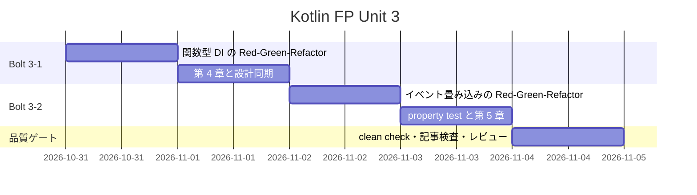
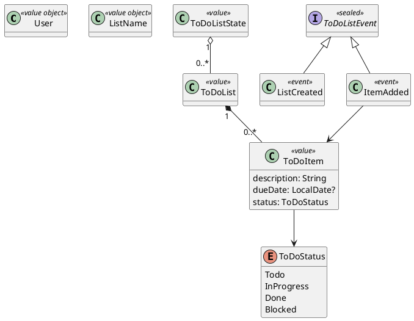
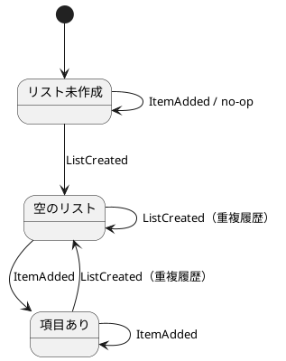
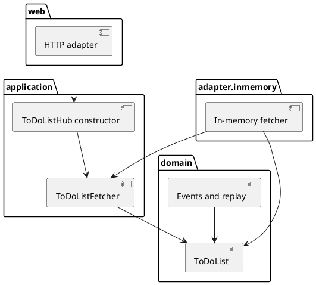

# Unit 3 の Bolt 計画 - Zettai 連載（Kotlin FP 版）

## 概要

| 項目 | 内容 |
| :--- | :--- |
| Unit | 3：関数型 DI とイベント畳み込み |
| Bolt | 3-1 第 4 章 / 3-2 第 5 章 |
| アプローチ | ドメイン型と純粋な状態変換から外側へ進むインサイドアウト TDD |
| テスト戦略 | Kotest のユニットテストと property test、既存 Cucumber 回帰テスト |
| 見積もり | US-004: 5 SP / US-005: 8 SP、フィーチャバッファ 30% |

## ゴール

interface より小さい関数型と constructor function で依存を注入し、immutable なイベント列を `fold` して状態を導出します。状態変換の結合律と単位元を property test で検証し、第 4〜5 章を実装済みコードと同期して公開します。

## ユーザーストーリー

### US-004: 関数型の依存性注入でアダプタを差し替える

読者として、interface や DI コンテナを使わずに依存を渡したいです。それにより、必要最小限の関数契約で domain、in-memory、HTTP を独立して組み替えられます。

- [x] `ToDoListFetcher` は `suspend (User, ListName) -> ToDoList?` という関数型である
- [x] `ToDoListHub` は関数プロパティを持つ値で、constructor function が依存を組み立てる
- [x] in-memory / test fetcher を constructor function へ差し替え、同じ Hub を HTTP adapter から利用できる
- [x] domain は application、web、http4k、coroutine runner に依存しない
- [x] `ToDoItem` の期日と状態を immutable な値として表す

### US-005: イベントを畳み込んで状態を導出する

読者として、状態を上書きせず出来事の列から現在状態を計算したいです。それにより、再帰と `fold` の対応、および状態変換が持つモノイド構造を理解できます。

- [x] `ListCreated` と `ItemAdded` を immutable なイベント値として表す
- [x] イベント適用は元の状態を変更せず、新しい `ToDoListState` を返す
- [x] 再帰による replay と `fold` による replay が同じ結果を返す
- [x] 状態変換の合成に結合律と左右の単位元が成り立つ
- [x] イベント列の連結と状態変換の合成が同じ結果を返す
- [x] 法則は Kotest property testing で生成入力に対して検証する

## スケジュール

## タスク

### Bolt 3-1: 第 4 章

- [x] Hub の振る舞いを表す失敗テストで Red を確認する
- [x] `ToDoItem`、`ToDoStatus`、`ToDoListHub` を domain / application の順で実装する
- [x] constructor function で fetcher を Hub へ注入する
- [x] HTTP adapter を Hub 契約へ接続し、差し替えテストを通す
- [x] package 境界テストで依存逆流を防ぐ
- [x] 第 4 章を実装済みコードから執筆する

### Bolt 3-2: 第 5 章

- [x] イベント適用と immutable state の失敗テストで Red を確認する
- [x] 再帰 replay を実装し、`fold` へ置き換えて同値性をテストする
- [x] `StateTransition`、`andThen`、`identityTransition` を実装する
- [x] Kotest property testing で結合律、左右単位元、列連結との準同型を検証する
- [x] 第 5 章を実装済みコードから執筆する
- [x] 対象 Cucumber test の後に全体 `clean check` を実行する

## 設計

package 間の依存方向は **`web -> application -> domain`** と **`adapter.inmemory -> application / domain`** とします。`domain` は外側の package を import せず、`application` は関数型ポートと constructor function を所有し、`web` は同期 HTTP 境界でだけ coroutine を実行します。

### ドメインモデル図

### 状態遷移図

`ToDoItem.status` 自体の業務状態遷移は第 6 章でコマンドとともに導入します。Unit 3 の状態遷移図は、イベント replay によるリスト状態の導出だけを対象にします。

### ER 図

Unit 3 は immutable な `Map` とイベント列だけを使い、永続化を導入しません。DB は Unit 5 の対象なので ER 図を省略します。

### 画面遷移図

Unit 2 の `GET /todo/{user}/{list}` と HTML を変更せず、画面を追加しません。そのため画面遷移図とユーザーマニュアル更新を省略します。

### アーキテクチャ境界

Arrow は typed error を扱う第 7 章で導入します。Unit 3 の `fold` と関数合成は Kotlin 標準機能で十分なため、ライブラリ抽象を先回りして使いません。

## 前 Unit からの改善

| Unit 2 の Try | Unit 3 での反映 |
| :--- | :--- |
| package 間の依存矢印を実装前に書く | 「設計」に `web -> application -> domain` を明記 |
| 節タイトルの概念をコンパイル対象に表す | `ToDoListHub` constructor function、`fold`、`StateTransition` を本番コードに置く |
| feature 変更後に対象 test を先に実行する | Cucumber 回帰 → 全体 `check` の順をタスク化 |
| 最後に clean build を行う | DoD に `clean check --no-daemon` を明記 |

Unit 2 レビューの低優先度指摘である fully-qualified reference の検出は、Unit 3 でも package 境界テストの制約として残ります。独立 module は前章 snapshot の保護には効きますが、同一 module 内の package 逆流は境界テストで検出します。HTML parser の見直しは第 11 章まで保留します。

## リスクと対策

| リスク | 対策 |
| :--- | :--- |
| Hub が単なる interface の置換になる | 関数プロパティと constructor function をコンパイル対象にし、差し替えテストを書く |
| `List` / `Map` の可変参照が漏れる | 入力を copy し、`+` と `copy` だけで新しい状態を返す |
| 関数の同値性を参照比較してしまう | 生成した初期状態へ適用した結果で法則を比較する |
| property test が正常系だけを生成する | 空列、未作成リストへの追加、複数ユーザーを generator に含める |
| 前章 snapshot を壊す | Unit 3 は独立した Gradle subproject とし、Unit 2 を回帰実行する |

## 完了条件

### Definition of Done

- [x] Unit 3 のユニットテストと property test が green
- [x] Unit 1〜3 の `gradlew.bat clean check --no-daemon` が green
- [x] 第 4〜5 章のコード例が実装と一致する
- [x] 記事コード、節構成、件数、引用、ADR 参照の検査が green
- [x] `mkdocs build --strict` が green
- [x] 第 4〜5 章が索引と nav から到達可能
- [x] アーキテクチャ設計とドメインモデル設計に Unit 3 の判断を反映する
- [x] 5 観点の開発成果物レビューで高重要度の残件がない
- [x] OKF 検査が ERROR 0

### デモ項目

- [x] 2 つの fetcher を同じ constructor function へ渡し、Hub の結果を差し替えられる
- [x] 同じイベント列を再帰と `fold` で replay し、同じ状態になる
- [x] property test が結合律と左右の単位元を検証する
- [x] 元の状態がイベント適用後も変わらない

## 更新履歴

| 日付 | 内容 | 更新者 |
| :--- | :--- | :--- |
| 2026-10-31 | 初版。Unit 2 の Try、設計 4 図の要否、インサイドアウトの順序を反映 | openai-codex/gpt-5 |
| 2026-10-31 | 実装、品質ゲート、5 観点レビューの完了を反映 | openai-codex/gpt-5 |

## 関連ドキュメント

- [リリース計画](release_plan-kotlin-fp.md)
- [開発戦略](development_strategy.md)
- [Unit 2 のふりかえり](retrospective-kotlin-fp-2.md)
- [Unit 3 のふりかえり](retrospective-kotlin-fp-3.md)
- [Unit 3 の Bolt 終了報告](bolt_report-kotlin-fp-3.md)
- [Unit 3 の開発成果物レビュー](../review/kotlin-fp-unit3_review_20261031.md)
- [執筆計画](../article/outline.md)
- [第 4 章（既存 Kotlin 版）](../article/zettai/kotlin/chapter04.md)
- [第 5 章（既存 Kotlin 版）](../article/zettai/kotlin/chapter05.md)
