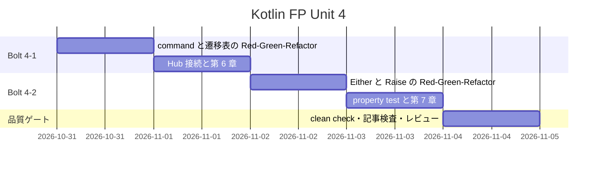
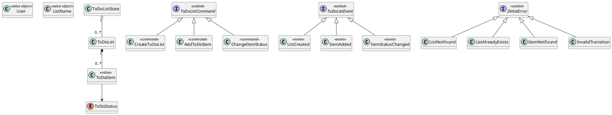
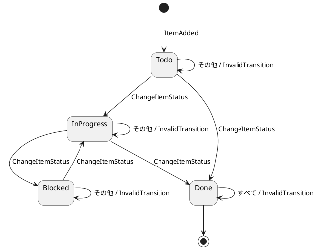
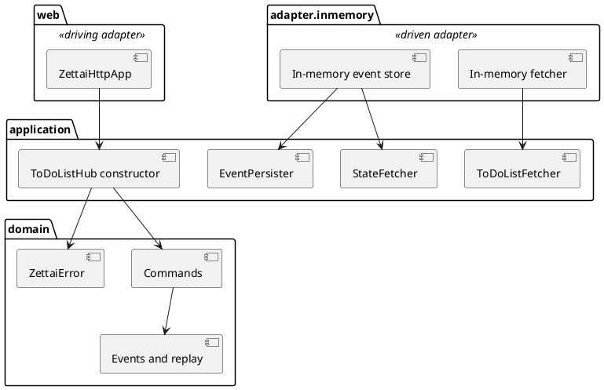

# Unit 4 の Bolt 計画 - Zettai 連載（Kotlin FP 版）

## 概要

| 項目 | 内容 |
| :--- | :--- |
| Unit | 4：command と typed error |
| Bolt | 4-1 第 6 章 / 4-2 第 7 章 |
| 局面 | 中盤 |
| アプローチ | command、遷移表、typed error から外側へ進むインサイドアウト TDD |
| テスト戦略 | Kotest の表駆動テストと property test、既存 Cucumber / Testcontainers 回帰 |
| 見積もり | US-006: 5 SP / US-007: 5 SP、フィーチャバッファ 30% |

## ゴール

利用者の意図を sealed command として表し、現在状態から immutable event を生成する純粋な state machine を作ります。拒否理由は Arrow `Either` と Raise DSL で型に載せ、HTTP 境界まで失敗の意味を保ったまま第 6〜7 章として公開します。

## ユーザーストーリー

### US-006: command から event を生成する

読者として、利用者の意図と既に起きた出来事を区別したいです。それにより、現在状態に応じて command を受理または拒否する純粋な state machine を理解できます。

- [x] `CreateToDoList`、`AddToDoItem`、`ChangeItemStatus` を sealed command ADT で表す
- [x] `ItemStatusChanged` を immutable event として表す
- [x] 4×4 の状態遷移表を 16 マスすべてテストする
- [x] command と現在状態から event または拒否理由を返す純粋関数を実装する
- [x] Hub が `StateFetcher` と `EventPersister` を関数値として受け取る
- [x] 拒否時には event を永続化しない

### US-007: Arrow で typed error を合成する

読者として、`null` や空の event list ではなく失敗理由を型で知りたいです。それにより、呼び出し側が失敗を無視せず、成功経路だけを関数合成できます。

- [x] `ListNotFound`、`ListAlreadyExists`、`ItemNotFound`、`InvalidTransition` を sealed error ADT で表す
- [x] `ToDoListFetcher` と Hub の戻り値を `Either<ZettaiError, T>` にする
- [x] Raise DSL で validation、event 生成、永続化の順序を表す
- [x] `Either.map` の恒等則と合成則を Kotest property testing で検証する
- [x] HTTP adapter が not found を 404、注入した command rejection を 400 に分類する。公開 route は GET のみとする
- [x] Arrow を domain rule の代わりではなく typed error の合成に限定する

## スケジュール

## タスク

### Bolt 4-1: 第 6 章

- [ ] command と遷移表の失敗テストで Red を確認する（初回実装は未 commit のまま進めたため履歴で確認できない。レビュー修正では H1 の Red を確認した）
- [x] `ToDoListCommand` と `ItemStatusChanged` を実装する
- [x] `canTransitionTo` を 16 マスの表駆動テストから実装する
- [x] immutable state への `ItemStatusChanged` 適用を実装する
- [x] pure command handler を実装し、可変参照を渡す aliasing test を先に書く
- [x] Hub へ `StateFetcher` / `EventPersister` を constructor function で注入する
- [x] in-memory driven adapter と HTTP driving adapter の依存方向を境界テストで守る
- [x] 第 6 章を実装済みコードから執筆する

### Bolt 4-2: 第 7 章

- [x] 4 種類の拒否理由を表す `ZettaiError` を実装する
- [x] fetcher と Hub を `Either<ZettaiError, T>` へ段階的に置き換える
- [x] Raise DSL で command execution を合成し、失敗時に persister が呼ばれないことをテストする
- [x] Kotest property testing で `Either.map` の恒等則と合成則を検証する
- [x] HTTP の error mapping（404 / 400）を adapter unit test で検証する。Unit 4 の公開 route は GET のみとする
- [x] Unit 2 の Cucumber は test class filter を使わず module の `clean test` で回帰する
- [x] 第 7 章を「構造 → 性質 → 名前 → 自前抽象との比較」の順で執筆する
- [x] 全体 `clean check` と記事検査を実行する

## 設計

依存方向は **`web -> application -> domain`**、**`adapter.inmemory -> application / domain`** とします。HTTP は driving adapter、in-memory fetcher / event store は driven adapter です。Arrow は domain と application で typed error を表しますが、http4k と coroutine runner は引き続き最外周だけに置きます。

### ドメインモデル図

### 状態遷移図

遷移の自己ループは状態を変更する event ではなく、`InvalidTransition` を返して元の immutable state を保つことを表します。実装では 4×4 の 16 マスを表駆動テストで固定します。

### ER 図

Unit 4 は Unit 3 と同じ in-memory event list を使い、永続化を導入しません。PostgreSQL と ER 図は Unit 5 の対象なので省略します。

### 画面遷移図

Unit 2 の `GET /todo/{user}/{list}` と HTML を変更せず、画面を追加しません。typed error を HTTP status へ写像するだけなので、画面遷移図とユーザーマニュアル更新を省略します。

### アーキテクチャ境界

## 前 Unit からの改善

| Unit 3 の Try | Unit 4 での反映 |
| :--- | :--- |
| read-only と immutable を設計時に区別する | state / adapter に可変入力を渡す aliasing test を先に書く |
| driving / driven adapter の依存矢印を分ける | アーキテクチャ境界図と package 境界テストで別々に表す |
| 章数・固有名詞・参照先を fact check する | 記事検査に加えて索引、著者名、公開章数をレビュー対象にする |
| Cucumber は module の clean test から回帰する | test class filter を使わないコマンドをタスクと DoD に明記する |

Unit 3 レビューの低優先度指摘である fully-qualified reference の検出は package 走査の制約として残します。`runBlocking` は同期 HTTP 境界に限定し、実サーバーと blocking I/O を扱う Unit 5 で再評価します。HTML parser の導入は第 11 章まで保留します。

## リスクと対策

| リスク | 対策 |
| :--- | :--- |
| Chapter 6 と 7 の到達点が混ざる | Red-Green の履歴を記事で示し、最終 module は Arrow typed error まで到達した snapshot と明記する |
| `Either` を使うだけで domain rule が薄くなる | 遷移表と error ADT を先に定義し、Arrow は合成だけに使う |
| Raise DSL 内で副作用が先に実行される | validation の後だけ persister が 1 回呼ばれるテストを置く |
| ポートの型変更が HTTP まで波及する | domain → application → driven adapter → driving adapter の順に置き換え、各段階で compile / test する |
| Arrow API の理解を記事が誤る | version catalog の 2.2.3 でコンパイルした API だけを掲載する |
| 前章 snapshot を壊す | Unit 4 を独立 Gradle subproject とし、Unit 1〜3 を回帰実行する |

## 着手前整合性検証

### 詳細整合性

| 対象 | 結果 | 根拠 |
| :--- | :--- | :--- |
| テンプレート | OK | ゴール、US、スケジュール、設計、リスク、DoD、更新履歴、関連文書を含む |
| ユーザーストーリー | OK | `docs/requirements/user_story.md` は存在しないため、`docs/article/outline.md` の US-006 / US-007 を正として ID、章、焦点を一致させた |
| ドメインモデル | OK | command、`ItemStatusChanged`、4 状態、4 error は共通ドメインモデルの名称と一致。Kotlin FP の Arrow 差分は本 Unit で追記する |
| データモデル | 対象外 | 永続化は Unit 5 で導入する |
| UI ビュー / interaction | 対象外 | 既存 GET と HTML を維持し、画面を追加しない |
| ゴール内部整合 | OK | US → タスク → 受入条件 → デモ項目を対応づけた |
| 前 Unit レビュー | OK | Unit 3 の低優先度 3 件と KPT の Try 4 件を対応方針へ明記した |

### 横断整合性

| 軸 | 結果 | 根拠 |
| :--- | :--- | :--- |
| A 開発戦略 | OK | 中盤のインサイドアウトとして domain rule → application → adapter の順に進める |
| B 設計文書 | OK | 対象範囲のドメインモデル図と状態遷移図を掲載し、ER / 画面遷移図の省略理由を明記した |
| C 過去計画 | OK | Unit 3 の用語、package 依存、module snapshot、`runBlocking` 境界を継承した |

## 完了条件

### Definition of Done

- [x] Unit 4 の table-driven test と property test が green
- [x] Unit 1〜4 の `gradlew.bat clean check --no-daemon` が green
- [x] Unit 2 の Cucumber `clean test` が green
- [x] 第 6〜7 章のコード例が実装と一致する
- [x] 記事コード、節構成、件数、引用、ADR 参照の検査が green
- [x] `mkdocs build --strict` が green
- [x] 第 6〜7 章が索引と nav から到達可能
- [x] アーキテクチャ設計とドメインモデル設計に Unit 4 の判断を反映する
- [x] 5 観点の開発成果物レビューで高・中重要度の残件がない
- [x] OKF 検査が ERROR 0

### デモ項目

- [x] 4×4 の状態遷移表が許可 5 マス、拒否 11 マスを返す
- [x] 同じ command handler が成功 event と具体的な error を返す
- [x] Raise DSL が成功時だけ event を 1 回永続化する
- [x] `Either.map` の恒等則と合成則が生成入力で成り立つ
- [x] HTTP adapter が `ListNotFound` を 404、注入した `InvalidTransition` を 400 に写像する（command route は未接続）

## 更新履歴

| 日付 | 内容 | 更新者 |
| :--- | :--- | :--- |
| 2026-10-31 | 初版。Unit 3 の Try、Arrow 2.2.3、設計 4 図の要否、インサイドアウトの順序を反映 | openai-codex/gpt-5 |
| 2026-10-31 | 5 観点レビューの高・中 15 件を修正し、タスク・DoD・デモ項目の完了を記録 | anthropic/claude-opus-5-5 |

## 関連ドキュメント

- [リリース計画](release_plan-kotlin-fp.md)
- [開発戦略](development_strategy.md)
- [Unit 3 のふりかえり](retrospective-kotlin-fp-3.md)
- [Unit 3 の開発成果物レビュー](../review/kotlin-fp-unit3_review_20261031.md)
- [執筆計画](../article/outline.md)
- [第 6 章（既存 Kotlin 版）](../article/zettai/kotlin/chapter06.md)
- [第 7 章（既存 Kotlin 版）](../article/zettai/kotlin/chapter07.md)
