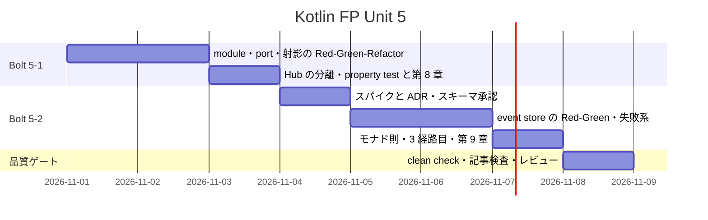
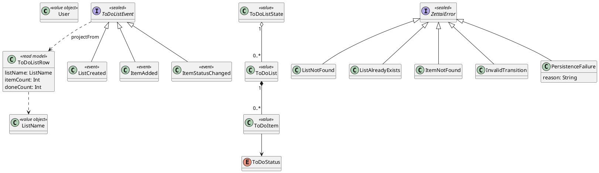
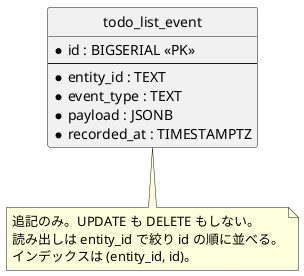
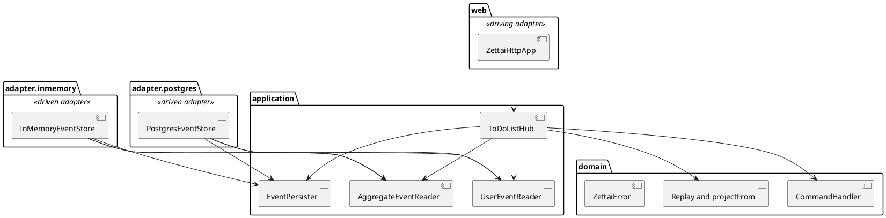

# Unit 5 の Bolt 計画 - Zettai 連載（Kotlin FP 版）

## 概要

| 項目 | 内容 |
| :--- | :--- |
| Unit | 5：射影と永続化 |
| Bolt | 5-1 第 8 章 / 5-2 第 9 章 |
| 局面 | 中盤の最後（Phase 2 の完了） |
| アプローチ | 射影と port の形から外側へ進むインサイドアウト TDD。永続化は adapter から結合テストで固める |
| テスト戦略 | Kotest の表駆動テストと property test、Testcontainers の結合テスト、Cucumber の 3 経路 |
| ゲート密度 | **密に戻す**（停止 6 箇所。Unit 4 は中密度） |
| 見積もり | US-008: 5 SP / US-009: 8 SP、フィーチャバッファ 30% |

## ゴール

イベントから表示用のモデルを射影で作り、コマンド側とクエリ側を別の経路に分けて CQRS に到達します。続けてイベントを PostgreSQL に追記する event store を作り、JDBC の副作用と失敗を `suspend` と `Either` の境界へ閉じ込めて、第 8〜9 章として公開します。Unit 4 のレビューで見つかった「全状態を replay する port」「型で表せない永続化の失敗」「Kotlin FP 版の ADR 不足」を、この Unit で解消します。

## Unit 4 からの引き継ぎ

[Unit 4 のふりかえり](retrospective-kotlin-fp-4.md)の Try と[開発成果物レビュー](../review/kotlin-fp-unit4_review_20261031.md)の引き継ぎ表を、次のステップへ割り当てます。

| # | 引き継ぎ | 消化するステップ |
| :--- | :--- | :--- |
| 1 | `StateFetcher` が全状態を replay する。集約単位で読む port に絞る | 5-1.2 |
| 2 | 読み取り側と event store が未接続。projection と整合性モデルを決める | 5-1.5・5-1.6 |
| 3 | `persist` が型付きの失敗を返せない | 5-2.5 |
| 4 | Kotlin FP 版の ADR が無い（Arrow 採用、関数型 DI、suspend port、`runBlocking` と JDBC）。Try は「着手前」なので、Arrow と関数型 DI の 2 本は 5-1.1 の前に作る | 5-1.0a・5-2.1 |
| 5 | replay が不正な event を黙って捨てる。永続化導入時に検出方針を決める | 5-2.5 |
| 6 | 受入条件ごとに成功側と拒否側のテストを対にする | 受入条件表（後述）と DoD |
| 7 | 計画のタスクに書いたテストを DoD 確認時にテスト名と 1 対 1 で突き合わせる | DoD |
| 8 | 実装の Green ごとに commit し、Red → Green の履歴を残してから記事を書く | 全 Bolt の作業規則 |
| 9 | 記事は「計画用語を使わない」「各章で既存 Kotlin 版との選択差を書く」を自己点検する | 5-1.8・5-2.10 |
| 10 | `gulp mkdocs:build` を CI と同じ `--strict` にするかを検討する | 5-1.0 |

次の項目は、理由を付けてこの Unit に含めません。

| 項目 | 扱い |
| :--- | :--- |
| transaction 境界、その ADR、rollback、競合を表す `ConcurrentModification` | 第 10 章（Unit 6）の主題。この Unit では `persist` の失敗を `PersistenceFailure` で表すところまでとする。Try の ADR 項目のうち transaction 境界だけを Unit 6 へ送る。執筆計画の第 9 章の到達点から rollback を外す |
| 一覧画面の HTTP route と HTML | 追加しない。Unit 2 の画面と HTTP 契約を変えず、射影は Hub の query として検証する |
| `ToDoListState.apply` の改名 | 第 5 章のコード例と物語が崩れるため行わない。理由を第 8 章で一言触れる |
| description の重複を拒否する domain rule | Unit 4 で「前提として明記」と決めた。変更しない |

## ユーザーストーリー

### US-008: 射影でクエリ側を分離する

読者として、画面ごとに状態を読み替える処理が散らばらない方法を知りたいです。それにより、コマンド側とクエリ側を別の経路に分ける CQRS を、困りごとの解決として理解できます。

- [x] 表示用の `ToDoListRow`（リスト名、項目数、完了数）を、イベント列から純粋関数 `projectFrom` で作る
- [x] 項目なし、複数リスト、複数ユーザー、状態変更後の完了数を表駆動テストで固定する
- [x] `Either<ZettaiError, List<ToDoListRow>>` に対する `map` の恒等則と合成則を property test で検証する。外側の `Either` と内側の `List` を重ねた合成も検証する
- [x] command 側の port は `(User, ListName)` で読む集約単位のイベント列、query 側の port は `User` で読むイベント列とし、全状態を replay しない
- [x] `getList` と射影の query は event store を唯一の源とし、別の fetcher を持たない
- [x] command の経路と query の経路が別の関数として Hub に現れる
- [x] 節構成が既存 Kotlin 版の第 8 章（イベントを射影する／ファンクタに対するクエリの実行／ファンクタの観点から考察する／コマンドクエリ責務分離（CQRS）／まとめ）と一致する

### US-009: PostgreSQL に安全に永続化する

利用者として、アプリケーションを再起動しても ToDo リストが残っていてほしいです。それにより、記録する意味のある event store を、副作用と失敗が型に現れる形で理解できます。

- [x] `todo_list_event` に event を追記し、同じ順序で読み戻せる
- [x] 同じ database に Hub と adapter を組み直しても（再起動に相当）、追記済みの event から同じ状態が復元される
- [x] 別の `(User, ListName)` のイベントが混ざらない。区切り文字を含む名前でも `entity_id` が衝突しない
- [x] 接続失敗、未知の `event_type`、壊れた payload を `PersistenceFailure` の `Left` で返し、例外を domain と application に漏らさない
- [x] `EventPersister` が `Either<PersistenceFailure, Unit>` を返し、失敗時は Hub が成功を返さない。計画では `Either<ZettaiError, Unit>` としたが、起こり得る失敗が永続化の失敗だけなので、型を狭めた
- [x] JDBC の blocking I/O と connection の寿命を adapter の `suspend` と resource 境界に閉じ込める。選択は ADR に残す
- [x] flatMap の左恒等則、右恒等則、結合律を property test で検証する
- [x] Cucumber の同じ scenario が domain、HTTP、PostgreSQL の 3 経路で通る
- [x] Testcontainers の結合テストが `./gradlew check` に含まれ、ローカルと CI の両方で通る
- [x] 節構成が既存 Kotlin 版の第 9 章（安全に永続化する／PostgreSQL と結合テスト／Kotlin でデータベースに接続する／データベースを準備する／関数型スタイルでリモートデータにアクセスする／モナドの力を探る／まとめ）と一致する。docker-compose を使う説明は Testcontainers に差し替わるので、選択差として書く

### 受入条件と検証の対応

Unit 4 で、受入条件を片側しか検証していなかった問題が見つかりました。この Unit では条件ごとに成功側と失敗側を対にします。

| 条件 | 成功側のテスト | 失敗側のテスト |
| :--- | :--- | :--- |
| 射影 | 項目数と完了数が合う | 項目のないリスト、未作成リストへの event を含む列で壊れない |
| port の絞り込み | 指定した集約のイベントだけで判断する | 他の集約のイベントが混ざっても判断が変わらない |
| 追記と読み出し | 追記順に同じ event を読み戻す | 別 entity、区切り文字を含む名前で混ざらない |
| 永続化の失敗 | 成功時は `Right` | 接続失敗、未知の `event_type`、壊れた payload は `PersistenceFailure` |
| Hub の保存 | 検証に成功した event だけ 1 回保存する | 拒否時と保存失敗時は成功を返さない |
| HTTP の写像 | 既存の 4 種に加え `PersistenceFailure` を写像する | 全 error type を表駆動で並べ、header も検証する |

## スケジュール

## タスク

作業規則：実装は Green ごとに commit します。実装と記事は別の変更単位にします。

### Bolt 5-1: 第 8 章

- [x] **5-1.0** `gulp mkdocs:build` を CI と同じ `--strict` にするか判断する。変更する場合は `operating-script` スキルで正式なタスクとして直し、運用手順書にも記載する（Unit のクローズ後に実施。`ops/scripts/mkdocs.js` に `--strict` を足し、`gulp mkdocs:build` が成功することを確かめた。運用手順書にこのタスクの記載は無いため、追記先は無い。CI の `npm run docs:build` も同じタスクを使うので、CI も strict の判定になる）
- [x] **5-1.0a** ADR を 2 本作る：Arrow Core を domain と application に使う範囲（遡及）、関数型 DI と suspend port の形。Unit 3〜4 で決めた判断の記録なので、実装を始める前に置く
- [x] **5-1.1** `zettai-step5-cqrs-persistence` module を新設する（**停止 1**：新規 ADR・新規ファイル・構造変更）。Unit 4 の production code と test を独立した snapshot としてコピーし、前段 module へ依存しない。`settings.gradle.kts` に `include` を足し、`build.gradle.kts` に Arrow Fx、PostgreSQL driver、Testcontainers、Cucumber の依存を足す。Unit 4 の module に Cucumber は無いので、feature・steps・runner は Unit 2 の module から移す
- [x] **5-1.2** port を集約単位へ絞る Red を書き、Green にする。command 側が `(User, ListName)` のイベント列だけで判断すること、他の集約が混ざっても判断が変わらないことを表駆動で固定する
- [x] **5-1.3** `projectFrom` の失敗テストで Red を確認し、`fold` で実装する
- [x] **5-1.4** `Either<ZettaiError, List<ToDoListRow>>` の恒等則と合成則を property test にする。生成器は空リスト、複数ユーザー、5 種の error（`PersistenceFailure` を含む）を含める
- [x] **5-1.5** Hub を command 側（`execute`）と query 側（`getList`、`listRows`）に分ける。query は event store を読んで射影し、`ToDoListFetcher` を廃止する。整合性モデル（同じ event store を毎回射影する同期方式で、永続化した射影は作らない）を設計文書に記す
- [x] **5-1.6** driven adapter（in-memory）を新しい port に合わせる。aliasing test を維持し、Unit 2 から移した Cucumber の domain / HTTP 2 経路が新 module で通ることを確認する。Unit 2 の module は別に回帰する
- [x] **5-1.7** アーキテクチャ設計とドメインモデル設計に Unit 5 前半の判断を反映する
- [x] **5-1.8** 第 8 章を実装済みコードから執筆する（**停止 2**：記事の構成と全文）。選択差（自前の `ToDoListProjection.map` と、標準の `List.map` / `Either.map` の合成）を書く

### Bolt 5-2: 第 9 章

- [x] **5-2.1** スパイクで次を確かめ、JDBC の ADR にする（**停止 3**：新規 ADR・外部連携の判断）
  - JDBC を直接使うか（event の追記と読み出しだけなら ORM は不要という仮説）
  - payload の組み立てを、`jsonb_build_object` と bind parameter で済ませるか、JSON ライブラリを足すか。新しい依存は確認必須
  - blocking の JDBC を `Dispatchers.IO` に閉じ込めるか、同期 port に戻すか。`runBlocking` との関係
  - connection の寿命を Arrow の `Resource` で表すか、Kotlin の `use` で足りるか
  - 作る ADR：JDBC の blocking と resource 境界（Arrow と関数型 DI の ADR は 5-1.0a で作成済み）
- [x] **5-2.2** `docs/design/data-model.md` に Kotlin FP 版の差分と ER 図を書く。スキーマは既存 Kotlin 版の `todo_list_event` と同じ振る舞いを保つ（**停止 4**：データベース。確認必須）
- [x] **5-2.3** Testcontainers の結合テストで Red を確認する。追記順、別 entity の分離、区切り文字を含む名前
- [x] **5-2.4** PostgreSQL の event store を adapter に実装して Green にする
- [x] **5-2.5** `PersistenceFailure` を `ZettaiError` に足す。HTTP の写像 `when` が compile error で未対応を示すことを確認してから直す。未知の `event_type` と壊れた payload は decode 時に `Left` にする。orphan event の `apply` が no-op のまま残る理由を記録する
- [x] **5-2.6** `EventPersister` を `Either<ZettaiError, Unit>` へ変え、Hub、in-memory adapter、HTTP を追従させる。保存失敗時に成功を返さないテストを置く
- [x] **5-2.7** flatMap の三法則を property test にする。実 DB は使わず、生成した suspend 関数で検証する
- [x] **5-2.8** Cucumber に PostgreSQL 経路を足し、同じ scenario が 3 経路で通ることを確認する。scenario ごとにテーブルを初期化し、container は suite で共有する
- [x] **5-2.9** アーキテクチャ設計とドメインモデル設計に Unit 5 後半の判断を反映する
- [x] **5-2.10** 第 9 章を実装済みコードから執筆する（**停止 5**：記事の構成と全文）。ここで JSONB が JSON を正規化するかどうかの確認結果を書く
- [x] **5-2.11** 全体 `clean check`、記事検査、5 観点レビュー、再レビューを行う（**停止 6**：レビュー結果の対応方針）。Cucumber は test class filter を使わず module の `clean test` で回帰する

## 設計

依存方向は **`web -> application -> domain`**、**`adapter.inmemory -> application / domain`**、**`adapter.postgres -> application / domain`** とします。JDBC、Testcontainers 以外の PostgreSQL への依存は `adapter.postgres` だけに置き、`domain` と `application` は JDBC を知りません。http4k と coroutine runner は引き続き最外周の `web` だけです。

### ドメインモデル図

`ToDoListRow` は表示のための値で、domain の状態 `ToDoListState` とは別に持ちます。`projectFrom(events)` は `replayFrom` と同じ形の `fold` で、畳み込み先が状態ではなく表示用の行になります。

### 状態遷移図

イベントの種類と状態遷移表は Unit 4 から変わりません。射影は event を読み取るだけで状態を持たないので、新しい状態遷移図は省略します。

### ER 図

スキーマは既存 Kotlin 版の `todo_list_event`（[データモデル設計](../design/data-model.md)）と同じ振る舞いを保ちます。FP 版の差分は、container を Testcontainers が起動し、接続情報だけを動的に注入する点です。`entity_id` は `{user}/{listName}` の複合文字列なので、区切り文字を含む名前の衝突をテストで確かめ、衝突する場合は escape または別カラムを 5-2.2 で決め、既存 Kotlin 版との差分として第 9 章の選択差に書きます。

### 画面遷移図

Unit 2 の `GET /todo/{user}/{list}` と HTML を変更せず、画面を追加しません。射影は Hub の query として検証し、一覧画面の route は追加しないので、画面遷移図とユーザーマニュアル更新を省略します。

### アーキテクチャ境界

port は現行どおり typealias の関数型とし、名前だけ読み取り元を表す `Reader` 系に改めます。名前は 5-1.2 で確定します。

## 前 Unit からの改善

| Unit 4 の Try | Unit 5 での反映 |
| :--- | :--- |
| 受入条件ごとに成功側と拒否側のテストを対にする | 「受入条件と検証の対応」の表を計画に置く |
| 計画のタスクのテストをテスト名と 1 対 1 で突き合わせる | DoD の最後に突合を入れる |
| 実装の Green ごとに commit する | タスクの作業規則に置く |
| 記事の自己点検項目を作る | 5-1.8・5-2.10 に計画用語と選択差の確認を置く |
| Kotlin FP 版の ADR を着手前に作る | Arrow と関数型 DI の 2 本を 5-1.0a で、JDBC と resource を 5-2.1 で作る。いずれも対応する実装の前に置く |
| `gulp mkdocs:build` を strict にするか検討する | 5-1.0 |

Unit 4 の再レビューで「記事の表の内訳が実際と合わない」という指摘が出ました。記事に載せるファイルの対応表は、記憶ではなく `git diff --stat` などで実際の差分を列挙してから書きます。

## リスクと対策

| リスク | 対策 |
| :--- | :--- |
| Testcontainers が起動できない環境で `check` が環境依存になる | skip して green にしない。リリース計画のリスク欄は「必要条件と診断を表示する」としているが、Unit 1 の `PostgreSqlContainerTest` は接続の確認だけで診断を持たない。Docker が無い環境の失敗が原因を示すかを 5-2.3 で確認し、不足なら診断を足す |
| 結合テストが遅い、または相互に干渉する | container は suite で 1 つだけ起動し、テストごとにテーブルを初期化する。3 回連続で green を NFR にする |
| `entity_id` の区切り文字で別の集約が衝突する | `a/b` と `c` の組と `a` と `b/c` の組を結合テストで固定する |
| JSONB が payload を正規化して文字列比較が崩れる | JSON の文字列を直接比較せず、decode した値で比較する。既存 Kotlin 版で踏んだ失敗を第 9 章に書く |
| blocking の JDBC を `runBlocking` の中で呼び、suspend が形式だけになる | 5-2.1 のスパイクで `Dispatchers.IO` か同期 port かを決め、ADR に残す |
| 永続化の失敗を握りつぶして成功を返す | 保存失敗時に Hub が成功を返さないテストを先に置く |
| port の型変更が HTTP まで波及する | Unit 4 と同じ順（domain → application → adapter → web）で置き換え、各段階で compile と test を通す |
| 前章 snapshot を壊す | 独立した Gradle module とし、Unit 1〜4 を回帰実行する |
| property test が正常系だけを生成する | 空リスト、複数ユーザー、4 種の error、区切り文字を含む名前を生成器に含める |

## 着手前整合性検証

### 詳細整合性

| 対象 | 結果 | 根拠 |
| :--- | :--- | :--- |
| テンプレート | OK | ゴール、US、スケジュール、設計 4 図の要否、リスク、DoD、更新履歴、関連文書を含む |
| ユーザーストーリー | OK | `docs/requirements/user_story.md` は存在しない。`docs/article/outline.md` の US-008（第 8 章、5 SP）と US-009（第 9 章、8 SP）に ID、章、焦点、見積もりを一致させた |
| ドメインモデル | 要追記 | `ToDoListRow` と `PersistenceFailure` は共通の用語集に無い。5-1.7 と 5-2.9 で Kotlin FP 版の差分に追記する |
| データモデル | OK | `todo_list_event` と `(entity_id, id)` のインデックスは既存の `data-model.md` と一致。FP 版の差分は 5-2.2 で追記する |
| UI | 対象外 | 画面と HTTP 契約を変更しない |
| ゴール内部整合 | OK | US → タスク → 受入条件の対応表 → デモ項目を対応づけた |
| 前 Unit レビュー | OK | 引き継ぎ 10 件を割り当て、含めない 4 項目に理由を付けた |

### 横断整合性

| 軸 | 結果 | 根拠 |
| :--- | :--- | :--- |
| A 開発戦略 | OK | 中盤のインサイドアウト。局面の割り当て（Unit 5 は密）を維持する。開発戦略の Kotlin FP 版の節に Unit 5 を追記する |
| B 設計文書 | 要追記 | アーキテクチャ設計の段階 module 表に `zettai-step5-cqrs-persistence` を追加する。ER 図は本計画に掲載した |
| C 過去計画 | OK | Unit 4 の package 依存、module snapshot、`runBlocking` を最外周に置く方針を継承した。既存 Kotlin 版の Unit 5 と章構成・US・NFR（3 回連続 green）が一致する |

「要追記」は、設計が正という原則に従い、該当する Bolt のステップで設計文書を直します。

## 完了条件

### Definition of Done

- [x] Unit 5 の表駆動テスト、property test、結合テストが green
- [x] Cucumber の同じ scenario が domain、HTTP、PostgreSQL の 3 経路で green
- [x] 同じ結合テストを 3 回連続で実行して green
- [x] Unit 1〜5 の `gradlew.bat clean check --no-daemon` が green
- [x] 第 8〜9 章のコード例が実装と一致する
- [x] 記事コード、節構成、件数、引用、ADR 参照の検査が green
- [x] `mkdocs build --strict` が green
- [x] 第 8〜9 章が索引と nav から到達可能
- [x] アーキテクチャ設計、ドメインモデル設計、データモデル設計に Unit 5 の判断を反映する
- [x] ADR 3 本（Arrow の採用範囲、関数型 DI と suspend port、JDBC と resource 境界）が作成されている。transaction 境界の ADR は Unit 6
- [x] 計画のタスクに書いたテストが、テスト名と 1 対 1 で対応している
- [x] 5 観点の開発成果物レビューで高・中重要度の残件がない
- [x] OKF 検査が ERROR 0
- [ ] push 後の CI が green（push は人の承認を得て行う）

### デモ項目

- [x] 同じイベント列から command 側の状態と query 側の行が別の経路で得られる
- [x] command 側は指定した集約のイベントだけを読み、他の集約が混ざっても判断が変わらない
- [x] `Either<ZettaiError, List<ToDoListRow>>` の `map` が恒等則と合成則を満たす
- [x] event を追記して別の接続で読み戻すと、同じ順序で復元される
- [x] 接続できない状態で保存すると `PersistenceFailure` が返り、成功を返さない
- [x] 同じ scenario が 3 経路で通る

## 更新履歴

| 日付 | 内容 | 更新者 |
| :--- | :--- | :--- |
| 2026-10-31 | 初版。Unit 4 のふりかえりとレビューの引き継ぎ、設計 4 図の要否、ゲート密度を反映 | anthropic/claude-sonnet-5-5 |
| 2026-10-31 | 実装、品質ゲート、5 観点レビューの完了を反映。永続化の失敗の型を `PersistenceFailure` に狭めたことを受入条件に記録。push 後の CI は未実施 | anthropic/claude-sonnet-5-5 |
| 2026-10-31 | 5-1.0 を実施。`gulp mkdocs:build` を `--strict` にした | anthropic/claude-sonnet-5-5 |

## 関連ドキュメント

- [リリース計画](release_plan-kotlin-fp.md)
- [開発戦略](development_strategy.md)
- [Unit 4 のふりかえり](retrospective-kotlin-fp-4.md)
- [Unit 4 の Bolt 終了報告](bolt_report-kotlin-fp-4.md)
- [Unit 4 の開発成果物レビュー](../review/kotlin-fp-unit4_review_20261031.md)
- [執筆計画](../article/outline.md)
- [データモデル設計](../design/data-model.md)
- [第 8 章（既存 Kotlin 版）](../article/zettai/kotlin/chapter08.md)
- [第 9 章（既存 Kotlin 版）](../article/zettai/kotlin/chapter09.md)
- [Unit 5 の Bolt 計画（既存 Kotlin 版）](iteration_plan-5.md)
