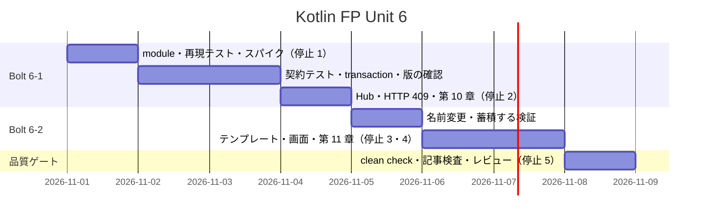
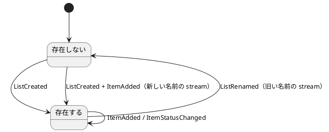
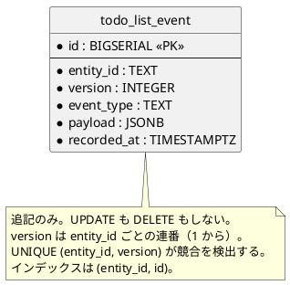
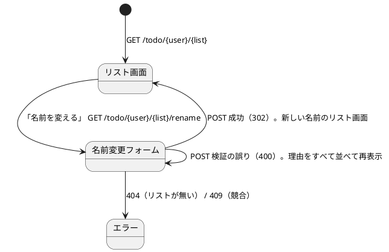
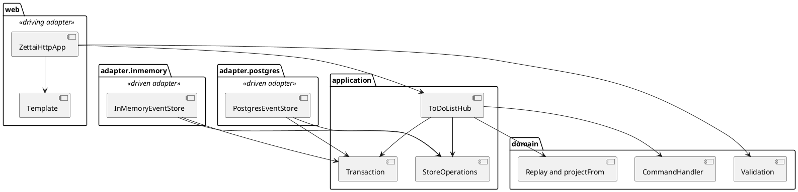

# Unit 6 の Bolt 計画 - Zettai 連載（Kotlin FP 版）

## 概要

| 項目 | 内容 |
| :--- | :--- |
| Unit | 6：transaction と検証 |
| Bolt | 6-1 第 10 章「コンテキストを読み込み、コマンドを処理する」 / 6-2 第 11 章「アプリカティブによるデータバリデーション」 |
| 局面 | 終盤（アウトサイドイン）。中盤からの移行 |
| アプローチ | 業務シナリオの失敗（並行する command、複数の入力の誤り）を受け入れ側から再現し、内側へ進める |
| テスト戦略 | 結合テスト（Testcontainers）、store の契約テスト（in-memory と PostgreSQL の両方）、Kotest の property test、Cucumber の 3 経路 |
| ゲート密度 | **中**（停止 5 箇所） |
| 見積もり | US-010: 5 SP / US-011: 5 SP、フィーチャバッファ 30% |

ゲート密度の根拠：Unit 5 は新しいデータベース、スキーマ、ADR、外部連携が集中したので密（6 箇所）でした。Unit 6 は、スキーマの変更と画面の追加を含むので疎には戻せませんが、残りは既存のドメインを組み合わせる作業が主です。そのため、停止する箇所を 1 つ減らした 5 箇所とします。

## ゴール

command 1 つの処理（読み出し、判断、保存）を 1 つの transaction にし、競合を版の確認で検出して、第 10 章として公開します。続けて、名前変更の command、複数の入力の誤りをすべて集める検証、エラーを表示するテンプレート描画を作り、第 11 章として公開します。Unit 5 で記録した並行実行の問題を、再現するテストから始めて直します。

## 設計上の発見：名前変更は集約の境界を越える

Unit 5 の event store は、`(User, ListName)` ごとに event の列（以下 stream）を分けています。名前変更はこの前提と衝突します。

| 状況 | 起こること |
| :--- | :--- |
| `book` を `novel` に変名する | `ListRenamed` を `book` の stream に書くと、`novel` の stream は空のままで、`getList(novel)` が `ListNotFound` になる |
| 変名先がすでに存在するか確かめる | `novel` の stream も読まないと判断できない。1 つの command が 2 つの stream に触れる |

開発戦略は、終盤で新しい集約の必要が出たとき、中盤の見落としの合図としています。この発見はその合図に当たります。「リスト名がユーザーの中で一意」という業務ルールは、ユーザー単位の整合性を求めていました。Unit 5 は「リスト名ごとの stream」を前提にしましたが、今回は設計を作り直さず、複数の stream を 1 つの transaction で書く形で吸収します。選んだ理由と、作り直す案を採らなかった理由は ADR に残します。

### 変名を表す event の組

| stream | 書く event | 意味 |
| :--- | :--- | :--- |
| 旧（`book`） | `ListRenamed(book → novel)` | 旧い名前のリストが無くなる |
| 新（`novel`） | `ListCreated(novel)`、各項目の `ItemAdded` | 新しい名前で現在の項目を引き継ぐ |

決める仕様は次のとおりです。

| 論点 | 決定 |
| :--- | :--- |
| `apply(ListRenamed)` の意味 | 旧い名前のリストを**削除するだけ**。新しい stream の `ListCreated` と `ItemAdded` が、新しい名前のリストを作る。二重に適用しない |
| 状態の操作 | `ToDoListState` に、キーを取り除く操作を足す |
| 射影 | 旧い名前の行を消す。新しい名前の行は作成順の末尾に付く。この並びをテストで固定する |
| command が読む stream | command が触れる stream をすべて読む（変名は旧と新の 2 つ）。読む対象は、command から導く |
| 保存 | 触れる stream ごとに期待する版を渡し、1 つの transaction で確定する。どれか 1 つでも版が合わなければ、すべて拒否する |
| 競合した stream | `ConcurrentModification` に、競合した stream の組を持たせる |

### 第 10 章と第 11 章の分担

名前変更の command は第 11 章の題材です。第 10 章は、その土台になる 2 つを扱います。

- 並行する `CreateToDoList` が `ListCreated` を重複させる問題の、再現と修正
- 複数の stream への保存が、1 つの transaction で原子的に確定すること（store の契約として検証する）

## Unit 5 からの引き継ぎ

[Unit 5 の Bolt 終了報告](bolt_report-kotlin-fp-5.md)と[開発成果物レビュー](../review/kotlin-fp-unit5_review_20261031.md)の保留を、次のステップへ割り当てます。

| # | 引き継ぎ | 消化するステップ |
| :--- | :--- | :--- |
| 1 | 並行する `CreateToDoList` が `ListCreated` を重複させ、replay で項目が消える。テストで再現してから直す | 6-1.2・6-1.7 |
| 2 | 版の確認と transaction の境界。スキーマの変更を伴うので確認必須 | 6-1.3・6-1.4 |
| 3 | port の Left の型を `PersistenceFailure` から広げる（`ConcurrentModification`） | 6-1.6 |
| 4 | 「操作ごとに接続を開く」形の見直しと、`Resource` の採否 | 6-1.3 |
| 5 | in-memory adapter の同期（`Mutex`） | 6-1.6 |
| 6 | 受入条件を成功側、失敗側、端の経路の 3 列で対にし、各セルにテスト名を書く | 受入条件表と DoD |
| 7 | 記事の断定表現は、対応するテスト名を示せるものだけに使う | 6-1.9・6-2.8 |
| 8 | 1 つの module に 2 つの章を持つので、前半の章を書く前に、後半で変わる型を一覧する | 6-1.1 |
| 9 | 「再現できない」で止まらず、条件を外側から作る方法を考える | 全 Bolt の作業規則 |
| 10 | データベースのスキーマと新しい ADR は、承認の記録を残す | 6-1.3・DoD |
| 11 | 一時スクリプトはファイルに書いてから実行する | 全 Bolt の作業規則 |
| 12 | データモデルの Kotlin FP 版の差分（Unit 5 分を含む）が `draft` のまま | 6-1.4・DoD |
| 13 | `CatchAll` が捕まえるその他の例外の本文。command route を足す章で見直す | 6-2.6 |

次の項目は、理由を付けてこの Unit に含めません。

| 項目 | 扱い |
| :--- | :--- |
| 競合したときの自動の再試行 | 含めない。`ConcurrentModification` を返すところまで。再試行は呼び出し側の業務判断なので |
| `PersistenceFailure.reason` の記録（logging） | 含めない。第 12 章（Unit 7）の監視で扱う |
| ユーザーマニュアル | 作らない。[開発戦略](development_strategy.md)で打ち切った判断を維持する |
| 認証と CSRF 対策 | 含めない。学習用の画面であり、連載の対象外 |

## ユーザーストーリー

### US-010: command を 1 つの transaction で処理する

利用者として、操作が途中で失敗したときに、半分だけ反映された状態にならないでほしいです。それにより、どこまで進んだか分からない状態から復旧する手間をなくせます。

- [ ] 同じリストへの並行する command が、重複した event を残さない。後から書こうとした側は `ConcurrentModification` を受け取る
- [ ] 読み出し、判断、保存が 1 つの transaction に入る境界が、コードの 1 か所から読み取れる。環境の渡し方は 6-1.3 で決める
- [ ] 複数の stream への保存が 1 つの transaction で確定し、途中で失敗したとき、どの stream にも書き込みが残らない（第 11 章の名前変更が使う）
- [ ] 保存の失敗の型を `StoreError`（`PersistenceFailure`、`ConcurrentModification`）に広げ、HTTP は `ConcurrentModification` を 409 に写像する。読み出しの失敗は `PersistenceFailure` のままにする
- [ ] in-memory と PostgreSQL の store が、同じ契約テストを満たす
- [ ] 節構成が既存 Kotlin 版の第 10 章（モナドでデータベースにアクセスする／ContextReader を使用したコマンドの処理／トランザクションの境界を決める／設計を 2 回間違えた／データベースに対する射影のクエリ／イベントソーシングによるドメインのモデリング／まとめ）と一致する

### US-011: 入力の誤りをまとめて知らせる

利用者として、入力の誤りをまとめて教えてほしいです。それにより、1 つずつ直して送り直す手間をなくせます。

- [ ] リストの名前変更ができる（`RenameToDoList` と `ListRenamed`）。旧い stream と新しい stream を 1 つの transaction で書き、途中で失敗したら、どちらにも残らない
- [ ] 利用者名、リスト名、新しい名前の誤りを、複数の入力にまたがって、最初の失敗で止まらずにすべて集めて返す。1 つの入力の中の複数の規則（空、長すぎる、使えない文字）も同様にする
- [ ] 蓄積する結果の `map` が恒等則と合成則を、蓄積する合成が順序の保存、結合律、単位元を、property test で満たす。アプリカティブ則に対応する性質で、対応関係は第 11 章に表で示す。`flatMap` が最初の失敗で止まることとの対比も、テストで示す
- [ ] 画面がテンプレートから作られ、未適用のタグが残っていたら描画が失敗する
- [ ] 名前を変える画面は、フォームを出す `GET` と、名前を変える `POST` を持つ。成功は 302 で新しい名前の画面へ送り（PRG）、検証の誤りは 400 で同じ画面に理由をすべて並べる。入力した値は保たれ、HTML としてエスケープされる
- [ ] 同じ scenario が domain、HTTP、PostgreSQL の 3 経路で通る
- [ ] 節構成が既存 Kotlin 版の第 11 章（ToDo リストの名前変更／2 つのパラメータを持った検証／バリデーションを使った検証／アプリカティブファンクタの結合／ユーザインタフェースの改善／まとめ）と一致する

### 受入条件と検証の対応

条件ごとに、成功側、失敗側、端の経路のテストを書きます。テスト名は実装時に記入し、Bolt 終了報告で突合します。

| 条件 | 成功側 | 失敗側 | 端の経路 |
| :--- | :--- | :--- | :--- |
| 並行する command | 1 つだけ成功し、event は重複しない | 後の側は `ConcurrentModification` | HTTP は 409。in-memory と PostgreSQL で同じ結果 |
| transaction | 読み出し、判断、保存が 1 つの単位で確定 | 保存の途中で失敗すると何も残らない | 複数の stream への保存は、どの stream にも残らない |
| store の契約 | 期待する版で追記でき、版が進む | 古い版での追記は拒否される | in-memory と PostgreSQL が同じテストを通る |
| 名前変更 | 新しい名前で項目を引き継ぐ | 元が無い、変名先がある | `getList` と `listRows` が新しい名前を返し、旧い名前は無い。往復（`a → b → a`）でも項目が二重にならない |
| 蓄積する検証 | 正しい入力は通る | 複数の入力、1 つの入力の複数の規則の誤りをすべて返す | 誤りが 1 つだけでも、3 つ以上でも、順序が保たれる |
| テンプレート | 全タグが適用される | 未適用のタグで失敗する | 値の HTML エスケープ、タグを含む入力値 |
| 画面 | 変更後の画面に移る（302） | 誤りがすべて表示される（400） | `ListNotFound` は 404、`ConcurrentModification` は 409、予期しない例外の本文に内部情報が出ない |

## スケジュール

## タスク

作業規則：実装は Green ごとに commit します。Red のまま commit しません（Red は、ローカルで失敗を確認するだけにします）。実装と記事は別の変更単位にします。一時スクリプトはファイルに書いてから実行します。

### Bolt 6-1: 第 10 章

- [ ] **6-1.1** `zettai-step6-transaction-validation` module を新設する。Unit 5 の production code と test を独立した snapshot としてコピーする。第 11 章で変わる型（`ZettaiError`、HTML の描画、port、`ToDoListState`）を一覧し、第 10 章で先に触れる点を決める
- [ ] **6-1.2** 並行する `CreateToDoList` が `ListCreated` を重複させ、replay で項目が消えることを、テストで再現する。2 つの command が、どちらも保存の前に読み出す順序を、待ち合わせ（`CompletableDeferred`）で作る。Red であることをローカルで確認し、このテストは 6-1.7 の Green と同じ変更単位で commit する
- [ ] **6-1.3** スパイクで次を確かめ、ADR にする（**停止 1**：データベースのスキーマ変更、新しい ADR、依存の追加。確認必須）
  - 環境を引数に取る形（型引数 `Tx` を通す）と、coroutine の context に載せる形の比較。基準は、transaction の境界がコードから読めるか
  - `Resource` と `use` の比較。複数の操作にまたがる connection で差が出るか。`Resource` を採る場合は、`arrow-fx-coroutines` を module の依存に足す（version catalog にはある）
  - 版の持ち方：stream ごとの連番 `version` と `UNIQUE (entity_id, version)` で、競合を一意制約の違反として検出する
  - port の形：読み出しは stream の版を返し、保存は触れる stream ごとの期待する版を受け取る
  - 作る ADR：transaction の境界と環境の渡し方、楽観ロック（版の確認）、複数 stream を 1 つの transaction で書く判断
- [ ] **6-1.4** `docs/design/data-model.md` に `version` 列と一意制約を書く。`CREATE TABLE IF NOT EXISTS` は既存のテーブルを変えないため、既存データを持たない結合テストの DB を前提にし、その旨を明記する。Unit 5 から `draft` のままの Kotlin FP 版の差分も、あわせて承認を得る
- [ ] **6-1.5** store の契約テストを書く（ローカルで Red を確認）。期待する版での追記、古い版での拒否、複数の stream への書き込みの原子性、保存の途中の失敗で何も残らないこと。in-memory と PostgreSQL の両方に同じテストを通す
- [ ] **6-1.6** port の型を変えて Green にする。保存の失敗の型を `StoreError`（`PersistenceFailure`、`ConcurrentModification`）に広げ、HTTP の写像の `when` が compile error で未対応を示すことを確認してから直す。読み出しの失敗の型は `PersistenceFailure` のままにする。PostgreSQL は transaction の中で動かし、in-memory は `Mutex` で同期する。波及したファイルを `git diff --stat` で数える
- [ ] **6-1.7** Hub の `execute` を 1 つの transaction で包み、6-1.2 の再現テストを Green にする。後から書こうとした側が `ConcurrentModification` を受け取り、event が重複しないことを確かめる。HTTP の写像を 409 にする
- [ ] **6-1.8** 設計文書（アーキテクチャ設計、ドメインモデル設計）に前半の判断を反映する
- [ ] **6-1.9** 第 10 章を実装済みコードから執筆する（**停止 2**：記事の構成と全文）。第 2 見出しは既存 Kotlin 版と同じ並びにする。「設計を 2 回間違えた」の節には、実装中に実際に踏んだ失敗だけを書く。踏まなかった場合は、そう書く。断定する表現は、対応するテスト名を示せるものだけにする（自己点検）

### Bolt 6-2: 第 11 章

- [ ] **6-2.1** 名前変更の受け入れ scenario を書く（ローカルで Red を確認）。成功、複数の誤りの表示、変名先がすでにある場合。domain、HTTP、PostgreSQL の 3 経路で動かす
- [ ] **6-2.2** `RenameToDoList` と `ListRenamed` を domain に足す（Red → Green）。handler は、command が触れる stream の状態を見て判断する。`ToDoListState` の削除の操作、`apply(ListRenamed)`（旧い名前を削除するだけ）、射影（旧い行を消し、新しい行は末尾）、store への書き込み（2 つの stream）を実装する。往復（`a → b → a`）のテストを置く
- [ ] **6-2.3** 入力の検証を蓄積する形で書く（Red → Green）。Arrow の蓄積の API は、固定した版（2.2.3）でコンパイルできるものだけを使う。`flatMap` が最初の失敗で止まることを対比するテストを置く
- [ ] **6-2.4** 蓄積する合成の性質を property test で確かめる。`map` の恒等則と合成則、順序の保存、結合律、単位元
- [ ] **6-2.5** テンプレートの描画を決める（**停止 3**：新しい依存を入れる場合は確認必須）。既製の道具を調べ、未適用のタグを失敗にできるか、新しい依存に見合うかを確かめる。既定は、小さな自前の関数
- [ ] **6-2.6** テンプレートから画面を作り、名前を変える画面の `GET` と `POST`、誤りの表示を作る。未適用のタグで描画が失敗すること、値のエスケープ、入力値の保持をテストする。`CatchAll` が返す予期しない例外の本文に、内部情報が出ないことを確かめ、出るなら固定の本文にする
- [ ] **6-2.7** 設計文書（ドメインモデル、UI 設計）に反映する。UI 設計の既存の記述（`GET` と `POST`、成功は 302）と矛盾しないことを確かめる
- [ ] **6-2.8** 第 11 章を実装済みコードから執筆する（**停止 4**：記事の構成と全文）。断定する表現は、対応するテスト名を示せるものだけにする（自己点検）
- [ ] **6-2.9** 全体 `clean check`、記事検査、5 観点レビュー、再レビューを行う（**停止 5**：レビュー結果の対応方針）

## 設計

依存方向は Unit 5 と同じ **`web -> application -> domain`**、**`adapter.inmemory` / `adapter.postgres -> application / domain`** です。transaction の環境は application の型として通し、`java.sql` を知るのは `adapter.postgres` だけにします。

### ドメインモデル図

```plantuml
@startuml
hide methods

class User <<value object>>
class ListName <<value object>>
class ToDoItem <<value>>
class ToDoListState <<value>>

interface ToDoListCommand <<sealed>>
class CreateToDoList <<command>>
class AddToDoItem <<command>>
class ChangeItemStatus <<command>>
class RenameToDoList <<command>> {
  newName: ListName
}

interface ToDoListEvent <<sealed>>
class ListCreated <<event>>
class ItemAdded <<event>>
class ItemStatusChanged <<event>>
class ListRenamed <<event>> {
  newName: ListName
}

interface ZettaiError <<sealed>>
class ListNotFound
class ListAlreadyExists
class ItemNotFound
class InvalidTransition
class InvalidInput {
  problems: NonEmptyList<InputProblem>
}
interface StoreError <<sealed>>
class PersistenceFailure
class ConcurrentModification {
  streams: List<Pair<User, ListName>>
}

interface InputProblem <<sealed>>
class Blank
class TooLong
class ForbiddenCharacter

ToDoListCommand <|-- CreateToDoList
ToDoListCommand <|-- AddToDoItem
ToDoListCommand <|-- ChangeItemStatus
ToDoListCommand <|-- RenameToDoList
ToDoListEvent <|-- ListCreated
ToDoListEvent <|-- ItemAdded
ToDoListEvent <|-- ItemStatusChanged
ToDoListEvent <|-- ListRenamed
ZettaiError <|-- ListNotFound
ZettaiError <|-- ListAlreadyExists
ZettaiError <|-- ItemNotFound
ZettaiError <|-- InvalidTransition
ZettaiError <|-- InvalidInput
ZettaiError <|-- StoreError
StoreError <|-- PersistenceFailure
StoreError <|-- ConcurrentModification
InputProblem <|-- Blank
InputProblem <|-- TooLong
InputProblem <|-- ForbiddenCharacter
InvalidInput --> InputProblem
@enduml
```

### 状態遷移図

リストの生存期間に、名前変更が加わります。

名前変更は、旧い名前の stream では「リストが無くなる」遷移、新しい名前の stream では「リストが作られる」遷移として表します。2 つは 1 つの transaction で確定します。

### ER 図

### 画面遷移図

[UI 設計](../design/ui_design.md)の「名前を変える画面」に従います。

### アーキテクチャ境界

型と名前は仮です。6-1.3 のスパイクで確定します。

## 前 Unit からの改善

| Unit 5 の Try | Unit 6 での反映 |
| :--- | :--- |
| 受入条件を成功側、失敗側、端の経路の 3 列にし、各セルにテスト名を書く | 「受入条件と検証の対応」の表を 3 列にした。テスト名は実装時に記入し、終了報告で突合する |
| 記事の断定表現は、対応するテスト名を示せるものだけに使う | 6-1.9・6-2.8 のタスクに自己点検として書いた |
| 後半で変わる型を一覧してから前半の章を書く | 6-1.1 に置く |
| 「再現できない」で止まらず、条件を外側から作る | 作業規則に置く。並行の再現は、待ち合わせで読み出しの順序を作る |
| スキーマと新しい ADR は承認の記録を残す | 6-1.3 を停止にし、DoD に承認を入れる |
| 一時スクリプトはファイルに書いてから実行する | 作業規則に置く |

## リスクと対策

| リスク | 対策 |
| :--- | :--- |
| 名前変更が 2 つの stream に触れ、設計が複雑になる | 変名を `ListRenamed` と、新しい stream の `ListCreated`・`ItemAdded` の組で表し、仕様の表で決めておく。契約テストで原子性を固定する |
| 一意制約の違反を、他の失敗と区別できない | SQLState `23505` を `ConcurrentModification` にし、それ以外は `PersistenceFailure`。両方をテストする |
| 競合のテストが不安定になる | 時間や順序に頼らず、待ち合わせ（`CompletableDeferred`）で読み出しの順序を作る。3 回連続で通ることを確かめる |
| port の型変更が広く波及する | 第 7 章と同じ順（domain → application → adapter → web）で置き換え、波及したファイルを `git diff --stat` で数える |
| in-memory が PostgreSQL と違う振る舞いになる | 同じ契約テストを両方に通す |
| 蓄積の API が固定した Arrow の版に無い | 6-2.3 の先頭で、固定した版でコンパイルできる API を確かめる |
| テンプレートの値による HTML 注入 | 値は必ずエスケープし、タグを含む入力値をテストする |
| 画面の変更で Cucumber の HTTP 経路が壊れる | 一覧の `<li>` の形を維持し、3 経路の scenario を回帰として毎回通す |
| 前章 snapshot を壊す | 独立した Gradle module とし、Unit 1〜5 を回帰実行する |

## 着手前整合性検証

### 詳細整合性

| 対象 | 結果 | 根拠 |
| :--- | :--- | :--- |
| テンプレート | OK | ゴール、US、スケジュール、設計 4 図、リスク、DoD、更新履歴、関連文書を含む |
| ユーザーストーリー | OK | `docs/requirements/user_story.md` は存在しない。`docs/article/outline.md` の US-010・US-011（5 SP ずつ）と、章タイトル、焦点を一致させた |
| ドメインモデル | 要追記 | `RenameToDoList`、`ListRenamed`、`StoreError`、`InvalidInput` は共通の用語集に無い。6-1.8・6-2.7 で追記する |
| データモデル | 要追記 | `version` 列と一意制約は 6-1.4 で追記する |
| UI | OK | `GET` のフォームと `POST`（成功は 302、誤りは 400）は、UI 設計の「名前を変える画面」と一致 |
| 前 Unit の保留 | OK | 引き継ぎ 13 件を割り当て、含めない 4 項目に理由を付けた |

独立した検証（読み取り専用のエージェント 1 体）で 16 件の指摘が出ました。名前変更の置き場所の矛盾、仕様の欠け、番号の食い違い、画面の記述の不一致です。すべて本計画に反映しました。

### 横断整合性

| 軸 | 結果 | 根拠 |
| :--- | :--- | :--- |
| A 開発戦略 | OK | 終盤のアウトサイドイン。名前変更の発見が、新しい集約の合図に当たることを書いた。開発戦略に Unit 6 の節を追記済み |
| B 設計文書 | 要追記 | アーキテクチャ設計の段階 module 表に `zettai-step6-transaction-validation` を足す |
| C 過去計画 | OK | Unit 5 の package 依存、module の snapshot、port の型変更の波及を数える方針を継承した |

## 完了条件

### Definition of Done

- [ ] Unit 6 の契約テスト、結合テスト、property test、Cucumber の 3 経路が green
- [ ] 同じ結合テストを 3 回連続で実行して green
- [ ] Unit 1〜6 の `gradlew.bat clean check --no-daemon` が green
- [ ] 第 10〜11 章のコード例が実装と一致する
- [ ] 記事コード、節構成、件数、引用、ADR 参照の検査が green
- [ ] `mkdocs build --strict` が green
- [ ] 第 10〜11 章が索引と nav から到達可能
- [ ] アーキテクチャ設計、ドメインモデル設計、データモデル設計、UI 設計に Unit 6 の判断を反映する
- [ ] ADR が作成され、データベースのスキーマ変更、データモデルの Kotlin FP 版の差分とともに、人の承認を得ている
- [ ] 受入条件の表の各セルが、テスト名と 1 対 1 で対応している
- [ ] 5 観点の開発成果物レビューで高・中重要度の残件がない
- [ ] OKF 検査が ERROR 0
- [ ] push 後の CI が green（push は人の承認を得て行う）

### デモ項目

- [ ] 同じリストへ並行する 2 つの command のうち、1 つだけが成功し、event は重複しない
- [ ] 複数の stream への保存の途中で失敗すると、どの stream にも何も残らない
- [ ] 名前変更の後、`getList` と `listRows` が新しい名前を返し、旧い名前は無い
- [ ] 空で長すぎる名前を送ると、誤りがすべて画面に表示される
- [ ] 未適用のタグがあるテンプレートは、描画が失敗する
- [ ] 同じ scenario が 3 経路で通る

## 更新履歴

| 日付 | 内容 | 更新者 |
| :--- | :--- | :--- |
| 2026-10-31 | 初版。Unit 5 の保留、名前変更が集約の境界を越える発見、設計 4 図、ゲート密度を反映 | anthropic/claude-sonnet-5-5 |
| 2026-10-31 | 独立した検証の 16 件を反映。名前変更の command を第 11 章に置き、第 10 章は複数 stream の原子的な保存までとした。仕様の表、画面の記述、番号の食い違いを直した | anthropic/claude-sonnet-5-5 |
| 2026-10-31 | 人（kakimomokuri）が計画を承認した。あわせて、`todo_list_event` への `version` 列（INTEGER NOT NULL）と `UNIQUE (entity_id, version)` の追加を承認した。対象は新しい module の Testcontainers の DB だけ。スパイクで使えないと分かったら、あらためて確認する | anthropic/claude-sonnet-5-5 |

## 関連ドキュメント

- [リリース計画](release_plan-kotlin-fp.md)
- [開発戦略](development_strategy.md)
- [Unit 5 のふりかえり](retrospective-kotlin-fp-5.md)
- [Unit 5 の Bolt 終了報告](bolt_report-kotlin-fp-5.md)
- [Unit 5 の開発成果物レビュー](../review/kotlin-fp-unit5_review_20261031.md)
- [執筆計画](../article/outline.md)
- [データモデル設計](../design/data-model.md)
- [UI 設計](../design/ui_design.md)
- [第 10 章（既存 Kotlin 版）](../article/zettai/kotlin/chapter10.md)
- [第 11 章（既存 Kotlin 版）](../article/zettai/kotlin/chapter11.md)
- [Unit 6 の Bolt 計画（既存 Kotlin 版）](iteration_plan-6.md)
