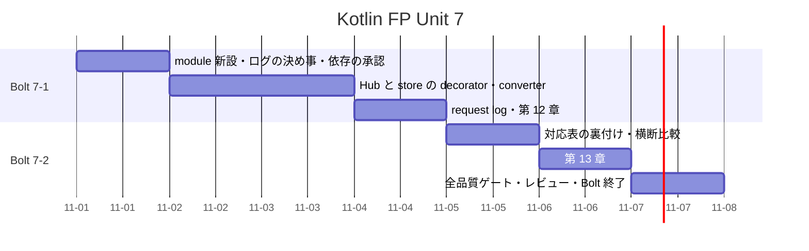

# Unit 7 の Bolt 計画 - Zettai 連載（Kotlin FP 版）

## 基本情報

| 項目 | 内容 |
| :--- | :--- |
| Unit | 7：監視と総括 |
| Bolt | 7-1 第 12 章「監視と関数型JSON」 / 7-2 第 13 章「関数型アーキテクチャの設計」 |
| 対象ストーリー | US-012（構造化ロギングと関数型 JSON、プロファンクタ）、US-013（設計判断の総括） |
| 前提 | [Unit 6 の Bolt 終了報告](bolt_report-kotlin-fp-6.md)。新しい module `zettai-step7-observability` を Unit 6 の snapshot から作る |
| 局面 | 終盤（アウトサイドイン）。最後の Unit |
| アプローチ | 運用で見たい事実（何が起きたか、機密が漏れていないか）を受け入れ側から書き、内側へ進める。第 13 章は実装を足さず、既存の判断をテストと文書で裏付ける |
| テスト戦略 | 性質テスト（converter の恒等則と合成則、往復）、decorator のテスト（ログに載るもの、載らないもの）、既存の契約テストと Cucumber の 3 経路は変えない |
| ゲート密度 | **疎**（停止 3 箇所 + 条件付き 1） |
| 見積もり | US-012: 5 SP / US-013: 3 SP、フィーチャバッファ 30% |

ゲート密度の根拠：Unit 7 の実装は、既存の Hub と store を包む decorator と、新しい変換の層です。スキーマの変更は無く、既存の判断を覆しません。ただし、JSON の道具は新しい依存の追加で、確認必須です（停止 1）。

## ゴール

Hub と event store を包む decorator で、機密を含まない構造化ログを出し、辞書と JSON の双方向変換を純粋な converter として作り、第 12 章として公開します。続けて、第 1〜12 章の設計判断を関数型アーキテクチャとして総括し、既存 3 版（Kotlin、Rust、なでしこ3）と並べて、第 13 章として公開します。最後に、連載全体（全 13 章、全 module）の品質ゲートを確かめます。

## 設計上の問い

Unit 6 の持ち越しと開発戦略から、この Unit が答える問いは 3 つです。

| 問い | この Unit での答えの出し方 |
| :--- | :--- |
| 副作用（ログ）を、domain に持ち込まずに足せるか | Hub と store を包む decorator にする。domain と application の import は変えない（`BoundaryTest` で固定） |
| ログに載ってはならないものは何か | 載せるもの（command の種類、結果の型、所要時間、stream 数）と、載せないもの（項目の説明、`PersistenceFailure.reason`、利用者の入力そのもの）を、先に表にして、テストで固定する |
| 辞書と JSON の変換を、副作用なしに合成できるか | `Converter<A, B>`（`to` と `from`）を純粋な値にし、`dimap` で入力と出力を写せることを、法則で確かめる |

### ログに載せるもの、載せないもの

| 載せる | 載せない |
| :--- | :--- |
| command または query の種類 | 項目の説明、期日 |
| 結果の型（成功、`ListNotFound`、`ConcurrentModification` など） | `PersistenceFailure.reason`（接続先を含みうる） |
| 利用者名とリスト名（識別子） | 入力された新しい名前の誤った値 |
| 所要時間（ミリ秒） | 例外のスタックトレース |
| store の操作（読み出し、追記）と stream の数、event の件数 | event の payload |

利用者名とリスト名を載せるかどうかは、業務上の判断です。計画では「載せる」とし、停止 2 で人が確認します（個人を特定しうるため）。

## Unit 6 からの引き継ぎ

[Unit 6 の Bolt 終了報告](bolt_report-kotlin-fp-6.md)、[ふりかえり](retrospective-kotlin-fp-6.md)、[開発成果物レビュー](../review/kotlin-fp-unit6_review_20261031.md)の持ち越しを、次のステップへ割り当てます。

| # | 引き継ぎ | 消化するステップ |
| :--- | :--- | :--- |
| 1 | Gradle の実行は `apps/kotlin-fp/zettai` で行い、出力を絞るときは `BUILD` の行が無ければ失敗として扱う | 全 Bolt の作業規則 |
| 2 | ファイルを書き換えるスクリプトは、バックスラッシュを `chr(92)` で組み立てるか、編集ツールを使う。実行後に書き換えたファイルを確かめる | 全 Bolt の作業規則 |
| 3 | `sealed` の制約（同じ package と module）を、型を移す前に確かめる | 全 Bolt の作業規則 |
| 4 | 小さな関数でも、テストを先に走らせて Red を確認する | 全 Bolt の作業規則 |
| 5 | 受入条件の表は、実装中に分かったことで直し、Bolt の終了報告で最終版にする。文言はテスト名で言い直せるものだけにする | 受入条件表・7-2.6 |
| 6 | レビューの指摘は、「直す」「持ち越す」を決める基準（利用者に見えるか、データが壊れるか）を先に持つ | 7-2.5 |
| 7 | 低の持ち越し：`Request.listKey()` の重複 | 7-1.5 |
| 8 | 低の持ち越し：名前変更の成功の知らせ | 含めない（理由は下の表） |
| 9 | HTTP と PostgreSQL の組み合わせが、どの経路でも検証されていない | 7-2.4（第 13 章で「確かめていない組み合わせ」として整理する。検証は含めない） |
| 10 | `Transaction<Tx>` の戻り値が固定されている。command 以外の用途が現れたら総称にする | 含めない。ロギングの decorator は `Transaction` を包まず、`readStream` と `append` を包むので、必要が現れない |

次の項目は、理由を付けてこの Unit に含めません。

| 項目 | 扱い |
| :--- | :--- |
| 名前変更の成功の知らせ | 含めない。画面の改善は第 11 章で一区切りにした。総括の章に、実装を足さない |
| 利用者のリスト一覧の画面 | 含めない。第 8 章の `listRows` を使う画面は連載の範囲外 |
| 分散トレース、メトリクスの収集基盤 | 含めない。構造化ログまでを扱う。収集基盤は運用環境の話で、連載の範囲外 |
| 既存 3 版の記事の修正 | 含めない。比較は第 13 章と横断比較に書き、既存の記事は変えない |
| GitHub Release、バージョンタグの作成 | 含めない。外向きで戻しにくい操作なので、人が判断する（連載の完了報告書は作る） |

## 見積もり

| ストーリー | SP | 見積もりの根拠 |
| :--- | :--- | :--- |
| US-012 | 5 | decorator 2 層（Hub、store）、converter と法則、新しい依存、HTTP の request log、記事 |
| US-013 | 3 | 実装は足さない。対応表の裏付けと、横断比較と、全品質ゲート |

## ユーザーストーリー

### US-012: 運用で何が起きたかを、機密を漏らさずに知る

運用者として、command と store の操作が何をして、どう終わったかを、構造化されたログで知りたいです。それにより、障害の原因を、利用者の入力を見ずに追えます。

- [ ] Hub を包む decorator が、command または query ごとに 1 行の構造化ログ（JSON）を出す。載せるものは上の表のとおり
- [ ] ログに、項目の説明、`PersistenceFailure.reason`、例外のスタックトレースが載らない。機密を含む入力で、テストする
- [ ] 失敗（`Left`）も、成功と同じく 1 行で出る。結果の型が載る
- [ ] event store を包む decorator が、読み出しと追記を、stream の数と event の件数と所要時間で記録する。payload は載せない
- [ ] 時刻は引数で与え、テストは決定的に書ける
- [ ] decorator は domain と application の import を増やさない（`BoundaryTest`）。decorator は adapter 側に置く
- [ ] 辞書と JSON の変換を `Converter<A, B>` で表し、`dimap` を持つ。恒等則と合成則、往復（`from(to(x)) == x`）を property test で満たす
- [ ] HTTP の request log（method、path、status、所要時間）を出す。body と query は載せない
- [ ] 節構成が既存 Kotlin 版の第 12 章（アプリケーションを監視する／構造化されたロギング／JSONを関数型にする／プロファンクタとの出会い／データベース呼び出しのロギング／まとめ）と一致する

### US-013: 設計判断を総括する

読者として、13 章で積み上げた設計判断を、ひとつの見取り図として知りたいです。それにより、自分のコードに、どの判断を持ち帰れるかを決められます。

- [ ] 第 13 章の主張を、対応するテストとコードの箇所で裏付ける。5 つの代数構造（モノイド、ファンクタ、モナド、アプリカティブ、プロファンクタ）ごとに、どの章のどのテストが対応するかを表にする。対応が無いものは「無い」と書く
- [ ] effect の境界（`runBlocking` は web だけ、JDBC は adapter だけ）を、`BoundaryTest` のテスト名で示す
- [ ] 採用しなかった道具（`Resource`、Arrow の optics、既製の template エンジン、悲観ロックなど）を、理由つきで列挙する。確かめていないことは、確かめていないと書く
- [ ] 既存 3 版との比較（横断比較）に、Kotlin FP 版の行を足す。数や行は実測から書く
- [ ] 節構成が既存 Kotlin 版の第 13 章（シンプルさを追い求めて／システム全体の設計／コードへの翻訳／最後の考察）と一致する（章末の「連載を終えて」は検査の対象外）
- [ ] 連載全体の品質ゲート（全 13 章の記事検査、全 module の `clean check`、`mkdocs build --strict`、OKF、CI）が green

### 受入条件と検証の対応

条件ごとに、成功側、失敗側、端の経路のテストを書きます。テスト名は実装時に記入し、Bolt 終了報告で突合します。実装中に分かったことで、この表を直します。

| 条件 | 成功側 | 失敗側 | 端の経路 |
| :--- | :--- | :--- | :--- |
| Hub のログ | command の成功が 1 行で出る | `Left` も 1 行で出る。結果の型が載る | query も出る。時刻は決定的 |
| 機密の除外 | 載せるものが載る | 項目の説明、`reason`、スタックトレースが載らない | 入力に JSON の特殊文字が入っても、ログが 1 行の正しい JSON のまま |
| store のログ | 読み出しと追記が記録される | 追記の失敗（`ConcurrentModification`）も記録される | payload が載らない。stream の数が複数（名前変更）でも 1 行 |
| converter | `to` と `from` が往復する | 壊れた JSON は `Left`（例外を投げない） | 恒等則と合成則。`dimap` の入出力の写し |
| request log | method、path、status、所要時間が出る | 404、400、409、500 も出る | body と query が載らない |
| 境界 | decorator が adapter 側にある | domain と application が新しい import を持たない | 既存の `BoundaryTest` が green のまま |
| 総括 | 対応表の各行にテスト名がある | 対応が無い行は「無い」と明記 | 横断比較の数が実測と一致する |

## スケジュール

## タスク

### Bolt 7-1：第 12 章「監視と関数型JSON」

- [ ] **7-1.1** `zettai-step7-observability` module を新設する。Unit 6 の production code と test を独立した snapshot としてコピーする。第 12 章で変わる型（`ToDoListHub`、`EventStore`、`ZettaiHttpApp`）を一覧し、decorator で包む点を決める
- [ ] **7-1.2** ログに載せるもの、載せないものの表（本計画）をテストにする（ローカルで Red を確認）。決定的な時刻、1 行の JSON、機密の除外
- [ ] **7-1.3** 新しい依存を決める（**停止 1**：新しい依存の追加は確認必須）。既定は `kotlinx-serialization-json`（`JsonElement` の木だけを使い、注釈と plugin は使わない）。既製の道具が無ければ、自前の JSON の ADT と printer になるが、parser まで自作するのは過剰なので、採らない。スパイクで、`JsonElement` の往復と、特殊文字の escape を確かめ、ADR にする
- [ ] **7-1.4** `Converter<A, B>` と `dimap` を作り、法則（恒等則、合成則、往復）を property test で確かめる。壊れた入力は `Left`
- [ ] **7-1.5** Hub の decorator を作る（Red → Green）。載せるものを確かめ、載せないものが載らないことをテストする。利用者名とリスト名を載せるかを確認する（**停止 2**：ログの内容の承認）。`Request.listKey()` の重複（引き継ぎ 7）をこの機会に直す
- [ ] **7-1.6** event store の decorator を作る（読み出し、追記、失敗の記録。payload は載せない）
- [ ] **7-1.7** HTTP の request log の filter を作る。body と query は載せない。404、400、409、500 も記録する
- [ ] **7-1.8** `BoundaryTest` に、decorator が adapter 側にあること、domain と application が新しい import を持たないことを足す
- [ ] **7-1.9** 設計文書（アーキテクチャ設計）に、前半の判断を反映する
- [ ] **7-1.10** 第 12 章を実装済みコードから執筆する（**停止 3**：記事の構成と全文）。第 2 見出しは既存 Kotlin 版と同じ並び。断定する表現は、対応するテスト名を示せるものだけに使う

### Bolt 7-2：第 13 章「関数型アーキテクチャの設計」

- [ ] **7-2.1** 5 つの代数構造と、各章のテストの対応表を、実装から作る。対応が無いものは「無い」と書く
- [ ] **7-2.2** effect の境界を、`BoundaryTest` のテスト名で示す表を作る
- [ ] **7-2.3** 採用しなかった道具を、理由つきで列挙する。確かめていないことは、確かめていないと書く
- [ ] **7-2.4** 横断比較（`docs/article/zettai/comparison/index.md`）に Kotlin FP 版の行を足す。数や行は実測から書く
- [ ] **7-2.5** 第 13 章を執筆する（**条件付き停止 4**：総括の主張が、実装で裏付けられない行が出た場合だけ、人に判断を求める）
- [ ] **7-2.6** 連載全体の品質ゲート：全 module の `clean check`、全 13 章の記事検査、`mkdocs build --strict`、OKF、step7 の 3 回連続
- [ ] **7-2.7** 5 観点レビュー、再レビュー、ふりかえり、Bolt 終了報告、連載の完了報告書（`creating-release-report`）。ADR の承認、push、CI は人の承認を得て行う

## 作業規則（ゲート）

| 停止 | 内容 |
| :--- | :--- |
| 1 | 新しい依存（`kotlinx-serialization-json`）と ADR。確認必須 |
| 2 | ログの内容。利用者名とリスト名を載せるか |
| 3 | 第 12 章の構成と全文 |
| 条件付き 4 | 第 13 章の主張のうち、実装で裏付けられない行 |

新しい ADR（ログの decorator、JSON の依存と converter）は、Unit のクローズで人が承認します。承認の記録を残します。

## 完了の定義（DoD）

- [ ] Unit 7 の decorator のテスト、converter の性質テスト、既存の契約テストと Cucumber の 3 経路が green
- [ ] 同じ結合テストを 3 回連続で実行して green
- [ ] Unit 1〜7 の `gradlew.bat clean check --no-daemon` が green
- [ ] 第 12〜13 章のコード例が実装と一致する
- [ ] 記事コード、節構成、件数、引用、ADR 参照の検査が全 13 章で green
- [ ] `mkdocs build --strict` が green
- [ ] 第 12〜13 章が索引と nav から到達可能。横断比較に Kotlin FP 版が載る
- [ ] アーキテクチャ設計に Unit 7 の判断を反映する
- [ ] ADR が作成され、人の承認を得ている
- [ ] 受入条件の表の各セルが、テスト名と 1 対 1 で対応している
- [ ] 5 観点の開発成果物レビューで高・中重要度の残件がない（再レビューで確認）
- [ ] OKF 検査が ERROR 0
- [ ] push 後の CI が green（push は人の承認を得て行う）
- [ ] 連載の完了報告書がある

### 受入条件（検証可能な表現）

- [ ] 機密を含む入力を処理しても、ログに項目の説明、`reason`、スタックトレースが載らない
- [ ] ログの各行が、特殊文字を含む入力でも、正しい JSON の 1 行である
- [ ] `Converter` が恒等則、合成則、往復を満たす
- [ ] decorator を外しても、Hub の振る舞いが変わらない
- [ ] 第 13 章の対応表の各行が、テスト名か「無い」で埋まっている

## リスク

| リスク | 対応 |
| :--- | :--- |
| ログに機密が漏れる | 載せるものを表にして、載せないものが載らないことをテストする。例外のスタックトレースと `reason` を載せない |
| JSON の自前実装が過剰になる | 新しい依存で `JsonElement` だけを使う（停止 1）。自前の parser は作らない |
| 総括の章が、実装で裏付けられない主張を書く | 対応表の各行にテスト名を要求する。裏付けが無い行は「無い」と書く（条件付き停止 4） |
| 連載全体の品質ゲートが、最後に大量の指摘を出す | 7-2.6 を最後に回さず、7-1 の終わりに全 13 章の記事検査を一度走らせる |
| 横断比較の数が古い | 実測から書き、書いた日付とコミットを残す |
| decorator の時刻・出力先が副作用で、テストが不安定になる | 時刻と出力先を引数で与える。標準出力には書かない |

## 関連ドキュメント

- [リリース計画](release_plan-kotlin-fp.md)
- [開発戦略](development_strategy.md)
- [Unit 6 の Bolt 計画](iteration_plan-kotlin-fp-6.md)
- [Unit 6 のふりかえり](retrospective-kotlin-fp-6.md)
- [Unit 6 の Bolt 終了報告](bolt_report-kotlin-fp-6.md)
- [Unit 6 の開発成果物レビュー](../review/kotlin-fp-unit6_review_20261031.md)
- [執筆計画](../article/outline.md)

## 変更履歴

| 日付 | 内容 | 作成者 |
| :--- | :--- | :--- |
| 2026-10-31 | 初版。Unit 6 の持ち越しと開発戦略を反映し、ログの内容、依存、停止の位置を定めた | anthropic/claude-sonnet-5-5 |
