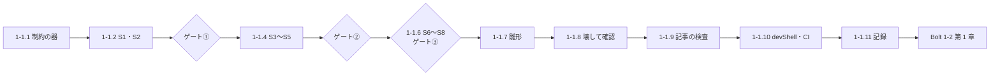

# Unit 1 の Bolt 計画（イテレーション 1）- Zettai 連載（TypeScript FP 版）

## 概要

| 項目 | 内容 |
| :--- | :--- |
| イテレーション | 1（TypeScript FP 版・**初回**） |
| Unit | Unit 1 土台と第 1 章 |
| 期間 | 日付は置きません。最初のコミットから完了のコミットまでをリードタイムとして記録します |
| Bolt | 1-1 前提整備 / 1-2 第 1 章 |
| ストーリー | US-000、US-001 |
| 局面 | 序盤（アウトサイドイン）。Bolt 1-1 は判断と土台を作る段階なので対象外です（[開発戦略](development_strategy.md)） |
| テスト戦略 | Standard |
| 人の検証負荷 | 13 |
| 承認ゲート | 3 箇所 |

**本計画は 2026-11-27 に人の承認を得ました。** 新規ファイルとライブラリの一覧も承認の対象です。

上位の計画は [リリース計画](release_plan-typescript-fp.md)、章の焦点と技術方針は [執筆計画](../article/outline.md) の「TypeScript FP 追加執筆計画」です。

### 承認ゲートの運用形態

**本 Unit のゲートは「同期停止」で運用します。** AI はゲートで止まり、人が選ぶまで次のステップに進みません。

> **本節は人だけが書き換えます。** AI は書き換えません。

| # | ゲート | ステップ | 添えるもの | 記録先 |
| :--- | :--- | :--- | :--- | :--- |
| ① | Effect の版と unstable モジュールの扱い | 1-1.3 | 版の候補、unstable に当たる import path の一覧、各案が第 2・9 章に与える影響 | ADR-053 |
| ② | 実行方法・step の配置・`npm run check` の構成 | 1-1.5 | TypeScript の版と lint の組ごとの実測、各段が守るものと秒数 | ADR-054 |
| ③ | テストと受け入れテストの道具 | 1-1.6 | 候補ごとの動作可否、追加される依存の数、同じ例を書いた行数 | ADR-055 |

変更依頼数は、[リリース計画](release_plan-typescript-fp.md) の定義（ゲートで作り直しや方針変更を求められた回数。表現の調整は含めない）で数えます。**目標は、3 箇所中 2 箇所以上が同期停止することです。**

---

## 持ち込み

この対象は初回なので、前の Unit のふりかえりはありません。直近に完結した対象のふりかえりと完了報告を入力にします。

| # | 持ち込み | 出典 | 消化するステップ |
| :--- | :--- | :--- | :--- |
| 1 | 基盤確認の受け入れテストを、Zettai の業務シナリオと混同しないように明記する | [Kotlin FP 版 Unit 1](retrospective-kotlin-fp-1.md) Problem | 1-1.7 |
| 2 | ふりかえりと Bolt 終了報告を Unit の完了条件に含める | 同上 Problem | 1-2.6、DoD |
| 3 | バックスラッシュを含むスクリプトは、ファイル作成ツールで書く | [Kotlin FP 版 Unit 7](retrospective-kotlin-fp-7.md) Try | 1-1.9 |
| 4 | テストの実行は場所を固定し、実行件数が出力に無ければ失敗として扱う | 同上 Try | 1-1.7、1-1.8 |
| 5 | 記事に数値を書くときは、数え方（コマンド）を残す | [Kotlin FP 版 完了報告](release_report-kotlin-fp-1.0.0.md) | 1-1.5、1-2.3 |
| 6 | 守っていると主張する検査は、壊して落ちることを確かめる | [Scala 版 完了報告](release_report-scala-1.0.0.md) 学び | 1-1.8、1-1.9 |
| 7 | push の前に記事の検査を回す | 同上 | 1-2.5 |
| 8 | コミットの前にステージの内容を確かめ、実装と記事を混ぜない | 同上 失敗 | 全ステップ |
| 9 | 試していない道具は「試していない」と書き、比較の結果のように扱わない | 同上 学び | 1-1.11 |
| 10 | 既知の制約の一覧を Unit 1 から置く。`check` は段を入れる前に、各段が何を守るかを書き出す | [Rust 版 Unit 1](iteration_plan-rust-1.md) | 1-1.1、1-1.5 |

---

## ゴール

> Effect v4 と周辺の道具を実物で確かめて 3 つの判断を下し、`npm run check`・CI・記事の検査を整えて第 1 章を書く。**確認したい仮説**: Effect v4 で、型検査・テスト・Node での実行が 1 つのゲートにまとまる。

仮説が成り立たなかった場合は、その事実を ADR と第 1 章に書き、残りの Unit の計画を直します。

### Unit 完了時の達成状態

- `apps/typescript-fp/zettai/` で `npm run check` が通り、CI でも同じコマンドが通る
- ADR-053〜055 があり、選ばなかった案と代償が書かれている
- 記事の検査が TypeScript のコードに効くことを、壊して確認している
- `apps/typescript-fp/zettai/README.md` に既知の制約の一覧がある
- 第 1 章と `typescript-fp/index.md` が公開されている（1 / 13 章）

### 成功基準

| # | 基準 | 判定方法 |
| :--- | :--- | :--- |
| 1 | `npm run check` が通る | 3 回続けて exit 0。実行されたテストの件数が出力にある |
| 2 | 判断が事実と数字つきで残っている | ADR-053〜055 を読む |
| 3 | 偽の緑が出ない | 「壊して確かめる項目」の全行に結果がある |
| 4 | 記事の検査が効く | 一致しないコードを置くと違反になる。依存の中の行には一致しない |
| 5 | 版が再現できる | 直接依存に `^`・`~` が無く、`package-lock.json` がコミットされ、`npm ci` が通る |
| 6 | 第 1 章が公開されている | 章の検査 5 本と `mkdocs build --strict` が通る |
| 7 | ゲートが機能した | 3 箇所中 2 箇所以上が同期停止した |

---

## 着手前に確認した事実

2026-11-27 に npm レジストリ（`npm view`）と開発機で確認しました。**版の組み合わせが実際に動くかは、まだ確かめていません。**

| 項目 | 事実 | 影響するゲート |
| :--- | :--- | :--- |
| Effect | `effect`・`@effect/vitest`・`@effect/platform-node` の latest は 4.1.6 | ① |
| `@effect/vitest` | peer は `effect ^4.1.6`、`vitest >=5.0.0 <6.0.0` | ③ |
| vitest | latest は 5.1.2。Node は `^22.12.0 \|\| ^24.0.0 \|\| >=26.0.0` | ②③ |
| TypeScript | latest は **7.0.2**（2026-07-08）。6 系の最新は 6.0.3 | ② |
| typescript-eslint | latest は 8.74.0。peer は `typescript >=4.8.4 <6.1.0` で、**7.0.2 は範囲の外** | ② |
| Effect の診断ツール | `@effect/language-service`（0.87.5）の README は、TypeScript 7 以降には `@effect/tsgo`（0.73.7）を使うよう案内している | ② |
| Cucumber | `@cucumber/cucumber` の latest は 13.3.0。Node は `22 \|\| 24 \|\| >=26` | ③ |
| 開発機 | Node 22.23.4、npm 10.9.9、Docker 29.9.3。Nix は無い | ② |
| 既存の devShell | `node` shell は `nodejs_20` と `nodePackages.*`。共通 shell は `nodejs_22` | ② |
| 記事の検査 | `SOURCE_GLOBS` に `apps/**/package.json` が既にあり、生成物の除外は無い。`.ts` は対象外 | — |
| 参考実装 | `tmp/grokkingfp-excersice` のコミット `bb76cc1`（2026-09-28）。fp-ts `^2.16.0`、TypeScript `^5.3.0`、Vitest `^1.0.0` | — |
| ADR | 現在 52 件。次は ADR-053。本文に ADR の件数を書いた章は無い | — |

### ゲート ② の中心になる組み合わせ

TypeScript の版を決めると、使える lint の道具がほぼ決まります。次は npm の情報から立てた候補で、**どれも未検証です。**

| 案 | TypeScript | Effect の診断 | lint / format の候補 | 分かっている制約 |
| :--- | :--- | :--- | :--- | :--- |
| A | 6.0.3 | `@effect/language-service` | `typescript-eslint` + Prettier | 型情報つきの lint が peer の範囲内。TypeScript は 1 つ前のメジャー版になる |
| B | 7.0.2 | `@effect/tsgo` | Oxlint + `oxlint-tsgolint`、または Biome | 最新の版。`typescript-eslint` は範囲の外。`tsgo` が対応する版は限られる |
| C | 7.0.2 | なし | Biome のみ | 依存が少ない。未実行の `Effect` を機械で見つける手段が残るかは分からない |

---

## ユーザーストーリー

### US-000: 前提を整える

> **読者**として、同じ版の環境を再現したい。記事のコードを手元で動かすためだ。

| # | 受入条件 |
| :--- | :--- |
| 1 | 直接依存の版が固定され、`package-lock.json` がコミットされている |
| 2 | `npm ci` の後に `npm run check` が通り、CI でも同じコマンドが通る |
| 3 | テストのコードに型エラーを入れると `npm run check` が失敗する |
| 4 | 記事の検査が `node_modules`・`dist`・`coverage` を見ないことを、壊して確認している |
| 5 | ビルドした出力が Node で実行できる |
| 6 | domain と HTTP の 2 経路と、Testcontainers の PostgreSQL の smoke が通る。Docker が無い場合は skip せず、原因が分かる形で失敗する |
| 7 | Nix の devShell `typescript-fp` で `npm run check` が通る（Docker 上の Nix で確認） |

### US-001: 第 1 章を公開する

> **読者**として、純粋関数と `Effect` の違いをテストで確かめたい。

| # | 受入条件 |
| :--- | :--- |
| 1 | 節構成が [章構成マインドマップ](../article/draft.md) の第 1 章と一致する（読み替えは不要） |
| 2 | 作った時点で動き始める Promise と、実行するまで動かない `Effect` の違いを、副作用の回数を数えるテストで示している |
| 3 | テストの型検査が効くことを、章の中で示している |
| 4 | 記事のコードが実装からの転記である |
| 5 | 「型で守れたこと・守れなかったこと」と「Effect に置き換えたこと・自作で残したこと」がある |
| 6 | 他の対象に無い内容が 1 つ以上ある |

---

## スパイク

**本 Unit の中心です。** スパイクはスクラッチ用のディレクトリで行い、リポジトリにコミットしません。再現に必要な版・コマンド・結果は ADR に書き写します。

| # | 確かめること | 成り立たなかったときの代替 | ゲート |
| :--- | :--- | :--- | :--- |
| S1 | v4 の `Result`・`Context.Service`・`Layer`・testing 系の API と、unstable に当たる import path。移行ガイドの未読ページ | 公式の型定義とソースを一次情報にする | ① |
| S2 | fp-ts の Effect への合流の公式情報 | 公式の記述が見つからなければ、ADR に「確認できなかった」と書き、選定の理由に使わない | ① |
| S3 | 案 A〜C ごとに、型検査・テスト・lint が動くか | 動かない案は、エラーを添えて候補から外す | ② |
| S4 | ESM + NodeNext で、`tsc` の出力・`tsx`・Node の型除去のどれで実行できるか | `tsc` で出力して Node で実行する | ② |
| S5 | テストの型エラー、`R` の解決漏れ、実行していない `Effect`、`await` 漏れのうち、型検査と lint が捕まえるもの | 捕まらないものは既知の制約に書き、テストで守る | ② |
| S6 | `@effect/vitest` と vitest だけの書き方の差。Effect の `Arbitrary` と fast-check の差 | vitest だけで書く | ③ |
| S7 | `@cucumber/cucumber` が選んだ実行方法で動くか。自作 DDT との行数の差 | 自作 DDT にする | ③ |
| S8 | Testcontainers で PostgreSQL を起動できるか（開発機で確かめ、CI は 1-1.10 の追加後に確かめる）。問い合わせはコンテナ内の `psql` で行い、DB のドライバは選ばない | CI だけで実行する案は採らない。原因を調べて停止する | ③ |

S1 の `http`・`sql` は、本 Unit では扱いの方針だけを決めます。HTTP の実装方式は第 2 章、永続化のドライバは第 9 章のゲートで決めます。2 経路の smoke で使う HTTP は確認用で、第 2 章の選定を先取りしません。

---

## 承認の対象となる新規ファイルとライブラリ

**本計画の承認をもって、次の追加を承認とします。** ここに無いものが必要になった場合は、その場で停止します。

### ライブラリ

| 区分 | ライブラリ | 用途 |
| :--- | :--- | :--- |
| 入れる | `effect` | 中心のライブラリ |
| 入れる | `typescript`（版はゲート ②） | 型検査とビルド |
| 入れる | `vitest`、`@types/node` | テスト |
| 入れる | `@testcontainers/postgresql` | 結合テストの smoke |
| 比べて、採ったものだけ入れる | `@effect/vitest`、`fast-check`、`@cucumber/cucumber` | ゲート ③ |
| 比べて、採ったものだけ入れる | `tsx`、`@vitest/coverage-v8` | ゲート ② |
| 比べて、採ったものだけ入れる | `@effect/language-service`、`@effect/tsgo` | ゲート ② |
| 比べて、採ったものだけ入れる | `eslint`、`@eslint/js`、`typescript-eslint`、`eslint-config-prettier`、`prettier`、`@biomejs/biome`、`oxlint`、`oxlint-tsgolint` | ゲート ② |
| 比べて、採ったものだけ入れる | `@effect/platform-node` | unstable な HTTP を試す（ゲート ①） |

これらの推移的な依存は、lock ファイルで確認します。実行環境として、Testcontainers が使う PostgreSQL のコンテナイメージと、CI の `actions/checkout`・`actions/setup-node`・`actions/setup-python`・PlantUML のサービスコンテナ（他の対象の CI と同じ）を使います。

### 新規ファイル

step の配置はゲート ② で決まるため、`apps/` の下は用途で示します。

| 場所 | 内容 |
| :--- | :--- |
| `apps/typescript-fp/zettai/` | `package.json`、`package-lock.json`、`tsconfig*.json`、テストと lint と format の設定、`README.md`（既知の制約の一覧）、第 1 章の step の実装とテスト、smoke（実行・2 経路・Testcontainers） |
| `ops/nix/environments/typescript-fp/shell.nix` | devShell |
| `.github/workflows/typescript-fp-zettai.yml` | `check` と `article` の 2 ジョブ |
| `docs/article/zettai/typescript-fp/` | `index.md`、`chapter01.md` |
| `docs/adr/` | ADR-053〜055 |
| `docs/development/` | `bolt_report-typescript-fp-1.md`、`retrospective-typescript-fp-1.md` |

### 変更する既存ファイル

`flake.nix`、`.gitignore`、`ops/scripts/article/` の `check_article_code.py`・`check_numbers.py`・`check_sections.py`、`mkdocs.yml`、`docs/article/draft.md`、`docs/article/outline.md`、`docs/article/zettai/index.md`、`docs/index.md`、`docs/adr/index.md`、`docs/development/` の索引・リリース計画・開発戦略、`docs/log.md`。

`check_code_style.py` は `.kt` だけが対象のため、変更しません。

---

## Bolt 1-1: 前提整備

### Bolt ゴール

> 道具を実物で確かめて 3 つのゲートで決め、偽の緑が出ない `npm run check` と CI を作る。

### ステップ計画

状態は `[ ]` 未着手、`[-]` 進行中、`[?]` 承認待ち、`[R]` 修正中、`[x]` 完了、`[S]` スキップです。

- [x] **1-1.1 既知の制約の一覧の器を作る**（持ち込み 10）
  - 完了判定: `README.md` に見出しと表がある
  - **実績（2026-11-27）**: `apps/typescript-fp/zettai/README.md` に 3 つの表を置いた
- [x] **1-1.2 スパイク: Effect v4 と fp-ts の合流**（S1・S2）
  - 完了判定: 確かめた API と import path に、出典か最小テストの結果が付いている。読めなかったページを明記している
  - **実績（2026-11-27）**: 下の「S1・S2 の結果」
- [x] **1-1.3 ★ゲート ①: Effect の版と unstable の扱い**
  - 完了判定: 人が選び、ADR-053 を書いた
  - **実績（2026-11-27。同期停止した）**: 人が案 A（stable を原則にし、unstable は承認したものだけを adapter に閉じ込める）を選んだ。版は 4.1.6 に固定する。変更依頼は 0 回（[ADR-053](../adr/ADR-053-typescript-effect-version-and-stability.md)）
- [x] **1-1.4 スパイク: TypeScript・lint・実行方法**（S3〜S5）
  - 案 A〜C で同じ小さなコードを型検査・テスト・lint にかける
  - 完了判定: 4 種類の壊し方それぞれについて、案ごとに「捕まえた / 捕まえない」の表がある
  - **実績（2026-11-27）**: 下の「S3〜S5 の結果」。未実行の `Effect` と `await` 漏れは 2 通りずつに分け、6 種類で比べた
- [x] **1-1.5 ★ゲート ②: 実行方法・step の配置・`npm run check`**
  - **段を入れる前に、各段が何を守るかを書き出す。** 守るものが無い段は入れない
  - 開発機の Node 22 と devShell の Node の版の扱いも決める
  - 完了判定: 人が選び、ADR-054 を書いた。段ごとの秒数と、測ったコマンドが残っている
  - **実績（2026-11-27。同期停止した）**: 人が推奨の案（B、`tsc` と `node`、npm workspaces、devShell と CI は Node 24、5 段の `check`、カバレッジなし）を選んだ。変更依頼は 0 回（[ADR-054](../adr/ADR-054-typescript-toolchain-and-check.md)）
- [x] **1-1.6 スパイクと ★ゲート ③: テストと受け入れテストの道具**（S6〜S8）
  - 完了判定: 人が選び、ADR-055 を書いた
  - **実績（2026-11-27。同期停止した）**: 人が推奨の案（vitest と `fast-check`、自作の受け入れテスト）を選んだ。変更依頼は 0 回（[ADR-055](../adr/ADR-055-typescript-testing-tools.md)）。**ゲート 3 箇所はすべて同期停止した**
- [x] **1-1.7 雛形と最小テスト（Red → Green）**
  - 純粋関数、`Result`、`Layer` を差し替える `Effect` を 1 本ずつ。Red の失敗を確認してから実装する
  - ビルドした出力を Node で実行する smoke、2 経路の smoke、Testcontainers の smoke を置く
  - 2 経路の smoke は基盤の確認用で、Zettai の業務シナリオではないと `README.md` に書く（持ち込み 1）
  - 完了判定: `npm run check` が 3 回続けて通り、テストの実行件数が出力にある
  - **実績（2026-11-27）**: 先に、誤った値を返すスタブで Red を確認した。基盤の 6 件のうち 5 件が検証の失敗になった。残る 1 件の性質テスト（分割しても合計が同じ）は、**常に 0 を返すスタブでも成り立ち、通った**。2 経路の 2 件も Red にしてから実装した。`npm run check` は 3 回続けて通り、テストは 3 ファイル 9 件。lock は 295 package で、Linux x64 向けのネイティブ package を含む。直接依存に範囲指定は無い。`tsconfig` には `exactOptionalPropertyTypes`・`noUncheckedIndexedAccess`・`verbatimModuleSyntax` を足した
- [x] **1-1.8 壊して確かめる**
  - 下の「壊して確かめる項目」をすべて実行し、出力を記録して元に戻す
  - 完了判定: 全行に結果があり、`git diff` に壊した変更が残っていない
  - **実績（2026-11-27）**: 下の「壊して確かめた結果」。項目 6〜8 は 1-1.9 の後に実行した。壊したファイルは削除し、戻した状態で `check` が通る
- [x] **1-1.9 記事の検査を TypeScript に対応させる**
  - `check_article_code.py`: `apps/**/*.ts` と `apps/**/tsconfig*.json`、言語タグ `typescript`・`ts` を追加し、`node_modules`・`dist`・`coverage` を除外する
  - `check_numbers.py`: `.ts` と `const TRIALS = N` の形式を追加し、生成物を除外する。**TypeScript FP の記事が試行回数を書いているのに、宣言が 0 件なら違反**にする
  - `check_sections.py`: `"typescript-fp": "TypeScript FP"` を追加し、`draft.md` に確定済みの第 9 章 第 3 節の読み替えを登録する
  - `.gitignore` に `dist/` と `coverage/` を追加する
  - 完了判定: 章の検査 5 本が違反 0 件。他の対象の検査結果が変わらない
  - **実績（2026-11-27）**: 5 本とも違反 0 件（記事 78 ファイル）。対象ごとの試行回数の宣言は、TypeScript FP に 200 が加わった以外は変わらない。照合に使う行の種類は 20,706 から 15,323 に減った（主に、雛形の追加で混ざった `node_modules` の `package.json` を除外したため）
- [x] **1-1.10 devShell と CI を追加する**
  - **★停止: CI と実行環境の追加は、リリース計画の「必ず停止する操作」です。** `shell.nix`・`flake.nix`・ワークフローの内容を示し、人の承認を得てから追加します（計画の 3 ゲートには数えません）
  - `shell.nix` を追加して `flake.nix` に登録し、Docker 上の Nix で `npm run check` を確かめる
  - CI は `npm ci` と `npm run check` を実行する。記事のジョブは他の対象と同じ構成にする
  - 完了判定: devShell で `check` が通る。**CI の成功は、人の指示で push した後に確かめる**
  - **実績（2026-11-27。停止して承認を得た）**: `shell.nix`、`flake.nix` の 1 行、ワークフローを追加した。追跡対象のファイルだけをコピーし、`nixos/nix` のコンテナで確かめた
    - 1 回目は、**Node が 22.21.1 のままだった。** `buildInputs` の要素は `dev` 出力になるため、`packages.nodejs_22` との比較が一致しなかった。パッケージ名で外すように直した
    - 1 回目は、**lint が `node_modules` まで検査して失敗した。** コピー先に `.gitignore` が無く、手元の除外は `.gitignore` に頼っていた。`.oxlintrc.json` に `node_modules` の除外を足した
    - 2 回目は、Node 24.12.0・npm 11.6.2 で、型検査・lint・format・smoke と、テスト 8 件が通った。**PostgreSQL のテスト 1 件は除いた。** コンテナにホストの Docker のソケットを渡さなかったためである
    - **CI（2026-11-27、コミット `8cf2565`）**: [TypeScript FP Zettai の実行](https://github.com/k2works/from-objects-to-functions-excersice/actions/runs/45976313499)で、`check` と `article` が成功した。Node 24.22.3 で、PostgreSQL のテストを含む 9 件が通った。同じ push で起動したほかの 6 本のワークフローも成功した
    - 改行の不具合も見つけた。`core.autocrlf=true` の Windows でファイルを取り出し直すと CRLF になり、`format:check` が失敗する。`.gitattributes` で `apps/typescript-fp/` を `eol=lf` にした
- [x] **1-1.11 記録を仕上げる**
  - ADR の索引を更新し、試していない道具は「試していない」と書く（持ち込み 9）
  - fp-ts の合流の記述を、S2 の結果に合わせて執筆計画で直す
  - ゲート ①〜③ の結果に合わせ、第 3 章 第 5 節と第 7 章 第 4 節の節名の読み替えを `draft.md` に登録して、執筆計画の表の状態を直す
  - **実績（2026-11-27）**: ADR-053〜055 を索引と `mkdocs.yml` に登録した。試していないことは各 ADR に書いた。fp-ts の記述は直した。節名は「DDT を driver のインターフェースに変換する」「`Result` と `Effect` の型付きエラーで実装する」で登録した

### S1・S2 の結果（2026-11-27）

確認したコードはスクラッチに置き、コミットしていません。環境は Node 22.23.4、`effect@4.1.6`、`@types/node@22`、`tsconfig` は `target: es2023`・`module: nodenext`・`strict` です。

**型検査と実行で確かめたこと**

| 確かめたこと | 結果 |
| :--- | :--- |
| `Result.succeed`・`Result.fail`・`Result.match` | 動いた |
| `Context.Service` のクラス構文と、`Layer.succeed` の差し替え | 動いた |
| 作った Promise と `Effect` の実行回数 | Promise は作った時点で 1 回。`Effect` は作った時点で 0 回、2 回実行すると 2 回 |
| `Effect.fail` と、`Effect.sync` 内の `throw` | `Exit` の理由は、それぞれ `Fail` と `Die` |
| reject する Promise を包む | `Effect.promise` は `Die`、`Effect.tryPromise` は `Fail` |
| `effect/testing` の `TestClock.layer` | import できた（時刻の操作は試していない） |
| TypeScript 6.0.3 と 7.0.2 | どちらも型検査が通った。実行は 6.0.3 の出力で確かめた。**7.0.2 の出力の実行と、lint は試していない**（S3・S4） |
| `effect/http` の `HttpRouter.add` と `toWebHandler` | サーバーを起動せず、`Request` を渡して応答を確かめられた |
| stable な部品だけの同じハンドラ（`Request` から `Effect<Response>`） | 動いた。Node のサーバーへの接続は試していない |

**公式の資料と、同梱の型定義で確かめたこと**

| 項目 | 事実 | 確かめ方 |
| :--- | :--- | :--- |
| `Either` | `effect/Either` は `effect/Result` になった | 移行ガイドの対応表（`migration/v3-to-v4.md`） |
| unstable の示し方 | import path に `unstable` は含まれず、`@stability` タグで示される。unstable な API は、**minor リリースで壊れる変更**が入りうる | [MIGRATION.md](https://github.com/Effect-TS/effect/blob/main/MIGRATION.md) |
| `effect` 以外の package | 現在はすべて unstable（`@effect/platform-node`・`@effect/sql-pg`・`@effect/vitest` を含む） | 同上 |
| 本体直下のモジュール | stable 120、unstable 22、experimental 3 | `dist/*.d.ts`（`index` を除く）の先頭コメントのタグを数えた |
| stable なもの | `Effect`・`Result`・`Option`・`Context`・`Layer`・`Scope`・`Schema`・`Exit`・`Cause`・`Data`・`Brand`・`Logger`・`Match` | 同上 |
| unstable なもの | `Arbitrary`。`effect/http` の 31、`effect/http-api` の 13、`effect/sql` の 10 モジュールはすべて unstable。`effect/schema` の 5 も unstable（**本体直下の `effect/Schema` とは別で、こちらは stable**） | 同上 |
| リリースの頻度 | 4.0.0（2026-10-01）から 4.1.6（2026-11-26）まで 15 回。unstable な API が実際に壊れた回数は調べていない | `npm view effect time` |
| HTTP の依存 | `effect` だけは 1 package。`@effect/platform-node` を足すと 14 package（peer の `redis` を含む） | 空のディレクトリに install し、lock の package を数えた |
| fp-ts の合流 | **公式 README に告知がある。** Effect-TS は fp-ts v2 の後継と位置づけられている。npm の latest は 2.16.11 のまま | [fp-ts の README](https://github.com/gcanti/fp-ts/blob/master/README.md)、`npm view fp-ts` |

移行ガイドは、索引、services、error-handling、yieldable、runtime、scope、cause、layer-memoization、fiber-keep-alive、equality、forking、fiberref、generators を読みました。**`schema.md` は読んでおらず、`v3-to-v4.md` は `Either`・testing・`Arbitrary` を検索しただけです。**

### S3〜S5 の結果（2026-11-27）

Windows の開発機（Node 22.23.4）で、スクラッチの小さなコード（service を使う `greet` とテスト 1 本）を対象にしました。**Linux と、実際の規模のコードでは確かめていません。** 共通の版は `effect@4.1.6`、`vitest@5.1.2`、`@types/node@22` です。`tsconfig` は `target: es2023`・`module: nodenext`・`strict`・`rewriteRelativeImportExtensions` で、`@effect/language-service` の名前の plugin を指定しました。

| 案 | 道具 | lock の package 数 |
| :--- | :--- | :--- |
| A | `typescript@6.0.3`、`@effect/language-service@0.87.5`、`eslint@10.15.0`、`typescript-eslint@8.74.0`（`recommendedTypeChecked`）、`eslint-config-prettier`、`prettier@3.10.1` | 189（`tsx` を含む） |
| B | `typescript@7.0.2`、`@effect/tsgo@0.73.7`、`oxlint@1.95.0`、`oxlint-tsgolint@7.0.2008`（`typescript/no-floating-promises`）、`prettier@3.10.1` | 149（`tsx` を含み、`prettier` を足す前） |
| C | `typescript@7.0.2`、`@biomejs/biome@2.6.9`（推奨ルールと `nursery/noFloatingPromises`） | 125（`tsx` を含む） |

壊れたコードを 1 つずつ置き、終了コードとメッセージを確かめました。

| 壊し方 | 案 A で捕まえた段 | 案 B で捕まえた段 | 案 C で捕まえた段 |
| :--- | :--- | :--- | :--- |
| 1 テストの型エラー | `tsc` | `tsc`、`effect-tsgo tsc` | `tsc` |
| 2 `R` の解決漏れ | `tsc` | `tsc`、`effect-tsgo tsc` | `tsc` |
| 3a 文として捨てた `Effect` | `effect-language-service diagnostics` | `effect-tsgo tsc` | **なし** |
| 3b `Effect.gen` 内で `yield*` を忘れる | `effect-language-service diagnostics` | `effect-tsgo tsc` | **なし** |
| 4a `resolves` の `await` 忘れ | `typescript-eslint`、vitest | Oxlint、vitest | Biome、vitest |
| 4b 実行した Promise を捨てる（中の検証は失敗する値） | `typescript-eslint`、vitest | Oxlint、vitest | vitest のみ |

- **vitest はテストの型を検査しません。** 壊し方 1 で、vitest は 3 案とも成功しました
- **`tsc` だけでは、実行していない `Effect` を指摘しません**（6・7 系とも）
- vitest 5.1.2 は、検証の値が正しくても、`await` していない `resolves` を失敗にしました
- 4b の vitest の失敗は、中の検証が失敗したためです。**中の検証が成功する場合は試していません**

**実行方法（S4）**: 案 A と B の TypeScript で、`tsc` でビルドして `node`、`tsx`、Node の型除去（`node src/main.ts`）の 3 つとも実行できました。

**各段の秒数**（`s4.py` で 3 回測った中央値。`npx` の起動を含みます）

| 案 | 型検査 | Effect の診断 | lint | format | test | 合計 |
| :--- | :--- | :--- | :--- | :--- | :--- | :--- |
| A | 3.7 | 2.3 | 2.6 | 0.7 | 1.3 | 10.8 |
| B | 1.4（`effect-tsgo tsc` が型検査と診断を兼ねる） | — | 1.1 | 0.7 | 1.4 | 4.6 |
| C | 1.1 | なし | 0.7 | 0.6 | 1.3 | 3.7 |

format の段は、整形していないコードを渡したため、3 案とも差分を指摘しました。ビルドして実行する時間は、1 回の測定で A が 4.1 秒、B が 1.4 秒でした。

**そのほか**

- `@vitest/coverage-v8@5.1.2` は、案 A の構成で計測できました
- Node の公式の[リリース予定](https://github.com/nodejs/Release/blob/main/schedule.json)では、サポートの終了は 22 が 2027-04-30、24 が 2028-04-30 です。**Node 24 での実行は試していません**
- TypeScript 7.0.2 と `typescript-eslint` の組み合わせは、peer の範囲外のため試していません
- IDE（IntelliJ など）で、TypeScript 7 と Effect の診断が使えるかは確かめていません

### S6〜S8 の結果（2026-11-27）

ゲート ② で決めた構成（案 B）で、Windows の開発機のスクラッチを使いました。

**unstable の検出（ゲート ② の後に分かったこと）**: `effect-tsgo tsc` は、unstable な API の使用を `effect(unstableApiUsage)` の警告として出し、**終了コード 1** にします。`effect/http`、`effect/Arbitrary`、`@effect/vitest` で確かめました。ファイル先頭の `// @effect-diagnostics unstableApiUsage:off` と、使う行の直前の `// @effect-diagnostics-next-line unstableApiUsage:off` で除外できます。import の行には指摘が出ないため、そこに置いた除外は「効果のない指定」の警告になります。

**S6: テストと性質テスト**。リスト連結の結合律（200 回）、わざと偽にした性質、`Layer` を差し替えるテストの 3 本を書きました。

| 案 | 空行を除く行数 | `effect-tsgo tsc` | 追加される package | 偽の性質の結果 |
| :--- | :--- | :--- | :--- | :--- |
| `@effect/vitest` + `Arbitrary` | 24 | unstable の警告で失敗 | 1（`@effect/vitest`） | 失敗し、縮小した反例を表示 |
| vitest + `fast-check` | 30 | 成功 | 2（`fast-check` とその依存） | 同上 |
| vitest + `Arbitrary` | 25 | unstable の警告で失敗 | 0 | 同上 |

Oxlint は 3 案とも成功しました。`it.effect` が用意する `TestClock` は試していません。

**S7: 受け入れテスト**。同じシナリオ 1 本を、domain と、プロセス内の `Request` を通す経路の 2 つで実行しました。共通の経路の切り替え（driver）は 18 行です。**実サーバーは通していません。**

| 案 | 空行を除く行数（driver を除く） | 追加される package | 実行 |
| :--- | :--- | :--- | :--- |
| vitest の `describe.each` による自作 DDT | 8 行・1 ファイル | 0 | `vitest` の段に含まれる |
| `@cucumber/cucumber` 13.3.0 | 24 行・2 ファイル | 86 | 経路ごとに 1 回ずつ。1 回 1.4 秒。`tsx` なしで、Node の型除去で動いた |

どちらも、誤った期待値では 2 経路とも失敗しました。

**S8: Testcontainers**。`@testcontainers/postgresql` 12.2.2（追加される package は 152）で `postgres:18-alpine` を起動し、コンテナ内の `psql` の `select 1` が通りました。テスト全体は 7.5 秒と 6.0 秒でした（イメージは取得済み）。`DOCKER_HOST` を接続できない値にすると、skip されず、`Could not find a working container runtime strategy` で失敗しました。Testcontainers は、後始末用の補助コンテナ `testcontainers/ryuk` も使います。

### 壊して確かめる項目

| # | 壊し方 | 期待する結果 | 失敗しなかった場合 |
| :--- | :--- | :--- | :--- |
| 1 | テストのコードに型エラーを入れる | `check` が失敗する | tsconfig を直す。直るまで完了にしない |
| 2 | 要求 `R` を解決せずに `Effect` を実行する | 型検査が失敗する | 型の書き方を調べ、停止して報告する |
| 3 | `Effect` を作るだけで実行も合成もしない | lint か診断が指摘する | 既知の制約に書き、テストの書き方で守る |
| 4 | テストで `await`（またはテストの返り値）を忘れる | lint か診断、またはテストが失敗する | 同上 |
| 5 | Docker に接続できない状態で結合テストを実行する | skip せず、原因が分かるメッセージで失敗する | smoke を直す |
| 6 | 実装に無いコードを記事の `typescript` ブロックに置く | `check_article_code.py` が違反にする | 検査を直す |
| 7 | `node_modules` にだけある行を記事に置く | `check_article_code.py` が違反にする | 除外を直す |
| 8 | 記事に試行回数を書き、`TRIALS` の宣言を置かない | `check_numbers.py` が違反にする | 検査を直す |

### 壊して確かめた結果（2026-11-27）

| # | 壊し方 | 失敗した段と、確かめた内容 |
| :--- | :--- | :--- |
| 1 | テストの型エラー | 型検査（`TS2322`）。同じ状態で vitest は成功する |
| 2 | `R` の解決漏れ | 型検査（`TS2379`）と、smoke のビルド |
| 3 | 実行していない `Effect`（文として捨てる・`yield*` 忘れ） | 型検査（`effect(floatingEffect)`） |
| 4a | `resolves` の `await` 忘れ | lint（`no-floating-promises`）とテスト |
| 4b | 実行した Promise を捨てる（**中の検証は成功**） | **lint だけ** |
| 5 | Docker に接続できない | テスト。skip されず、`Could not find a working container runtime strategy` |
| 6 | 実装に無いコードを記事に置く | `check_article_code.py` が違反 1 件 |
| 7 | `node_modules` にだけある行を記事に置く | 違反 1 件。**除外を外すと 0 件で素通りする**ことも確かめた |
| 8 | 記事に試行回数を書き、宣言を無くす | `check_numbers.py` が違反にする。回数の不一致も違反になる |

項目 5 は、環境変数 `DOCKER_HOST` を接続できない値にして確かめました。項目 8 の「宣言が 0 件」は、検査の関数に空の宣言を渡して確かめました。追加で、unstable な API（`effect/http`）の使用が型検査で失敗することも確かめました。

---

## Bolt 1-2: 第 1 章

### Bolt ゴール

> 純粋関数と `Effect` の違いを、テストで確かめられる第 1 章を公開する。

### ステップ計画

- [x] **1-2.1 参照の読み込みと骨子**
  - Kotlin 版・Scala 版の第 1 章と、参考の記事の part-1 を読む。文章とコードは転載しない
  - 本文を書く前に `typescript-fp/index.md` の器を作る（執筆計画の前提整備）
  - **実績（2026-11-27）**: 参考の記事はコミット `bb76cc1` を参照した（part-1 は冒頭の 200 行）。例は単語の得点にした
- [x] **1-2.2 第 1 章の実装（Red → Green → Refactor）**
  - Promise と `Effect` で、同じ副作用の回数を数えるテストを書く
  - **実績（2026-11-27）**: 単語の得点、空の名前の `Result`、`announceScore` を、誤った仮の実装で Red にしてから書いた。常に 0 を返す仮の実装では、性質 2 本が通った。記録を `Effect` の外で行う仮の実装は、型検査を通り、テストが止めた。型で拒否される例を固定する `type-guards.test.ts` を足した
- [x] **1-2.3 第 1 章の執筆**
  - US-001 の受入条件を満たす。数値には数え方を添える
  - Effect の版を本文に明記し、unstable な API を使う場合は本文で示す
  - **実績（2026-11-27）**: [第 1 章](../article/zettai/typescript-fp/chapter01.md) を書いた。使った Effect の API は stable なものだけである。2026-11-27 に人の承認を受けた
- [x] **1-2.4 索引とサイトの反映**
  - `typescript-fp/index.md`、`zettai/index.md`、`docs/index.md`、`mkdocs.yml`、執筆計画の対象の状態
- [x] **1-2.5 品質ゲートの確認**
  - `npm run check`、章の検査 5 本、`mkdocs build --strict`、OKF の検査。push の前にすべて実行する
  - **実績（2026-11-27）**: すべて手元で実行した。結果は [Bolt 終了報告](bolt_report-typescript-fp-1.md) にある。第 1 章を含む CI は、push の後に確かめる
- [x] **1-2.6 Bolt 終了報告とふりかえり**
  - 同期停止したゲート数、変更依頼数、人が修正を入れた箇所数、リードタイム、`check` の秒数を記録する
  - ゲート密度を見直すのは、開発戦略どおり Unit 2 の完了時です
  - **実績（2026-11-27）**: [Bolt 終了報告](bolt_report-typescript-fp-1.md) と [ふりかえり](retrospective-typescript-fp-1.md) を書いた。リードタイムは、完了のコミットの後に確定する

実装は `feat(typescript-fp):`、記事は `docs(typescript-fp):` でコミットし、混ぜません。コミットと push は、人の指示を受けてから行います。

---

## スケジュール

日付と理想時間は置きません（[リリース計画](release_plan-typescript-fp.md) の方針）。順序は次のとおりです。

第 1 章に必要な判断を先に下します。HTTP と SQL は本 Unit で確定しません。

---

## 設計

### 本 Unit のスコープでの設計図

**4 図とも掲載しません。**

| 図 | 掲載しない理由 |
| :--- | :--- |
| ドメインモデル図 | 本 Unit ではドメインを作りません。最初の型は第 2 章（Unit 2）で出ます |
| 状態遷移図 | ToDo 項目の状態は後の章で扱います（[ドメインモデル設計](../design/domain-model.md)） |
| ER 図 | 永続化は第 9 章（Unit 5）からです（[データモデル設計](../design/data-model.md)） |
| 画面遷移図 | 画面は第 2 章からです（[UI 設計](../design/ui_design.md)） |

共通の設計ドキュメントには「TypeScript FP 版での差分」を、該当する章の Unit で追記します。本 Unit では変更しません。

### NFR（Unit 1）

| 項目 | 要件 | 確かめ方 |
| :--- | :--- | :--- |
| 再現性 | 版と lock を固定し、ローカル・devShell・CI で同じコマンドを使う | 3 つの環境で `npm ci` と `npm run check` |
| 検査の実行時間 | 基準値を測る。**上限は実測を見てから決め、ADR-054 に書く** | 空に近い構成で 3 回。段ごとにも測る |
| テストの実行条件 | 結合テストは Docker を必要とし、無ければ失敗する | 壊して確かめる項目 5 |
| テストの独立 | 他のテストの終了状態に依存しない | テストごとに状態を作り、共有する書き込み先を持たない |

### ADR

| ADR | 内容 | ステップ |
| :--- | :--- | :--- |
| ADR-053（予定） | Effect の版と unstable モジュールの扱い。fp-ts を使わない理由 | 1-1.3 |
| ADR-054（予定） | TypeScript の版、実行方法、step の配置、`npm run check` の構成（lint を含む。Kotlin 版の ADR-004 と違う判断なら理由を書く） | 1-1.5 |
| ADR-055（予定） | テスト、性質テスト、受け入れテストの道具 | 1-1.6 |

### ユーザーマニュアル

作りません。画面が無く、連載ではマニュアルを持たない方針です（[開発戦略](development_strategy.md)）。

---

## エントロピー評価

| 軸 | 水準 | 根拠 | 対処 |
| :--- | :--- | :--- | :--- |
| 意図の曖昧さ | LOW | 第 1 章の主題は他の対象で確定している | — |
| 構造的不確実性 | HIGH | module・実行方法・step の配置が決まっていない | S3・S4、ゲート ② |
| 検証の不確実性 | MED | 型検査と lint が何を捕まえるか分からない | S5、壊して確かめる |
| リスク | HIGH | 版と道具の組み合わせが後続の全 Unit を縛る | ゲート ①〜③ |
| 未解決の仮定 | HIGH | Effect v4 の API の多くを、まだ動かしていない | S1 |

---

## リスクと対策

| リスク | 影響 | 対策 | 検知 |
| :--- | :--- | :--- | :--- |
| 選定の項目が多く、Unit が終わらない | 高 | HTTP と SQL は方針だけ決める。スパイクは表の項目に限る | 1-1.2、1-1.4 |
| どの案でも、型検査と lint と Effect の診断が揃わない | 高 | 足りないものを数字と一緒にゲート ② へ出し、揃わないまま選ぶ場合は既知の制約と ADR に残す | 1-1.4 |
| v3 の情報が混ざる | 中 | v4 の公式資料、型定義、最小テストを一次情報にする | 全ステップ |
| ESM の解決がツールごとに違い、テストは通るのに起動できない | 中 | ビルドした出力を Node で実行する smoke を置く | 1-1.7 |
| Windows の開発機と Linux の CI で結果が違う | 中 | Docker 上の Nix でも `check` を確かめる | 1-1.10 |
| 記事の検査の変更が、他の対象の結果を変える | 中 | 変更の前後で、全対象の検査結果を比べる | 1-1.9 |
| 第 1 章が他の対象の焼き直しになる | 中 | US-001 の受入条件 6 を満たすまで完了にしない | 1-2.3 |

---

## 完了条件

### Definition of Done

- [x] US-000 と US-001 の受入条件を満たす。**例外が 1 件ある。** US-000 の 7（Nix の devShell）は、PostgreSQL のテストを除いて確かめた。コンテナにホストの Docker のソケットを渡さなかったためである。PostgreSQL のテストは、CI と開発機で通っている
- [x] `npm run check` が 3 回続けて通り、秒数と段ごとの内訳が記録されている
- [x] 壊して確かめる項目のすべてに結果がある
- [x] ADR-053〜055 があり、選ばなかった案と代償が書かれ、状態が人の判断と一致する
- [x] 既知の制約の一覧に、本 Unit で分かったことが入っている
- [x] 章の検査 5 本が違反 0 件（TypeScript を対象に含めた状態で）
- [x] `mkdocs build --strict` が通る
- [x] OKF の検査で、本 Unit の変更による ERROR が無い（着手前からある ERROR 1 件は対象外）
- [x] CI の `check` と `article` が成功した（push 後に確認）
- [x] `mkdocs.yml`、シリーズ索引、執筆計画、リリース計画の進捗が一致する
- [x] 第 1 章を人が全文確認した（ゲートには数えない）
- [x] Bolt 終了報告とふりかえりがある
- [x] 実装と記事を別のコミットにした

リリース計画の「全 Bolt 共通の完了条件」も適用します。

### デモ項目

| # | デモ | 確認すること |
| :--- | :--- | :--- |
| 1 | `npm ci && npm run check` | 通る。テストの実行件数と所要時間が分かる |
| 2 | テストに型エラーを入れて `npm run check` | 失敗する |
| 3 | ADR-053〜055 を読む | 選ばなかった案と代償がある |
| 4 | 第 1 章を読み、Promise と `Effect` のテストを実行する | 本文の説明どおりの結果になる |

---

## 指標

| 指標 | 計画 |
| :--- | :--- |
| ステップ | 17（Bolt 1-1: 11 / Bolt 1-2: 6） |
| 承認ゲート | 3 箇所。目標は 2 箇所以上の同期停止 |
| 検証負荷 | 13 |
| 公開する章 | 1 |
| ADR | 3 |
| 変更依頼数、人が修正を入れた箇所数、リードタイム | 完了時に記録する |

GitHub Project への同期は行いません（[開発戦略](development_strategy.md)）。

---

## 更新履歴

| 日付 | 更新内容 | 更新者 |
| :--- | :--- | :--- |
| 2026-11-27 | 初版作成。持ち込み 10 件、着手前に確認した版の事実、スパイク 8 件、ゲート 3 箇所、承認の対象となる新規ファイルとライブラリを提案した（未承認） | anthropic/claude-sonnet-5-5 |
| 2026-11-27 | 整合性検証後の内容で承認を得た | human:kakimomokuri |

---

## 関連ドキュメント

- [リリース計画（TypeScript FP 版）](release_plan-typescript-fp.md) / [開発戦略](development_strategy.md)
- [執筆計画](../article/outline.md) / [章構成マインドマップ](../article/draft.md)
- [Kotlin FP 版 Unit 1 の Bolt 計画](iteration_plan-kotlin-fp-1.md) / [Rust 版 Unit 1 の Bolt 計画](iteration_plan-rust-1.md)
- [リリース完了報告書 v1.0.0（Scala 版）](release_report-scala-1.0.0.md)
