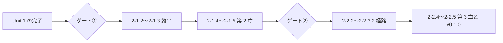
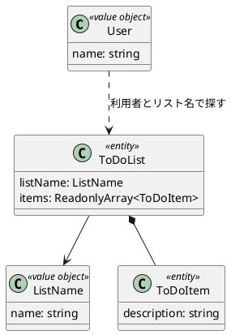
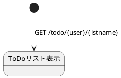

# Unit 2 の Bolt 計画（イテレーション 2）- Zettai 連載（TypeScript FP 版）

## 概要

| 項目 | 内容 |
| :--- | :--- |
| イテレーション | 2（TypeScript FP 版） |
| Unit | Unit 2 ウォーキングスケルトンとドメイン分離 |
| 期間 | 日付は置きません。最初のコミットから完了のコミットまでをリードタイムとして記録します |
| Bolt | 2-1 第 2 章 / 2-2 第 3 章 |
| ストーリー | US-002、US-003 |
| 局面 | 序盤（アウトサイドイン）（[開発戦略](development_strategy.md)） |
| テスト戦略 | Standard |
| 人の検証負荷 | 13 |
| 承認ゲート | 2 箇所 |

**本計画は 2026-11-27 に人の承認を得ました。** 新規ファイルの一覧も承認の対象です。

上位の計画は [リリース計画](release_plan-typescript-fp.md) です。この Unit の完了が Release v0.1.0 です。

### 着手の前提

**Unit 1 は、まだ完了していません。** 第 1 章のコードを含む CI の成功が残っています（[Unit 1 の Bolt 終了報告](bolt_report-typescript-fp-1.md)）。本 Unit のステップは、Unit 1 の完了を確かめてから始めます。

### 承認ゲートの運用形態

**本 Unit のゲートは「同期停止」で運用します。**

> **本節は人だけが書き換えます。** AI は書き換えません。

| # | ゲート | ステップ | 添えるもの | 記録先 |
| :--- | :--- | :--- | :--- | :--- |
| ① | HTTP の実装方式 | 2-1.1 | 下の「HTTP の 3 案」。本計画の承認と同時に判断できます | ADR-056 |
| ② | 受け入れテストの経路の差し替え方 | 2-2.1 | driver を置く層の候補ごとの行数と、HTTP の経路で確かめられる範囲 | ADR-057 |

目標は、2 箇所とも同期停止することです。CI と実行環境の追加、データベースのスキーマ変更、永続化の形式の変更は、ゲートと別に必ず停止します。**本 Unit では、どれも予定していません。**

---

## 持ち込み

[Unit 1 のふりかえり](retrospective-typescript-fp-1.md)の Try と、Bolt 終了報告の持ち越しを反映します。

| # | 持ち込み | 消化するステップ |
| :--- | :--- | :--- |
| 1 | 承認を求める設定やスクリプトは、先にスクラッチで実行してから提示する | 2-1.1、2-2.1 |
| 2 | 品質ゲートは、追跡ファイルだけを取り出した場所でも確かめてから、コミットする | 2-1.5、2-2.5 |
| 3 | 章を書く前に、執筆規約の「対象ごとの差分」を読み、受入条件に加える | 2-1.4、2-2.4 |
| 4 | バックスラッシュを含むスクリプトは、ファイル作成ツールで書く | 全ステップ |
| 5 | 道具が止めると章に書くものは、拒否され続けることをテストで固定する | 2-1.4、2-2.4 |
| 6 | HTTP の方式は、実サーバーに接続して比べる | 事前比較で実施済み |
| 7 | unstable を認める場合は、除外コメントの置き場所の守り方も決める | ゲート ① |
| 8 | `check` の時間の上限を決める。ばらつきの原因を調べるかも判断する | 2-1.5 |
| 9 | 基盤確認用の 2 経路のテストを、Zettai の業務シナリオに置き換える | 2-2.2 |

---

## ゴール

> `GET /todo/{user}/{listname}` が HTML を返す最小の縦串を通し、同じ受け入れシナリオを domain と HTTP の 2 経路で実行する。**確認したい仮説**: Effect を使っても、縦串は薄く保てる。

仮説が成り立たなかった場合は、その事実を章に書き、残りの Unit の計画を直します。

### Unit 完了時の達成状態

- 第 2〜3 章が公開されている（3 / 13 章）
- 実サーバーを起動して、一覧の HTML と 404 を確かめるテストがある
- 同じ受け入れシナリオが、domain と HTTP の 2 経路で通る
- ADR-056・057 がある
- `comparison/` に TypeScript FP 版の節がある
- Release v0.1.0 の条件を満たしている

---

## ユーザーストーリー

### US-002: ToDo リストを HTTP で見る

> **読者**として、HTTP の縦串を動かしたい。

| # | 受入条件 |
| :--- | :--- |
| 1 | `GET /todo/{user}/{listname}` が、存在するリストの項目を HTML で返す |
| 2 | 存在しないリスト、知らないパス、`GET` 以外のメソッドは、404 を返す |
| 3 | 壊れた URL エンコードへの応答が決まっていて、テストで固定されている |
| 4 | 日本語の名前を扱え、HTML の中の値がエスケープされる。応答の `content-type` に `charset` がある |
| 5 | サーバーを起動しないテストと、実サーバーを起動する smoke の両方が通る |
| 6 | domain のコードは、HTTP と `effect/http`、Node の module を import しない |
| 7 | `Effect` の実行は、最外周とテストだけにある |

### US-003: 同じ受け入れシナリオを 2 経路で実行する

> **読者**として、同じ受け入れシナリオを経路を変えて実行したい。

| # | 受入条件 |
| :--- | :--- |
| 1 | シナリオは、業務の言葉の操作だけで書かれている |
| 2 | 同じシナリオが、domain を直接呼ぶ経路と、HTTP の経路で通る（[ADR-055](../adr/ADR-055-typescript-testing-tools.md)） |
| 3 | HTTP の経路は、実サーバーを起動し、HTML から値を取り出す |
| 4 | 経路の選択は、テストのコードだけにある |
| 5 | domain の依存の向きを、テストで固定している |

---

## ゲート ①: HTTP の 3 案

2026-11-27 に、スクラッチで 3 案のサーバーを実際に起動して比べました。条件と全結果は、[Unit 1 のふりかえり](retrospective-typescript-fp-1.md)の「HTTP の方式の事前比較」にあります。その後、`effect-tsgo` の型検査と Oxlint を通しました。

| 案 | 構成 | `effect-tsgo` の指摘 | Oxlint |
| :--- | :--- | :--- | :--- |
| A | stable な部品だけ。ルーティングと `node:http` への接続を自作 | 0 件 | 通る |
| B | `effect/http` のルーター。`node:http` への接続は自作 | `unstableApiUsage` 5 件 | 通る |
| C | `effect/http` のルーターと `@effect/platform-node` のサーバー | `unstableApiUsage` 6 件 | 通る |

| 比較 | A | B | C |
| :--- | :--- | :--- | :--- |
| 空行とコメントを除く行数（業務の部分を除く） | 39 | 49 | 32 |
| 実行時の package 数 | 1 | 1 | 14 |
| 追加するライブラリ | なし | なし | `@effect/platform-node` |
| 壊れた URL エンコードへの応答 | 400（自分で分岐） | 404 | 404 |
| HTML の `charset` | 自分で指定した | 既定では付かない | 既定では付かない |
| 後の章でフォームの POST を受けるとき | 接続の自作に、本文の読み取りを足す | 同左 | ライブラリが扱う見込み（**試していない**） |

**推奨は A です。**

- [ADR-053](../adr/ADR-053-typescript-effect-version-and-stability.md) の「stable を原則にする」に沿います。除外コメントの置き場所を守る仕組み（持ち込み 7）も要りません
- 第 2 章の主題は「関数を使って HTTP を扱う」で、`Request` から応答への関数と、サーバーへの接続を、自分のコードで示せます
- **代償:** ルーティングと接続を自作し、後の章で本文の読み取りを足します。性能、同時の要求、大きな要求への対処は、自作の範囲では扱いません

B は、unstable を使いながら接続を自作するため、行数が最も多くなりました。C は最も短く、後の章の POST も扱える見込みですが、unstable の package が 2 系統と、実行時の依存 14 を引き受けます。

---

## 承認の対象となる新規ファイルとライブラリ

**本計画の承認をもって、次の追加を承認とします。** ここに無いものが必要になった場合は停止します。

### ライブラリ

**追加しません。** ただし、ゲート ① で C を選んだ場合は、`@effect/platform-node` 4.1.6 を追加します。受け入れテストで HTML から値を取り出す部分は、ライブラリを入れずに書きます。

### 新規ファイル

| 場所 | 内容 |
| :--- | :--- |
| `apps/typescript-fp/zettai/zettai-step2-http-domain/` | 第 2〜3 章の step。`package.json`、`tsconfig.build.json`、`src/`（domain、web、application、起動の入口）、`test/`（HTTP、境界、受け入れ） |
| `docs/article/zettai/typescript-fp/` | `chapter02.md`、`chapter03.md` |
| `docs/adr/` | ADR-056、ADR-057 |
| `docs/development/` | `bolt_report-typescript-fp-2.md`、`retrospective-typescript-fp-2.md` |

変更する既存ファイルは、`apps/typescript-fp/zettai/` の `package.json`・`package-lock.json`・`README.md`・設定、`mkdocs.yml`、`docs/` の索引・執筆計画・章構成マインドマップ・設計ドキュメント・`comparison/`・リリース計画・本計画です。

---

## Bolt 2-1: 第 2 章

### Bolt ゴール

> `GET /todo/{user}/{listname}` の縦串を、外側のテストから通す。

### ステップ計画

状態は `[ ]` 未着手、`[-]` 進行中、`[?]` 承認待ち、`[R]` 修正中、`[x]` 完了、`[S]` スキップです。

- [x] **2-1.1 ★ゲート ①: HTTP の実装方式**
  - 完了判定: 人が選び、ADR-056 を書いた
  - **実績（2026-11-27。同期停止した）**: 人が案 A（stable な部品だけで書き、接続を自作する）を選んだ。変更依頼は 0 回（[ADR-056](../adr/ADR-056-typescript-http-with-stable-parts.md)）
- [ ] **2-1.2 step を追加し、外側のテストを Red にする**
  - `zettai-step2-http-domain` を workspaces に足す。前の step は残す
  - 実サーバーを起動し、`GET /todo/uberto/book` の応答を確かめるテストを先に書く
- [ ] **2-1.3 内側を Red → Green で作る**
  - `User`・`ListName`・`ToDoItem`・`ToDoList`、リストを探す関数、HTML への変換、ルート、サーバーの起動と停止
  - domain の import を検査するテストを置く
  - 完了判定: US-002 の受入条件をテストで満たし、`npm run check` が通る
- [ ] **2-1.4 第 2 章の執筆**
  - 節構成は章構成マインドマップに一致させる（読み替えは無い）
  - 「型で守れたこと・守れなかったこと」と「Effect に置き換えたこと・自作で残したこと」を書く。型と名前の取り違え（`User` と `ListName` は同じ形）が型で止まるかを確かめて書く
- [ ] **2-1.5 品質ゲートと反映**
  - `npm run check`、追跡ファイルだけを取り出した場所での確認、記事の検査 5 本、`mkdocs build --strict`、OKF の検査
  - `check` の時間を測り、上限を提案する（持ち込み 8）
  - 索引と `mkdocs.yml` に反映する。**第 2 章は人の全文確認を受けるまで完了にしない**

## Bolt 2-2: 第 3 章

### Bolt ゴール

> 受け入れシナリオを業務の言葉で書き、domain と HTTP の 2 経路で実行する。

### ステップ計画

- [ ] **2-2.1 ★ゲート ②: 経路の差し替え方**
  - driver を置く層の候補をスクラッチで書き、行数と、HTTP の経路で確かめられる範囲を比べる
  - 完了判定: 人が選び、ADR-057 を書いた
- [ ] **2-2.2 シナリオを Red → Green で作る**
  - 基盤確認用の 2 経路のテストは、前の step に残し、この step では業務シナリオを使う
- [ ] **2-2.3 domain とインフラストラクチャを分離する**
  - 依存の向きをテストで固定し、向きを壊すと失敗することを確かめる
- [ ] **2-2.4 第 3 章の執筆**
  - 第 5 節は「DDT を driver のインターフェースに変換する」にする（登録済み）
- [ ] **2-2.5 `comparison/` と報告**
  - `comparison/` に TypeScript FP 版の節を追加し、Release v0.1.0 の条件を確かめる
  - Bolt 終了報告とふりかえりを書く。ゲートの密度を見直し、検証負荷と実績を突き合わせる（[開発戦略](development_strategy.md)、[リリース計画](release_plan-typescript-fp.md)）

実装は `feat(typescript-fp):`、記事は `docs(typescript-fp):` でコミットします。コミットと push は、人の指示を受けてから行います。

---

## スケジュール

日付と理想時間は置きません。順序は次のとおりです。

---

## 設計

### ドメインモデル図

本 Unit で導入する、読み取りの対象だけを示します（[ドメインモデル設計](../design/domain-model.md)）。

`dueDate` と `status` は第 4 章で加えます。名前の生成時の制約は第 11 章です。**`User` と `ListName` は同じ形です。** TypeScript の型付けは構造的なので、取り違えを型で区別するのは第 4 章で扱います。

### 状態遷移図と ER 図

掲載しません。状態は第 4 章、永続化は第 9 章からです。本 Unit のリストは、メモリ上に置きます。

### 画面遷移図

画面は 1 つです（[UI 設計](../design/ui_design.md)）。

URL の規約と、HTML のエスケープの方針は、UI 設計に従います。UI 設計に「TypeScript FP 版での差分」節を足すのは、ゲート ① で決まった方式を反映するときです。

### NFR

| 項目 | 要件 | 確かめ方 |
| :--- | :--- | :--- |
| テストの独立 | サーバーを使うテストは、空きポートを使い、終了時に停止する | ポート 0 で起動し、後始末をテストの中に書く |
| 検査の実行時間 | 上限を決める | 2-1.5 で 3 回測る |
| 機密の保護 | 応答の失敗に、内部のエラーの内容を出さない | 失敗の応答の本文をテストで固定する |

### ADR

| ADR | 内容 | ステップ |
| :--- | :--- | :--- |
| ADR-056（予定） | HTTP の実装方式。unstable を認める場合は、その範囲と守り方 | 2-1.1 |
| ADR-057（予定） | 受け入れテストの経路の差し替え方 | 2-2.1 |

### ユーザーマニュアル

作りません（[開発戦略](development_strategy.md)）。

---

## リスクと対策

| リスク | 影響 | 対策 | 検知 |
| :--- | :--- | :--- | :--- |
| 自作の接続（案 A・B）が、後の章の POST で作り直しになる | 中 | 本文を扱わないことを制約の一覧に書く。第 11 章の前に見直す | 2-1.3 |
| サーバーの停止が漏れて、テストが終わらない | 中 | 起動と停止を 1 つの値にまとめ、失敗しても停止することをテストする | 2-1.3 |
| 壊れた入力で 500 になる | 中 | 壊れた URL エンコードをテストにする | 2-1.3 |
| step の複製で、前の step の修正が漏れる | 中 | 全 step を `check` の対象にする | 2-1.2 |
| 第 2 章が他の対象の焼き直しになる | 中 | 型の限界と、Effect の実行の境界を、この版の内容として書く | 2-1.4 |

---

## 完了条件

### Definition of Done

- [ ] US-002 と US-003 の受入条件をすべて満たす
- [ ] `npm run check` が通る。追跡ファイルだけを取り出した場所でも通る
- [ ] [リリース計画](release_plan-typescript-fp.md) の「全 Bolt 共通の完了条件」を満たす
- [ ] ADR-056・057 がある
- [ ] 第 2〜3 章を人が全文確認した（ゲートには数えない）
- [ ] CI の `check` と `article` が成功した（push 後に確認）
- [ ] `comparison/`、索引、`mkdocs.yml`、執筆計画、リリース計画が一致する
- [ ] Bolt 終了報告とふりかえりがある
- [ ] ゲートの密度を見直した

### デモ項目

| # | デモ | 確認すること |
| :--- | :--- | :--- |
| 1 | サーバーを起動して `GET /todo/uberto/book` | HTML で項目が返る |
| 2 | 無いリストと、知らないパスへの要求 | 404 |
| 3 | 受け入れテストを実行する | 同じシナリオが 2 経路で通る |
| 4 | domain から web を import して `npm run check` | 失敗する |

---

## 指標

| 指標 | 計画 |
| :--- | :--- |
| ステップ | 10（Bolt 2-1: 5 / Bolt 2-2: 5） |
| 承認ゲート | 2 箇所。目標は 2 箇所の同期停止 |
| 検証負荷 | 13 |
| 公開する章 | 2 |
| ADR | 2 |
| 変更依頼数、人が修正を入れた箇所数、リードタイム | 完了時に記録する |

GitHub Project への同期は行いません。

---

## 更新履歴

| 日付 | 更新内容 | 更新者 |
| :--- | :--- | :--- |
| 2026-11-27 | 初版作成。持ち込み 9 件、HTTP の 3 案の事前比較、ゲート 2 箇所、承認の対象となる新規ファイルを提案した（未承認） | anthropic/claude-sonnet-5-5 |
| 2026-11-27 | 提案した内容で承認を得た。ゲート ① は案 A | human:kakimomokuri |

---

## 関連ドキュメント

- [リリース計画（TypeScript FP 版）](release_plan-typescript-fp.md) / [開発戦略](development_strategy.md)
- [Unit 1 の Bolt 計画](iteration_plan-typescript-fp-1.md) / [Bolt 終了報告](bolt_report-typescript-fp-1.md) / [ふりかえり](retrospective-typescript-fp-1.md)
- [執筆計画](../article/outline.md) / [UI 設計](../design/ui_design.md) / [ドメインモデル設計](../design/domain-model.md)
