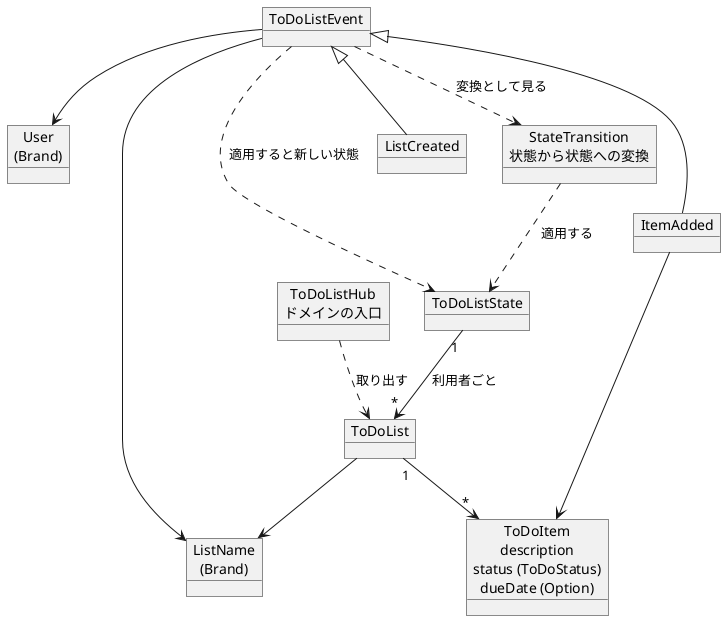

# Unit 3 の Bolt 計画（イテレーション 3）- Zettai 連載（TypeScript FP 版）

## 概要

| 項目 | 内容 |
| :--- | :--- |
| イテレーション | 3（TypeScript FP 版） |
| Unit | Unit 3 依存の注入とイベント |
| 期間 | 日付は置きません。最初のコミットから完了のコミットまでをリードタイムとして記録します |
| Bolt | 3-1 第 4 章 / 3-2 第 5 章 |
| ストーリー | US-004、US-005 |
| 局面 | 中盤（インサイドアウト）（[開発戦略](development_strategy.md)） |
| テスト戦略 | Standard |
| 人の検証負荷 | 11 |
| 承認ゲート | 1 箇所 |

**本計画は 2026-11-28 に人の承認を得ました。** 承認で決める設計 7 件と、新規ファイルの一覧も承認の対象です。章の中身の独立したレビューは含みません。

上位の計画は [リリース計画](release_plan-typescript-fp.md) です。Release v0.2.0 は、第 9 章までが条件です。本 Unit では到達しません。

### 着手の前提

**Unit 2 は完了し、Release v0.1.0 を達成しました**（2026-11-28、コミット `10b7e69`）。Nix の devShell で PostgreSQL のテストを実行していない例外が残っています。本 Unit は永続化を扱わないので、この例外の影響を受けない見込みです。

### 承認ゲートの運用形態

**本 Unit のゲートは「同期停止」で運用します。**

| # | ゲート | ステップ | 添えるもの | 記録先 |
| :--- | :--- | :--- | :--- | :--- |
| ③ | 依存の渡し方 | 3-1.2 | 3 案の行数、差し替えに要る変更、提供漏れを型検査が止めるか、`App` と接続と受け入れテストの経路に及ぶ変更 | ADR-058 |

番号は、Unit 2 の ①・② と区別するため、通し番号にしています。外部ライブラリの導入、CI と実行環境の追加、データベースのスキーマ変更、永続化の形式の変更は、ゲートと別に必ず停止します。**本 Unit では、どれも予定していません。** ゲートの密度は、2026-11-28 の決定どおり変えません。

---

## 持ち込み

[Unit 2 のふりかえり](retrospective-typescript-fp-2.md)の Try と、[Bolt 終了報告](bolt_report-typescript-fp-2.md)の持ち越しを反映します。

| # | 持ち込み | 消化するステップ |
| :--- | :--- | :--- |
| 1 | ゲートの代償は、確かめた事実と見込みを分けて書く | 3-1.2 |
| 2 | 原因を述べるのは、直して失敗が消えることを確かめた後にする | 全ステップ |
| 3 | 起動の入口を持つ章は、smoke とは別に、読者の手順どおりに起動して確かめる | 3-1.6、3-2.6 |
| 4 | 本文の「型が止める・通る」という主張は、壊して確かめる作業を執筆の手順に含める | 3-1.5、3-2.5 |
| 5 | `Layer` を使う形が、第 3 章の経路（高階関数）と重ならないかを確かめる | 3-1.2 |
| 6 | 取り違えを型で止める形は、`@ts-expect-error` のテストで固定する | 3-1.4 |
| 7 | 章を書く前に、執筆規約の「対象ごとの差分」を読み、受入条件に加える | 3-1.5、3-2.5 |

次の持ち越しは、本 Unit では扱いません。失敗の種類を増やしても型検査が通ること（第 6 章）、接続の本文の読み取り（フォームを受ける章の前）です。章の中身の独立したレビューは、これまで実施していません。**本 Unit の計画にも含めていません。** 必要な場合は、承認のときに指示してください。

---

## ゴール

> 依存の渡し方を 3 通りで比べて決め、取り違えを型で止める。変更をイベントの列で表し、畳み込みで現在の状態を導く。**確認したい仮説**: `R` に依存を載せると、差し替えの漏れが型で分かる。

仮説が成り立たなかった場合は、その事実を章に書き、残りの Unit の計画を直します。型検査が漏れを止めても、`R` を使う形を採るとは限りません。

### Unit 完了時の達成状態

- 第 4〜5 章が公開されている（5 / 13 章）
- 依存の渡し方の 3 通りの比較が記録され、ADR-058 がある
- `User` と `ListName` の取り違えが、型検査で止まる
- `ListCreated` と `ItemAdded` の列を畳み込むと、現在の状態が得られる
- 状態変換の結合律と単位元が、性質テストで通る
- 受け入れシナリオが、domain と HTTP の 2 経路で通り続ける

---

## ユーザーストーリー

### US-004: 依存を差し替えられる形を理解する

> **読者**として、依存を差し替えられる形を理解したい。

| # | 受入条件 |
| :--- | :--- |
| 1 | 引数で渡す形、`Context.Service` に直接値を与える形、`Layer` で与える形を、同じ処理で比べた記録がある |
| 2 | 3 通りは、同じ入力（あるリスト、無いリスト、無い利用者）に同じ結果を返す。比較の段階で確かめる |
| 3 | 採る形で、テストが取得の依存を差し替えられる |
| 4 | `User` を `ListName` の位置に渡す書き方（逆も）が型検査で拒否され、`@ts-expect-error` のテストで固定されている |
| 5 | 依存の提供漏れが型検査で拒否される。Effect の診断で拒否される場合は、`@effect-diagnostics-next-line` のテストで固定する。**拒否されない形を採った場合は、その事実を章に書く** |
| 6 | 名前は、検査する生成の関数を通して作る。HTTP の境界で、生の文字列から domain の型にする |
| 7 | `ToDoItem` が状態 `status`（`ToDoStatus` の `Todo`・`InProgress`・`Done`・`Blocked`。既定は `Todo`）と任意の期限 `dueDate` を持つ。実在しない日付は作れない。状態の遷移は実装しない |
| 8 | ドメインの入口 `ToDoListHub` を設け、取得の依存はハブが受け取る。web は取得の依存を直接受け取らず、ハブの操作だけを呼ぶことを、テストで固定する |

### US-005: 状態をイベントの畳み込みで表す

> **読者**として、状態をイベントの畳み込みで表したい。

| # | 受入条件 |
| :--- | :--- |
| 1 | `ListCreated` と `ItemAdded` を適用すると、新しい状態が返り、前の状態は変わらない |
| 2 | 再帰で書いた畳み込みと、`reduce` を使う畳み込みが、同じ状態を返す（性質テスト） |
| 3 | 作られていないリストへの `ItemAdded` は、状態を変えない。同じ利用者の同じリストの `ListCreated` が重なると、項目の無いリストになる。**不正な履歴の拒否は第 6 章で扱うと書く** |
| 4 | 別の利用者の同じ名前のリストや、区切り文字を含む名前が、混ざらない |
| 5 | 状態変換 `StateTransition` の合成 `andThen` の結合律と、単位元 `identityTransition` を、性質テストで確かめる。回数は `const TRIALS = N` で宣言する |
| 6 | 単位元と合成の順序をわざと壊すと、テストが失敗する |
| 7 | 状態の畳み込みと、モノイドを区別して書く。交換律が成り立たない例を固定する |
| 8 | 受け入れシナリオに「作ったリストは、項目の無いリストとして見える」を加え、2 経路で通る |

---

## 本計画の承認で決める設計

次は、選択肢の比較をゲートにするほどの材料が無いため、案を示します。**変える場合は、承認のときに指示してください。** 実装して成り立たなかった場合は、停止して相談します。

| # | 項目 | 案 | 理由と、確かめていないこと |
| :--- | :--- | :--- | :--- |
| 1 | 名前の区別 | `User` と `ListName` に、Effect の `Brand` を使う。生成の関数は、失敗を値で返す | 第 2 章で、同じ形の 2 つの型の取り違えが型検査を通った。`Brand` の生成の関数の使い心地は未確認 |
| 2 | 名前の制約 | 本 Unit では「空でない」だけにする。長さなどは第 11 章で足す | [ドメインモデル設計](../design/domain-model.md)で、生成時の制約は第 11 章の予定。空の名前の応答は 404 のまま変えない |
| 3 | 項目の状態と期限 | `ToDoStatus` は文字列リテラルの union。期限は `Option` で持ち、`YYYY-MM-DD` の実在する日付だけを作れる型にする | `Date` は可変なので使わない案。画面には、まだ表示しない |
| 4 | 状態のキー | 組や連結した文字列をキーにせず、利用者ごとの入れ子の `Map` にする | 組のキーは引けず、連結は区切り文字を含むと衝突しうる（下の「確かめたこと」） |
| 5 | 受け入れテストの経路の準備 | 経路に渡すものを、リストの保管からイベントの列に変える。driver に状態を変える操作は足さない | HTTP の POST は、まだ無い。状態を変える操作の経路は第 6 章で扱う |
| 6 | step | `zettai-step3-events` を足し、第 4〜5 章をここに書く。step 2 は残す | [ADR-054](../adr/ADR-054-typescript-toolchain-and-check.md) の累積の step |
| 7 | ドメインの入口 | `ToDoListHub` を `src/domain/` に置く。本 Unit の操作は、リストの取得の 1 つ | 新設する章は[ドメインモデル設計](../design/domain-model.md)の定め。置き場所は同じ文書の「ドメインサービス」の分類に合わせる（Kotlin FP 版は `application` に置いた）。ハブを値にするか service にするかは、ゲート ③ の結果に合わせる |

モノイドを自作のままにするか、`Reducer` に置き換えるかは、実装して比べてから決め、ADR-059 に記録します。**法則は、先に自作の型のテストで示します。** この判断はゲートにせず、第 5 章の全文確認で確認を受けます。

### 計画の前に確かめたこと

2026-11-28 に確かめました。

| 項目 | 結果 | 条件と限界 |
| :--- | :--- | :--- |
| モノイドに当たるモジュール | `effect` の `dist` に、名前に `monoid`・`semigroup` を含むファイルは無い。`Reducer<A>` は `combine`・`initialValue`・`combineAll` を持ち、`Combiner<A>` は `combine` を持つ | Effect 4.1.6 の型定義を読んだ。法則の保証や、使い心地は確かめていない |
| `Brand` | `nominal`・`make`・`check`・`all` がある。モジュールは `@stability stable` | 型定義を読んだ。動かしていない |
| `Context`・`Layer` | どちらも `@stability stable` | 同上 |
| 組を `Map` のキーにする | 同じ中身の別の配列では引けない（`undefined`） | Node 22.23.4 |
| 区切り文字で連結したキー | `["a/b","c"]` と `["a","b/c"]` が同じ文字列になる | `/` で連結した場合 |
| 素朴な再帰 | 配列を添字でたどる再帰は、5,000 件で成功し、10,000 件で `RangeError` | Node 22.23.4 で 1 回。限界の件数は、環境と関数の形で変わる |

---

## ゲート ③: 依存の渡し方の比べ方

比較は、本計画の承認の後、3-1.2 で行います。**まだ結果はありません。** 推奨も、比べてから示します。

3 案とも、ハブが取得の依存を受け取り、web はハブの操作だけを呼びます。比べるのは、取得の依存をハブに渡す形です。

| 案 | 形 |
| :--- | :--- |
| A | 依存を関数の型にして、引数で渡す（いまの `makeApp(fetch)` の延長） |
| B | 依存を `Context.Service` にし、`Effect.provideService` で値を与える |
| C | 依存を `Context.Service` にし、`Layer` で組み立てて与える |

比べる項目は次のとおりです。

- 空行とコメントを除く行数（本体、組み立て、テストの差し替え）
- 依存を 1 つ増やしたときに、直すファイルの数
- 提供を忘れたとき、型検査が止めるか。止める場合は、どの診断で、どの行を指すか
- `App` の型、`node:http` への接続、受け入れテストの経路に必要な変更
- 取得が失敗しうる形に変えたとき（第 9 章の予告）に、型に現れる変化

比較のコードは一時的に置き、実行の後に削除します。仮説は `R` を使う形についてのものなので、**A を選んでも、B・C で漏れが型で分かるかは記録します。**

### ゲート ③ の比較結果

2026-11-28、開発機で実行しました（TypeScript 7.0.2、Effect 4.1.6）。比較のコードは、`zettai-step3-events/test/zz-spike/` に置き、実行の後に削除しました。**依存が 1 つの、小さな実装での結果です。**

3 案とも、あるリスト、無いリスト、無い利用者に同じ応答（200・404・404）を返し、テストで取得の依存を差し替えられました。型検査、lint、テスト 4 件が通りました。

| 項目 | A: 引数 | B: `provideService` | C: `Layer` |
| :--- | :--- | :--- | :--- |
| 行数: ハブ / web / 組み立て / 差し替え（合計） | 5 / 17 / 6 / 7（35） | 10 / 13 / 10 / 10（43） | 10 / 13 / 10 / 8（41） |
| 提供忘れ | 止まる（`TS2554`、引数の不足） | 止まる（`TS2375` などと、診断 `missingEffectContext`） | 同左 |
| 依存を 1 つ増やしたとき、ハブのほかに直すファイル | 組み立て、差し替え（2） | web、組み立て、差し替え（3） | 同左（3） |
| 取得を失敗しうる形にしたとき、型エラーになるファイル | web、組み立て、差し替え | 同左 | 同左 |

- 行数は、整形の後の、空行とコメントを除く行です。3 案が共有する応答の組み立ては含みません
- B・C は、`App` を返す場所や `runPromise`・`serve` に渡す場所でエラーになりました。まだ境界に渡していない関数は、`R` を持ったまま型検査を通ります
- C で、`Layer` が必要とする別の依存を忘れた場合は、足りない依存の名前（`Store`）が診断に出ました
- B・C で web を直したのは、戻り値の型に `R` を明示しているためです。推論に任せた場合は確かめていません
- 組み立てで依存を与えて `App` を返す形では、`App` の型は変わりません。型の上の確認で、この形でサーバーは起動していません。domain の経路は、B・C ではハブの操作が `Effect` になるので、依存を与えて実行する処理が要ります（型からの見込み）
- C で要求ごとに `Effect.provide(layer)` を使うと、3 回の要求で `Layer` が 3 回組み立てられました。`Layer.build` で一度組み立てて渡すと 1 回でした。`Layer.succeed` では害がありませんが、接続のような資源を持つ `Layer` では、組み立ての場所を決める必要があります

**仮説「`R` に依存を載せると、差し替えの漏れが型で分かる」は、この比較では成り立ちました。ただし、引数で渡す形でも漏れは型検査で止まりました。** この比較では、漏れの検出に `R` の利点は見られませんでした。

---

## 承認の対象となる新規ファイルとライブラリ

**本計画の承認をもって、次の追加を承認とします。** ここに無いものが必要になった場合は停止します。

### ライブラリ

**追加しません。** `Brand`・`Context`・`Layer`・`Reducer` は `effect` 4.1.6 に含まれます。性質テストは、導入済みの `fast-check` を使います。

### 新規ファイル

| 場所 | 内容 |
| :--- | :--- |
| `apps/typescript-fp/zettai/zettai-step3-events/` | 第 4〜5 章の step。step 2 を複製し、`src/`（domain、web、application、起動の入口）と `test/`（型の拒否、依存の差し替え、イベント、性質、受け入れ）を足す |
| `docs/article/zettai/typescript-fp/` | `chapter04.md`、`chapter05.md` |
| `docs/adr/` | ADR-058（依存の渡し方）、ADR-059（モノイドの表し方） |
| `docs/development/` | 本計画、`bolt_report-typescript-fp-3.md`、`retrospective-typescript-fp-3.md` |

変更する既存ファイルは、`apps/typescript-fp/zettai/` の `package.json`・`package-lock.json`・`README.md`・設定、`mkdocs.yml`、`docs/` の索引・執筆計画・章構成マインドマップ・`comparison/`・リリース計画・本計画です。

---

## Bolt 3-1: 第 4 章

### Bolt ゴール

> 依存の渡し方を決め、名前の取り違えを型で止め、項目に状態と期限を持たせる。

### ステップ計画

状態は `[ ]` 未着手、`[-]` 進行中、`[?]` 承認待ち、`[R]` 修正中、`[x]` 完了、`[S]` スキップです。

- [x] **3-1.1 step を追加する**
  - `zettai-step3-events` を workspaces に足し、step 2 の内容を複製する
  - 完了判定: 複製した状態で `npm run check` が通る。`check` の時間を測る
  - **実績（2026-11-28）**: step 2 の追跡対象の 28 ファイルを複製した。`check` は 24 秒で通り、テストは 27 ファイル 120 件（開発機で 1 回）。依存の追加は無く、lock に増えたのは workspace の登録だけ
- [x] **3-1.2 ★ゲート ③: 依存の渡し方**
  - 上の 3 案を比べる。代償は、確かめた事実と見込みを分けて書く
  - 完了判定: 人が選び、ADR-058 を書いた
  - **実績（2026-11-28。同期停止した）**: 比較の結果（下の「ゲート ③ の比較結果」）を示し、人が推奨の案 A（引数で渡す）を選んだ。変更依頼は 0 回（[ADR-058](../adr/ADR-058-typescript-dependency-by-function-argument.md)）
- [x] **3-1.3 依存の渡し方を実装する**
  - 差し替えのテストを先に書き、Red を確かめる。提供漏れの扱いをテストで固定する
  - `ToDoListHub` を設け、web をハブ経由に変える
  - 完了判定: US-004 の受入条件 3、5、8
  - **実績（2026-11-28）**: Red は、ハブのモジュールが無いことと、`app.ts` が `find-todo-list.ts` を読み込んでいることの 2 つ。`ToDoListHub` と `makeHub` を足した。提供忘れと、ハブの代わりに取得の依存を渡す誤りは、3 つの `@ts-expect-error` で固定し、指定を外すと意図したエラー（`TS2554` が 2 件、`TS2345` が 1 件）が出ることを確かめた
- [x] **3-1.4 ドメインの型を太くする**
  - 取り違えの `@ts-expect-error` のテストを先に書き、型検査が「指定が使われていない」で失敗することを確かめてから、`Brand` を入れる
  - 名前の生成、HTTP の境界での変換、項目の状態と期限を、Red → Green で作る
  - 完了判定: US-004 の受入条件 4、6、7
  - **実績（2026-11-28）**: 取り違えのテストは、`Brand` を入れる前に `TS2578` で失敗した。名前と期限のテストは、関数が無い状態で 31 件が失敗した
  - 計画で形を決めていなかった点: `User` と `ListName` は、`name` を持つオブジェクトから、`Brand` を付けた文字列に変えた
  - 取り違えのテストは、最初は 1 行で 2 つの引数を入れ替えていた。片方向の拒否でも通るので、向きごとの 2 行に分けた
  - 矢印 1 のテスト（`extract.test.ts`）は、振る舞いが既にある状態で足した。境界で名前を取り違えると失敗することを確かめた
- [x] **3-1.5 第 4 章の執筆**
  - 節は「ToDo リストを変更するための新しいストーリーを始める」「関数型の『依存性の注入』を使う」「関数型コードをデバックする」「関数型ドメインモデリング」。検査が期待する見出しは、章構成マインドマップに一致させる
  - 「型で守れたこと・守れなかったこと」「Effect に置き換えたこと・自作で残したこと」を書く。型が消える実行時に、`Brand` が何を保証しないかを、壊して確かめて書く
  - 「関数型コードをデバックする」は、失敗したときの実際の出力を確かめて書く
  - **実績（2026-11-28）**: [第 4 章](../article/zettai/typescript-fp/chapter04.md) を書いた。壊して確かめた中で、**目印を外して名前をただの `string` にすると、型検査は失敗し、step 3 の実行するテスト 92 件はすべて通った**。`as`、`JSON.parse` の結果、`string` の引数への受け渡し、`Object.assign` は、型検査と lint を通った。公開の前に、本文の言い過ぎを直した。2026-11-28、第 4 章は人の全文確認を受けて承認された。`User` と `ListName` を、`Brand` を付けた文字列にする形も承認に含む
- [x] **3-1.6 品質ゲートと反映**
  - `npm run check`、追跡対象のファイルだけの確認、読者の手順どおりの起動、記事の検査、`mkdocs build --strict`、OKF の検査、索引と `mkdocs.yml`
  - 完了判定: 人が第 4 章を全文確認し、CI が成功する
  - **実績（2026-11-28、開発機）**: `npm run check` はテスト 31 ファイル 160 件と smoke が通った。読者の手順どおりに起動し、200・404・404（空の利用者名）・400 を確かめて停止した。記事の検査は違反 0 件、`mkdocs build --strict` は成功した。OKF の検査は、今回変更していないファイルの ERROR 1 件が残る
  - 追跡対象になるファイル（86 件）だけをスクラッチの深いディレクトリにコピーすると、テストは通り、smoke のビルドで `tsc` が見つからなかった。同じコピーは、短いドライブ名に割り当てると `check` が通った
  - 人の全文確認の後、コミット `d27f080`・`7c2b4f0` を push した。4 つの CI が成功し、[TypeScript の CI](https://github.com/k2works/from-objects-to-functions-excersice/actions/runs/46092738756)（Node 24.22.3）は PostgreSQL のテストを含む 31 ファイル 160 件と smoke が通った。公開サイトのブランチに第 4 章があることを確かめた。Nix のコンテナでは確かめていない

## Bolt 3-2: 第 5 章

### Bolt ゴール

> 変更をイベントの列で表し、畳み込みで状態を導き、状態変換のモノイドを性質テストで確かめる。

### ステップ計画

- [x] **3-2.1 外側のシナリオを Red にする**
  - 経路の準備をイベントの列に変え、「作ったリストは、項目の無いリストとして見える」を足す
  - **実績（2026-11-28）**: イベントのモジュールが無いため、受け入れテストの読み込みで失敗した。実装の後、2 経路で通った
- [x] **3-2.2 イベントと状態を Red → Green で作る**
  - `ListCreated`、`ItemAdded`、状態 `ToDoListState`、1 件の適用。前の状態が変わらないこと、キーが混ざらないこと、`ListCreated` が重なった場合の結果をテストする
  - 型の上の読み取り専用が、実行時の変更を防がないことも確かめる
  - **実績（2026-11-28）**: `state.test.ts` の 7 件を先に書いた。`as` で `Map` に言い切る書き換えは、型検査と lint を通った。その実装ではテストが 5 件失敗し、共有の `emptyState` の件数が 0 から 1 に変わった
- [x] **3-2.3 再帰と畳み込み**
  - 再帰の形と `reduce` の形を書き、同じ結果になることを性質テストで確かめる。再帰の限界を、この版の実装で確かめる
  - **実績（2026-11-28）**: 開発機の Node 22.23.4、ビルドした出力で、再帰は 6,259 件で `RangeError`、`reduce` は 20 万件が通った（2 回とも同じ）
- [x] **3-2.4 モノイド**
  - `StateTransition`、合成 `andThen`、何もしない変換 `identityTransition` を自作し、結合律と単位元を性質テストにする
  - **生成するイベントの列が、既にあるリストへの追加を実際に含むことを確かめる。** 含まないと、何も起きない変換どうしを比べて通る
  - 壊して失敗することを確かめる。`Reducer` に置き換えて比べ、ADR-059 を書く
  - **実績（2026-11-28）**: 順序を逆にした合成は、結合律と単位元を通り、畳み込みと比べるテストだけが失敗した。合成した変換の適用は 9,376 件で `RangeError`。3 つのシードの 500 列で、追加が効いた列は 192〜220。自作を残した（[ADR-059](../adr/ADR-059-typescript-own-state-transition-monoid.md)）
- [x] **3-2.5 第 5 章の執筆**
  - 節は「ToDo リストの作成の表示」「状態変更の保存」「再帰の力を解き放つ」「イベントを畳み込む」「モノイドの発見」
  - 第 4 章と同じく、型の主張は壊して確かめる。性質テストが示す範囲（生成した値の範囲）を書く
  - **実績（2026-11-28）**: [第 5 章](../article/zettai/typescript-fp/chapter05.md) を書いた。2026-11-28、第 5 章は人の全文確認を受けて承認された。第 4 章の抜粋への注記と、モノイドを自作のままにする決定も承認に含む
- [x] **3-2.6 品質ゲート、反映、報告**
  - 3-1.6 と同じ確認をする。`comparison/` の更新は、依存の注入の節に必要な場合だけ行う
  - Bolt 終了報告とふりかえりを書き、リリース計画の指標を記録する
  - 完了判定: 人が第 5 章を全文確認し、CI が成功する
  - **実績（2026-11-28、開発機）**: `npm run check` はテスト 34 ファイル 181 件と smoke が通り、読者の手順どおりの起動も確かめた。第 5 章の変更で、第 4 章の 3 つの抜粋が実装から消えたため、版の注記と検査の除外を足した。[Bolt 終了報告](bolt_report-typescript-fp-3.md)と[ふりかえり](retrospective-typescript-fp-3.md)を書いた。`comparison/` は変えていない。追跡対象になる 95 ファイルだけを短いドライブ名で実行した `check`、記事の検査、`mkdocs build --strict` も通った
  - 人の全文確認の後、コミット `179abee`・`d7f72a6` を push した。4 つの CI が成功し、[TypeScript の CI](https://github.com/k2works/from-objects-to-functions-excersice/actions/runs/46098331998)（Node 24.22.3）は 34 ファイル 181 件と smoke、記事の検査、`mkdocs build --strict` が通った。公開サイトのブランチに第 5 章があることを確かめ、リリース計画の指標を記録した

実装は `feat(typescript-fp):`、記事は `docs(typescript-fp):` でコミットします。コミットと push は、人の指示を受けてから行います。**第 4 章を公開してから、Bolt 3-2 に進みます。**

---

## 設計

### ドメインモデル図（本 Unit の範囲）

名前は [ドメインモデル設計](../design/domain-model.md)のユビキタス言語に合わせます。この設計の文書は Kotlin 版を対象にしているので、TypeScript FP 版の型の表し方は、ADR と章に記録します。

### 状態遷移図、ER 図、画面遷移図

掲載しません。項目の状態の遷移は第 6 章で実装します。永続化は第 9 章からです。画面は、第 2 章の一覧のまま変えません。画面の変更が無いので、ユーザーマニュアルの更新はありません。

---

## リスク

| リスク | 影響 | 対策 | 検知 |
| :--- | :--- | :--- | :--- |
| `Brand` の導入で、テストと境界の直しが広がる | 中 | 生成の関数を 1 か所にまとめる。直す量が大きければ停止して相談する | 3-1.4 |
| `R` を使う形が、接続や経路まで型の変更を広げる | 中 | ゲート ③ で、変更の範囲を比べる項目にする | 3-1.2 |
| 性質テストが、何も起きない入力ばかりで通る | 高 | 少ない候補から名前を生成し、追加が効いた割合を確かめる。壊して失敗を確かめる | 3-2.4 |
| 関数の等価を、一部の入力でしか確かめられない | 中 | 比べ方を章に書き、法則の証明ではないと明記する | 3-2.5 |
| 2 章分の変更が 1 つの step に入り、第 4 章のコードが後で変わる | 中 | 第 4 章を公開してから 3-2 に進む。変わる抜粋は、版を明記する | 記事のコードの検査 |
| step の複製で、前の step の修正が漏れ、`check` が長くなる | 中 | 全 step を `check` の対象にする。上限 60 秒を超えたら、段ごとに測る | 3-1.1 |
| 第 4〜5 章が他の対象の焼き直しになる | 中 | 構造的型付け、実行時に消える型、再帰の限界、`Map` のキーを、この版の内容として書く | 3-1.5、3-2.5 |

---

## 完了条件

### Definition of Done

- [x] US-004 と US-005 の受入条件をすべて満たす
- [x] `npm run check` が通る。追跡ファイルだけを取り出した場所でも通る
- [x] [リリース計画](release_plan-typescript-fp.md) の「全 Bolt 共通の完了条件」を満たす
- [x] ADR-058・059 がある
- [x] 第 4〜5 章を人が全文確認した（ゲートには数えない）
- [x] CI の `check` と `article` が成功した（push 後に確認）
- [x] 索引、`mkdocs.yml`、執筆計画、リリース計画が一致する
- [x] Bolt 終了報告とふりかえりがある

追跡ファイルだけの確認には、条件があります。**Windows の深いディレクトリでは smoke が失敗し、短いドライブ名に割り当てると通りました。** 受入条件は、テスト、型のテスト、比較の記録と照合しました。

### デモ項目

| # | デモ | 確認すること |
| :--- | :--- | :--- |
| 1 | `User` と `ListName` を入れ替えたコードを型検査する | 失敗する |
| 2 | 依存を差し替えたテストを実行する | サーバーも保管も使わずに、画面の HTML が確かめられる |
| 3 | イベントの列を畳み込む | 作成と追加の結果の状態が得られ、前の状態は変わらない |
| 4 | 何もしない変換を壊して、性質テストを実行する | 失敗し、反例が表示される |
| 5 | 受け入れテストを実行する | 作ったリストのシナリオが 2 経路で通る |

---

## 指標

| 指標 | 計画 |
| :--- | :--- |
| ステップ | 12（Bolt 3-1: 6 / Bolt 3-2: 6） |
| 承認ゲート | 1 箇所。目標は同期停止 |
| 検証負荷 | 11 |
| 公開する章 | 2 |
| ADR | 2 |
| 変更依頼数、人が修正を入れた箇所数、リードタイム | 完了時に記録する |

GitHub Project への同期は行いません。

---

## 更新履歴

| 日付 | 更新内容 | 更新者 |
| :--- | :--- | :--- |
| 2026-11-28 | 初版作成。持ち込み 7 件、承認で決める設計 6 件、ゲート 1 箇所の比べ方、承認の対象となる新規ファイルを提案した（未承認） | anthropic/claude-sonnet-5-5 |
| 2026-11-28 | 承認前に設計文書と照合し、`ToDoListHub` の新設（受入条件と設計の案を 1 件ずつ追加）、`ToDoStatus`・`StateTransition` の名前、`ListCreated` が重なった場合の挙動を加えた | anthropic/claude-sonnet-5-5 |
| 2026-11-28 | 提案した内容で承認を得た | human:kakimomokuri |
| 2026-11-28 | ゲート ③ は案 A | human:kakimomokuri |
| 2026-11-28 | Bolt 3-1 の実装と第 4 章の執筆の実績を記録した | anthropic/claude-sonnet-5-5 |
| 2026-11-28 | 第 4 章を承認した | human:kakimomokuri |
| 2026-11-28 | CI の成功と公開を確かめ、Bolt 3-1 を完了にした | anthropic/claude-sonnet-5-5 |
| 2026-11-28 | Bolt 3-2 の実装と第 5 章の執筆の実績を記録した | anthropic/claude-sonnet-5-5 |
| 2026-11-28 | 第 5 章と、第 4 章の抜粋への注記を承認した | human:kakimomokuri |
| 2026-11-28 | CI の成功と公開を確かめ、Unit 3 を完了にした | anthropic/claude-sonnet-5-5 |

---

## 関連ドキュメント

- [リリース計画（TypeScript FP 版）](release_plan-typescript-fp.md) / [開発戦略](development_strategy.md)
- [Unit 2 の Bolt 計画](iteration_plan-typescript-fp-2.md) / [Bolt 終了報告](bolt_report-typescript-fp-2.md) / [ふりかえり](retrospective-typescript-fp-2.md)
- [執筆計画](../article/outline.md) / [ドメインモデル設計](../design/domain-model.md)
