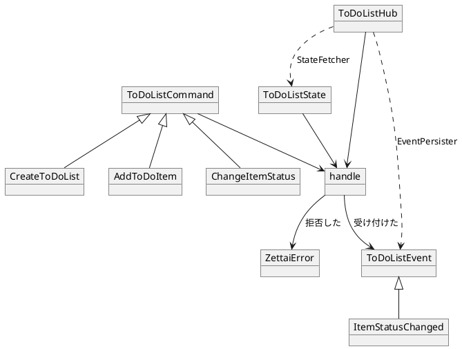
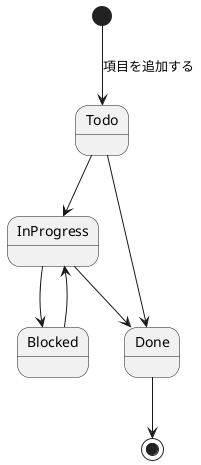

# Unit 4 の Bolt 計画（イテレーション 4）- Zettai 連載（TypeScript FP 版）

## 概要

| 項目 | 内容 |
| :--- | :--- |
| イテレーション | 4（TypeScript FP 版） |
| Unit | Unit 4 コマンドと型付きエラー |
| 期間 | 日付は置きません。最初のコミットから完了のコミットまでをリードタイムとして記録します |
| Bolt | 4-1 第 6 章 / 4-2 第 7 章 |
| ストーリー | US-006、US-007 |
| 局面 | 中盤（インサイドアウト）（[開発戦略](development_strategy.md)） |
| テスト戦略 | Standard |
| 人の検証負荷 | 10 |
| 承認ゲート | 1 箇所 |

**本計画は 2026-11-28 に人の承認を得ました。** 承認で決める設計 8 件と、新規ファイルの一覧も承認の対象です。章の中身の独立したレビューは含みません。

上位の計画は [リリース計画](release_plan-typescript-fp.md) です。Release v0.2.0 は、第 9 章までが条件です。本 Unit では到達しません。

### 着手の前提

**Unit 3 は完了しました**（2026-11-28、コミット `1f169fd`）。依存は関数の引数でハブに渡します（[ADR-058](../adr/ADR-058-typescript-dependency-by-function-argument.md)）。

### 承認ゲートの運用形態

**本 Unit のゲートは「同期停止」で運用します。**

| # | ゲート | ステップ | 添えるもの | 記録先 |
| :--- | :--- | :--- | :--- | :--- |
| ④ | 型付きエラーと defect の線引き | 4-2.2 | 3 案の、型に現れる失敗、失敗を足したときに型検査が止める場所、`Effect.catch` で捕まる範囲、500 の応答に理由が出るか、行数 | ADR-060 |

番号は、前の Unit からの通し番号です。外部ライブラリの導入、CI と実行環境の追加、データベースのスキーマ変更、永続化の形式の変更は、ゲートと別に必ず停止します。**本 Unit では、どれも予定していません。**

---

## 持ち込み

[Unit 3 のふりかえり](retrospective-typescript-fp-3.md)の Try と、[Bolt 終了報告](bolt_report-typescript-fp-3.md)の持ち越しを反映します。

| # | 持ち込み | 消化するステップ |
| :--- | :--- | :--- |
| 1 | 計画の前に、設計文書が章に定める名前を検索して照合する | 本計画で実施した（下の「設計文書との照合」） |
| 2 | 「両方向を拒否する」ような受入条件は、向きごとに別のテストにする | 4-1.2、4-1.3 |
| 3 | 次の章が前の章の抜粋の行を変える場合は、step を分けるかを着手前に判断する | **分ける案**（下の設計 8） |
| 4 | 性質テストは、反例が読める値を生成する | 4-1.3、4-2.4 |
| 5 | コマンドで不正な履歴を止めることと、`apply` が無視する扱いが、重ならないかを確かめる | 4-1.3 |
| 6 | `_tag` の分岐を足したときに、型検査が止める場所を、壊して確かめる | 4-1.5 |
| 7 | 失敗の種類を増やしても型検査が通る（第 2 章からの持ち越し） | 4-2.3 |

次の持ち越しは、本 Unit では扱いません。フォームを受けるための接続の本文の読み取り（第 11 章の前）、依存を引数で渡す決定の確かめ直し（第 9〜10 章）です。章の中身の独立したレビューは、これまで実施していません。**本 Unit の計画にも含めていません。** 必要な場合は、承認のときに指示してください。

---

## ゴール

> 利用者の意図をコマンドで受け取り、起こしてよい出来事を純粋な関数で決める。失敗を型で表し、型付きエラーと defect の線を決める。**確認したい仮説**: 純粋な核は `Effect` に依存せずに書ける。

ここでの「核」は、出来事、コマンド、状態、状態遷移、コマンドの処理です。**`Effect` の型を読み込まないことを、テストで固定して確かめます。** Effect の `Result`・`Option` は使ってかまいません。ハブと web は、核に含めません。仮説が成り立たなかった場合は、その事実を章に書き、残りの Unit の計画を直します。

### Unit 完了時の達成状態

- 第 6〜7 章が公開されている（7 / 13 章）
- 3 種類のコマンドが、状態を見て、出来事か拒否の理由を返す
- 項目の状態遷移の 16 通りが、テストされている
- 失敗の種類を足すと、HTTP への対応の場所で型検査が失敗する
- 型付きエラーと defect の線引きが記録され、ADR-060 がある

---

## ユーザーストーリー

### US-006: コマンドを純粋な状態遷移で扱う

> **読者**として、コマンドを純粋な状態遷移で扱いたい。

| # | 受入条件 |
| :--- | :--- |
| 1 | `CreateToDoList`・`AddToDoItem`・`ChangeItemStatus` を、`_tag` を持つ型の和 `ToDoListCommand` で表す |
| 2 | `handle(command, state)` は純粋な関数で、出来事の列か、拒否の理由を返す。拒否の理由は、`ListAlreadyExists`・`ListNotFound`・`ItemNotFound`・`InvalidTransition` で区別できる |
| 3 | 状態遷移の 16 通りのうち、許す 5 通りと拒否する 11 通りを、別のテストで確かめる。同じ状態への遷移は拒否する |
| 4 | `ItemStatusChanged` を適用すると、新しい状態が返り、前の状態は変わらない |
| 5 | `handle` が返した出来事は、同じ状態に `apply` すると必ず状態を変える。生成したコマンドの列で確かめる |
| 6 | コマンド・出来事・状態の値を 1 つ足すと、型検査が失敗する。止まらない書き方も、壊して確かめて章に書く |
| 7 | ハブは、コマンドを受け取り、状態を取り出し、`handle` の結果の出来事を保存する。拒否した場合は、何も保存しない |
| 8 | 受け入れシナリオに「作ったリストに足した項目が、順に見える」を加える。コマンドはハブに送り、domain と HTTP の 2 経路で見る |
| 9 | 核のファイルが `Effect` の型を読み込まないことを、テストで固定する |

### US-007: 失敗を型で扱う

> **読者**として、失敗を型で扱いたい。

| # | 受入条件 |
| :--- | :--- |
| 1 | リストの取得は、`Option` ではなく、失敗の理由を持つ `Result` を型に出す。変更が要るファイルを数えて記録する |
| 2 | `ListNotFound`・`ItemNotFound` は 404、`ListAlreadyExists`・`InvalidTransition` は 400 になる |
| 3 | 失敗の種類を 1 つ足すと、HTTP への対応の場所で型検査が失敗する。壊して確かめる |
| 4 | 失敗の応答の本文に、失敗の中身（利用者、リスト名、項目の説明）を出さない |
| 5 | `Result.map` と `Effect.map` が、恒等則と合成則を満たすことを、性質テストで確かめる。回数は `const TRIALS = N` で宣言する。`Effect` は、実行した結果と実行の記録で比べる |
| 6 | わざと壊した `map` で、法則のテストが失敗する。恒等則だけでは見分けられない壊し方を含める |
| 7 | 型付きエラーと defect の線引きを、ゲート ④ の決定どおりにテストで固定する。業務の失敗は 500 にならず、defect の応答に理由が出ない |
| 8 | `Result` と、`Effect` のエラーの型引数を、どこで使い分けるかを章に書く |

---

## 本計画の承認で決める設計

次は、案を示します。**変える場合は、承認のときに指示してください。** 実装して成り立たなかった場合は、停止して相談します。

| # | 項目 | 案 | 理由と、確かめていないこと |
| :--- | :--- | :--- | :--- |
| 1 | 拒否の理由を足す章 | `ZettaiError` の 4 種類を、**第 6 章で** `handle` の拒否の理由として足す | US-006 は拒否の理由を求める。[ドメインモデル設計](../design/domain-model.md)は `ZettaiError` を第 7 章としている（Kotlin 版は、第 6 章では空の列で拒否を表した。[ADR-006](../adr/ADR-006-outcome-port-type.md)）。第 7 章では、取得の失敗と HTTP への対応に広げる |
| 2 | 状態遷移の表 | 現在の状態ごとに、移れる状態を持つ `Record<ToDoStatus, …>` にする。判定は `canTransitionTo` | `Record` はキーの不足を型検査が止める（下の「確かめたこと」）。**移れる先の書き漏れは止まらない**ので、16 通りのテストで守る。許す 5 通りは、ドメインモデル設計の表のとおり |
| 3 | 項目の特定 | 項目は説明で特定する。同じ説明の項目がある場合は、**最初の 1 件**を対象にする。同じ説明の追加は拒否しない | ドメインモデル設計のコマンドは説明を持つ。挙動は Kotlin FP 版の実装に合わせる。同じ説明の 2 件目は、状態を変えられない |
| 4 | `apply` の扱い | `apply` は、対象が無い出来事を無視する規則のままにする。拒否は `handle` だけがする | 畳み込みを、失敗しない関数に保つ。受入条件 5 で、`handle` の出来事が無視されないことを確かめる |
| 5 | ハブのアダプタ | `ToDoListFetcher`・`StateFetcher`・`EventPersister` の 3 つを引数で渡し、**3 つとも `Effect` を返す**。実体は、出来事を持つメモリ上の保管で、`src/application/` に置く | 保存は副作用で、保存の後は取得の結果が変わる。第 1 章の「実行するまで起きない」形で表す。第 9 章の前に同期の関数にする案は、型を 2 回変えることになる見込み |
| 6 | 同時のコマンド | 状態の取り出しから保存までは、まとめて守らない | 同じリストを同時に作ると、両方が成功しうる。第 10 章で扱う。既知の制約に書く |
| 7 | コマンドの経路 | 画面からの操作は足さない。受け入れテストは、コマンドをハブに送る | [UI 設計](../design/ui_design.md)は、画面からのコマンドを第 11 章で通すとしている。項目の状態は画面に出さないので、状態の変更は受け入れシナリオでは見ない |
| 8 | step | 第 6 章は `zettai-step4-commands`、第 7 章は `zettai-step5-errors` に分ける | 第 7 章は取得の型を変える。分けないと、公開した第 6 章の抜粋が実装から消える。複製が増え、`check` が長くなる |

失敗の型を、出来事と同じ素の型の和にするか、`Data.TaggedError` にするかは、4-2.3 で比べて決め、ADR-061 に理由を書きます。ハブのアダプタの型の決定も、ADR-061 に記録します。どちらもゲートにせず、章の全文確認で確認を受けます。

### 設計文書との照合

| 設計の記述 | 本計画 |
| :--- | :--- |
| 第 6 章でコマンド 3 種類と `ItemStatusChanged`、`handle`、`canTransitionTo`、状態遷移（[ドメインモデル設計](../design/domain-model.md)） | US-006。同じ名前を使う |
| 状態遷移の表は 16 通りで、すべてテストする（同上） | US-006 の受入条件 3 |
| ハブに、第 6 章でアダプタを 2 つ足す。`StateFetcher`・`EventPersister`（同上、[バックエンドアーキテクチャ設計](../design/architecture_backend.md)） | 設計 5 |
| 第 7 章で取得の戻り値が失敗の理由を持つ（[ADR-006](../adr/ADR-006-outcome-port-type.md)） | US-007 の受入条件 1。Kotlin 版の `Outcome` は作らず、Effect の `Result` を使う |
| 失敗と HTTP の状態の対応（ドメインモデル設計の「失敗の型」） | US-007 の受入条件 2。`PersistenceError` は第 9 章で足す |
| 第 7 章第 4 節は「`Result` と `Effect` の型付きエラーで実装する」（[章構成](../article/draft.md)の読み替え） | 4-2.5 |

名前は、ドメインモデル設計のユビキタス言語に合わせます。この設計の文書は Kotlin 版を対象にしているので、TypeScript FP 版の型の表し方は、ADR と章に記録します。

### 計画の前に確かめたこと

2026-11-28、`zettai-step3-events` を一時的に壊して確かめ、元に戻しました（TypeScript 7.0.2、Effect 4.1.6、Node 22.23.4）。

| 項目 | 結果 |
| :--- | :--- |
| 出来事の型の和に 1 種類足す | `apply` で型検査が失敗する（`TS2366`）。戻り値の型を書いた `switch` のため |
| 戻り値の型を書かない関数、`void` を返す関数で、`switch` の分岐が漏れる | **型検査も lint も通る** |
| `Record` のキーが 1 つ足りない | 型検査が失敗する（`TS2741`） |
| web の失敗の種類（いまの `Failure`）に 1 つ足す | **型検査も、step 3 のテスト 114 件も通る。** 三項演算子で、残りを 404 にしているため |
| `Effect.fail` と `Effect.fromResult` の失敗 | 型付きの失敗（`Fail`）になる |
| `Effect.die`、`Effect.sync` の中の `throw`、`Result.getOrThrow` | defect（`Die`）になる |
| defect に `Effect.catch` を掛ける | 捕まらない |
| `Result.map` に渡した関数の `throw` | 呼び出しの場所で、そのまま例外になる |
| `Result`・`Data`・`Match`・`Cause`・`Exit`・`Effect` の安定性 | 型定義の最初の指定は `@stability stable`。関数ごとには確かめていない |

---

## ゲート ④: 型付きエラーと defect の線の比べ方

比較は、4-2.2 で行います。**まだ結果はありません。** 推奨も、比べてから示します。

| 案 | 形 |
| :--- | :--- |
| A | 業務上ありうる失敗（`ZettaiError`）だけを型で運ぶ。想定外の失敗は defect にし、最外周で 500 にする |
| B | 想定外の失敗も、包んで型付きエラーに含める |
| C | 業務の失敗も例外（defect）にし、最外周で見分ける |

同じ処理（取得、コマンドの拒否、保存の失敗、実装の誤り）で、次を比べます。

- 関数の型に現れる失敗
- 失敗の種類を足したとき、型検査が止める場所
- `Effect.catch` で捕まる範囲
- 500 の応答に、内部の理由が出ないか
- 空行とコメントを除く行数
- 第 9 章の保存の失敗を、型に足すか defect にするかの見込み（確かめた事実と分けて書く）

比較のコードは一時的に置き、実行の後に削除します。

---

## 承認の対象となる新規ファイルとライブラリ

**本計画の承認をもって、次の追加を承認とします。** ここに無いものが必要になった場合は停止します。

### ライブラリ

**追加しません。** `Result`・`Effect`・`Data`・`Match` は `effect` 4.1.6 に含まれます。性質テストは、導入済みの `fast-check` を使います。

### 新規ファイル

| 場所 | 内容 |
| :--- | :--- |
| `apps/typescript-fp/zettai/zettai-step4-commands/` | 第 6 章の step。step 3 を複製し、コマンド、状態遷移、失敗の型、保管のアダプタと、そのテストを足す |
| `apps/typescript-fp/zettai/zettai-step5-errors/` | 第 7 章の step。step 4 を複製し、取得の型、HTTP への対応、法則と defect のテストを足す |
| `docs/article/zettai/typescript-fp/` | `chapter06.md`、`chapter07.md` |
| `docs/adr/` | ADR-060（型付きエラーと defect の線引き）、ADR-061（ハブのアダプタと失敗の型の表し方） |
| `docs/development/` | 本計画、`bolt_report-typescript-fp-4.md`、`retrospective-typescript-fp-4.md` |

変更する既存ファイルは、`apps/typescript-fp/zettai/` の `package.json`・`package-lock.json`・`README.md`・設定、`mkdocs.yml`、`docs/` の索引・執筆計画・章構成マインドマップ・`comparison/`・リリース計画・本計画です。

---

## Bolt 4-1: 第 6 章

### Bolt ゴール

> コマンドと現在の状態から、起こしてよい出来事か、拒否の理由を決め、ハブにつなぐ。

### ステップ計画

状態は `[ ]` 未着手、`[-]` 進行中、`[?]` 承認待ち、`[R]` 修正中、`[x]` 完了、`[S]` スキップです。内側の domain から作ります。

- [ ] **4-1.1 step を追加する**
  - `zettai-step4-commands` を workspaces に足し、step 3 の追跡対象のファイルを複製する
  - 完了判定: 複製した状態で `npm run check` が通る。`check` の時間を測る
- [ ] **4-1.2 状態遷移と `ItemStatusChanged`**
  - 許す 5 通りと拒否する 11 通りのテストを先に書き、Red を確かめる。出来事の適用を足す
  - 完了判定: US-006 の受入条件 3・4
- [ ] **4-1.3 コマンドの処理**
  - 拒否の理由ごとのテストを先に書く。`handle` の出来事が必ず効くことを、性質テストにする。生成するコマンドの列で、受け付けと拒否の両方が起きることも確かめる
  - 核が `Effect` の型を読み込まないことを、テストにする
  - 完了判定: US-006 の受入条件 1・2・5・9
- [ ] **4-1.4 ハブと保管、受け入れシナリオ**
  - 受け入れシナリオを先に Red にする。保管のアダプタを足し、ハブでつなぐ
  - 拒否した場合に何も保存しないことを、テストする
  - 完了判定: US-006 の受入条件 7・8
- [ ] **4-1.5 網羅性を壊して確かめる**
  - コマンド、出来事、状態を 1 つずつ足し、型検査が止める場所と止めない場所を記録する
  - 完了判定: US-006 の受入条件 6
- [ ] **4-1.6 第 6 章の執筆**
  - 節は「新しいToDoリストの作成」「コマンドを使って状態を変更する」「状態とイベントによるドメインのモデリング」「関数型ステートマシンを記述する」「ハブと接続する」「コマンドとイベントを深く知る」。検査が期待する見出しは、章構成マインドマップに一致させる
  - 「型で守れたこと・守れなかったこと」「Effect に置き換えたこと・自作で残したこと」を書く
- [ ] **4-1.7 品質ゲートと反映**
  - `npm run check`、追跡対象のファイルだけの確認、読者の手順どおりの起動、記事の検査、`mkdocs build --strict`、OKF の検査、索引と `mkdocs.yml`
  - 完了判定: 人が第 6 章を全文確認し、CI が成功する

## Bolt 4-2: 第 7 章

### Bolt ゴール

> 失敗の理由を型で運び、HTTP の応答に漏れなく対応させ、型付きエラーと defect の線を引く。

### ステップ計画

- [ ] **4-2.1 step を追加する**
  - `zettai-step5-errors` を足し、step 4 を複製する。`check` の時間を測る
- [ ] **4-2.2 ★ゲート ④: 型付きエラーと defect の線引き**
  - 上の 3 案を比べる。代償は、確かめた事実と見込みを分けて書く
  - 完了判定: 人が選び、ADR-060 を書いた
- [ ] **4-2.3 取得の型と HTTP への対応**
  - いまの形では、失敗の種類を足しても型検査が通ることを先に示す。Red → Green で対応を作り、壊して確かめる
  - 失敗の型の表し方を比べ、ADR-061 を書く。変更したファイルを数える
  - 完了判定: US-007 の受入条件 1〜4・7
- [ ] **4-2.4 ファンクタの法則**
  - `Result.map` と `Effect.map` の恒等則と合成則を性質テストにする。壊した `map` で失敗することを確かめる
  - 完了判定: US-007 の受入条件 5・6
- [ ] **4-2.5 第 7 章の執筆**
  - 節は「より適切なエラー処理」「ファンクタと圏を学ぶ」「ファンクタを使ったエラーハンドリング」「`Result` と `Effect` の型付きエラーで実装する」
- [ ] **4-2.6 品質ゲート、反映、報告**
  - 4-1.7 と同じ確認をする。`comparison/` に、失敗の扱いの比較が要るかを判断する
  - Bolt 終了報告とふりかえりを書き、リリース計画の指標を記録する
  - 完了判定: 人が第 7 章を全文確認し、CI が成功する

実装は `feat(typescript-fp):`、記事は `docs(typescript-fp):` でコミットします。コミットと push は、人の指示を受けてから行います。**第 6 章を公開してから、Bolt 4-2 に進みます。**

---

## 設計

### ドメインモデル図（本 Unit の範囲）

### 状態遷移図

[ドメインモデル設計](../design/domain-model.md)の遷移を、そのまま使います。

### ER 図、画面遷移図

掲載しません。永続化は第 9 章からです。画面は変えないので、ユーザーマニュアルの更新はありません。

---

## リスク

| リスク | 影響 | 対策 | 検知 |
| :--- | :--- | :--- | :--- |
| ハブが `Effect` を返すと、web、起動の入口、テストの直しが広がる | 中 | 変更したファイルを数える。核のファイルが直しに含まれたら停止して相談する | 4-1.4 |
| 網羅性が、戻り値の型の有無に依存する | 高 | 分岐する関数は戻り値の型を書く。壊して確かめ、止まらない形を章に書く | 4-1.5、4-2.3 |
| 16 通りのテストが、遷移表の写しになる | 中 | 期待値は、ドメインモデル設計の表から書く。許す側と拒否する側を分ける | 4-1.2 |
| コマンドの性質テストが、拒否ばかりで通る | 高 | 少ない候補から生成し、受け付けた割合をテストにする | 4-1.3 |
| `Result.map` の法則のテストが、ライブラリの確認だけになる | 中 | 壊した `map` で見分けられることを示し、章では法則が何を許すかを書く | 4-2.4 |
| step が 2 つ増え、`check` が上限の 60 秒に近づく | 中 | step の追加のたびに測る。超えたら、段ごとに測って原因を調べる | 4-1.1、4-2.1 |
| 第 6〜7 章が他の対象の焼き直しになる | 中 | `switch` の網羅性の条件、defect との線、`Result` と `Effect` の使い分けを、この版の内容として書く | 4-1.6、4-2.5 |

---

## 完了条件

### Definition of Done

- [ ] US-006 と US-007 の受入条件をすべて満たす
- [ ] `npm run check` が通る。追跡ファイルだけを取り出した場所でも通る（Windows の深いディレクトリは除き、条件を記録する）
- [ ] [リリース計画](release_plan-typescript-fp.md) の「全 Bolt 共通の完了条件」を満たす
- [ ] ADR-060・061 がある
- [ ] 第 6〜7 章を人が全文確認した（ゲートには数えない）
- [ ] CI の `check` と `article` が成功した（push 後に確認）
- [ ] 索引、`mkdocs.yml`、執筆計画、リリース計画が一致する
- [ ] Bolt 終了報告とふりかえりがある

### デモ項目

| # | デモ | 確認すること |
| :--- | :--- | :--- |
| 1 | 許されない状態遷移のコマンドを処理する | 理由つきで拒否され、出来事は増えない |
| 2 | コマンドを 1 種類足して型検査する | 失敗する |
| 3 | 失敗の種類を 1 つ足して型検査する | HTTP への対応の場所で失敗する |
| 4 | 業務の失敗と、実装の誤りを起こす | 404・400 と 500 に分かれ、応答に理由が出ない |
| 5 | 受け入れテストを実行する | コマンドで作ったリストと項目が、2 経路で見える |

---

## 指標

| 指標 | 計画 |
| :--- | :--- |
| ステップ | 13（Bolt 4-1: 7 / Bolt 4-2: 6） |
| 承認ゲート | 1 箇所。目標は同期停止 |
| 検証負荷 | 10 |
| 公開する章 | 2 |
| ADR | 2 |
| 変更依頼数、人が修正を入れた箇所数、リードタイム | 完了時に記録する |

GitHub Project への同期は行いません。

---

## 更新履歴

| 日付 | 更新内容 | 更新者 |
| :--- | :--- | :--- |
| 2026-11-28 | 初版作成。持ち込み 7 件、承認で決める設計 8 件、ゲート 1 箇所の比べ方、承認の対象となる新規ファイルを提案した（未承認） | anthropic/claude-sonnet-5-5 |
| 2026-11-28 | 提案した内容で承認を得た | human:kakimomokuri |

---

## 関連ドキュメント

- [リリース計画（TypeScript FP 版）](release_plan-typescript-fp.md) / [開発戦略](development_strategy.md)
- [Unit 3 の Bolt 計画](iteration_plan-typescript-fp-3.md) / [Bolt 終了報告](bolt_report-typescript-fp-3.md) / [ふりかえり](retrospective-typescript-fp-3.md)
- [執筆計画](../article/outline.md) / [ドメインモデル設計](../design/domain-model.md)
