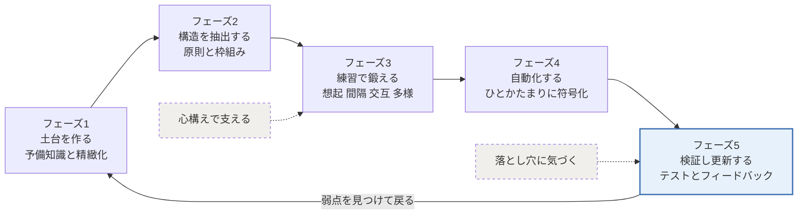
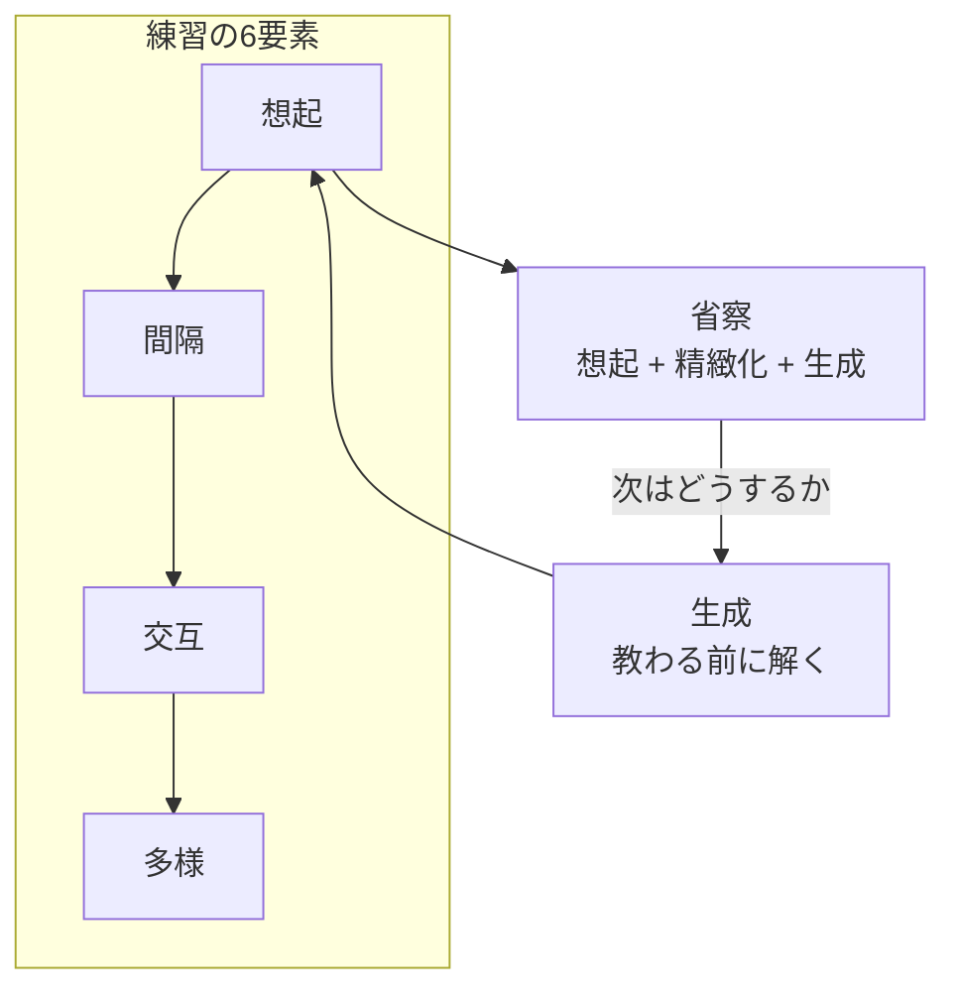
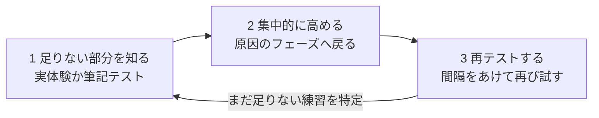
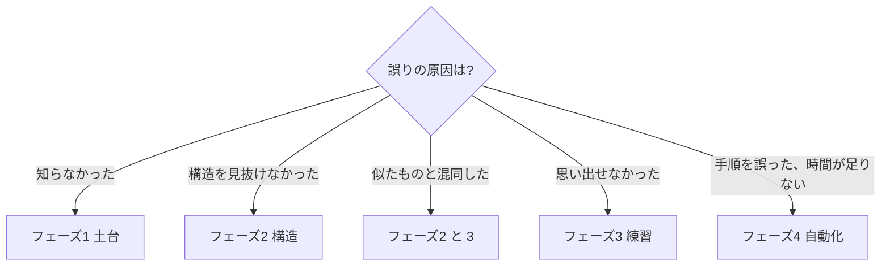

# メンタルモデル構築ガイド（汎用版）

2026-11-07

## このガイドについて

メンタルモデルとは、実世界の事象や問題解決の手順をひとつにまとめた頭の中の枠組みで、知識を「実行できるノウハウ」に変えるものである (1, 5, 6)。本ガイドは、どんな分野にも当てはまる作り方を、5つのフェーズと2つの支え（落とし穴の点検、心構え）にまとめる。

- **対象**: 新しい技術、業務領域、学問、資格など、何かを「使えるレベル」まで身につけたい人。分野は問わない。
- **根拠**: 『使える脳の鍛え方 成功する学習の科学』の読書メモから作った「メンタルモデル構築マインドマップ」。各項目の末尾の数字は同書の章を示す。
- **特定分野への当てはめ**: 文末の「適用例」で、技術習得、業務知識、読書、試験の4場面に落とし込む。

基本方針は3つ。

1. **モデルは与えられるものではなく、自分で組み上げるものである。** わかりやすい説明を聞いても、自分で原則を抽出し、思い出す努力をしなければ、使えるモデルにはならない (4, 5)。
2. **一度作って終わりではなく、作り直し続ける。** 検証で見つかった弱点を材料に、前のフェーズに戻る。古い手がかりは新しい手がかりに置き換える (4, 7)。
3. **自分の感覚ではなく、外部のものさしで判断する。** 「わかった」「できる」という感覚は当てにならない。テスト、フィードバック、実際の結果で確かめる (5)。

## 全体像

構築は循環する。検証で見つかった弱点を材料に、該当するフェーズへ戻って作り直す。

実線は構築の流れ、破線は支えを示す。心構えは練習の負荷に耐えるために、落とし穴の点検は検証を甘くしないために働く。

| フェーズ | 目的 | 主な活動 | 完了の目安 |
| --- | --- | --- | --- |
| 1 土台を作る | 既に知っていることと新しい知識をつなぐ | 全体像の把握、精緻化、具体例への当てはめ | 主要な概念を自分の言葉で説明できる |
| 2 構造を抽出する | 個々の知識を原則と枠組みにまとめる | 原則の抽出、取捨選択、類似概念の比較 | 何も見ずに全体の構造を描ける |
| 3 練習で鍛える | 判別力と応用力をつける | 想起、間隔、交互、多様、生成、省察 | 条件を変えても再現・応用できる |
| 4 自動化する | 意識せずに使える状態にする | 計画的な練習、実環境での反復 | 考える前に手が動く |
| 5 検証し更新する | 実力を客観的に測り、弱点を特定する | テスト、フィードバック、誤りの分析 | 誤りの原因を自分で説明できる |

フェーズは期間で厳密に区切らない。全体では1から5へ重心が移るが、ひとつの概念ごとに小さく回すのが普通である。

## フェーズ1 土台を作る

モデルは既に知っていることの上にしか組み上がらない。最初の仕事は暗記ではなく、新しい知識を自分の既知と結びつける材料集めである。

- **先に全体像を置く。** 分野の範囲、主要な構成要素、それらの関係を1枚にまとめてから細部に入る。個々の知識は、より大きなコンテキストに当てはめると定着しやすい (1)。
- **予備知識の不足を先に埋める。** 土台がない状態で難しい素材に挑むと、乗り越えられない「望ましくない困難」になる。入門資料や前提となる概念を先に押さえる (1, 4)。
- **精緻化する。** 新しい概念を自分の言葉に置き換え、既に知っていることと関連づけて意味を与える。既知と結びつけば、記憶できる量に実質的な限界はない (1, 4)。
- **抽象を具体に当てはめる。** 抽象的な概念は、自分の経験や身近な事例に当てはめて理解する。自分に関わるほど学習は強化される (1)。
- **誰かに説明する。** 口に出すか、数行で書く。説明に詰まった箇所が理解の穴であり、次に埋めるべき場所になる (8)。
- **読むのは1、2回まで。** 再読は時間がかかり、記憶に残らず、理解したという錯覚を生む。読んだら本を閉じて、重要な概念は何か、既知とどう関係するかを自問する (1, 8)。

## フェーズ2 構造を抽出する

事実を集めるだけではモデルにならない。根本の原則を取り出し、何を残し何を捨てるかを判断して、個々のパーツの集合以上の構造にまとめる (6)。

- **重要なアイデアを読み取る。** 新しい素材から顕著な概念を抽出し、一貫した枠組みを作る。情報の羅列ではなく「これが肝だ」と言える数個の原則に絞る (1, 6)。
- **「なぜそうなるか」を規則で言う。** 個別の事例を先例として覚えるのではなく、背後にある規則を言葉にする。規則で学ぶ人は、学んだことを新しい状況に当てはめる能力に優れる (6)。
- **取捨選択する。** 新しい情報を構造に加えるか、脇によけるかを判断する。これができることが構築力であり、構築力の低い人は残す情報と捨てる情報がわからない (6)。
- **似た概念は並べて違いを書く。** 混同しやすいものは、共通点と相違点を一覧にする。種類を見分ける判別力の下地になる (4)。
- **白紙から描き出して確かめる。** 何も見ずに構造を再現し、描けなかった部分を補う。きれいにまとめたノートを眺めても構造は身につかない (2)。
- **経験を物語にする。** 何がうまくいき、何がうまくいかなかったか、次は何を試すかを振り返り、物語の形にして構造に加える (6)。

## フェーズ3 練習で鍛える

努力を要する想起と、条件を変えた練習が、学んだことをモデルに統合し、判別力と汎用性を持たせる (4)。どれも「やりにくい」と感じるのが正常で、その負荷が定着を生む。

| 練習法 | やり方 | 避けたいやり方 | 効果 |
| --- | --- | --- | --- |
| 想起練習 (2, 4) | 資料を見ずに記憶から呼び出す。自分にクイズを出す | 資料を読み返す。下線を引く | 思い出す努力が記憶を再統合し、反射的に呼び出せるようになる |
| 間隔練習 (3) | 少し忘れた頃に、同じ内容を複数回思い出す | 同じ日に繰り返して完璧にする | 忘れかけてから思い出すことで統合が促される |
| 交互練習 (3, 4) | 2つ以上の種類や分野を混ぜて取り組む | 1種類を習得してから次へ進む | 種類による違いを見抜く判別力がつく |
| 多様練習 (3, 4) | 条件、状況、形式を変えて同じことを行う | 同じ条件で同じことを繰り返す | 別の状況に適用できる汎用性ができる |
| 生成 (4) | 教わる前に自分で解こうとする。間違えてよい | 答えや解法を先に覚える | 解答がわかりやすくなり、長く記憶に残る |
| 省察 (2, 3) | 何が起きた、何をした、どうなった、次はどうするかを書く | やった量だけを記録する | 想起と精緻化と生成を一度に行う |

運用のポイント。

- **想起は初日から始める。** 練習は構造ができてから、ではない。学んだその日から、資料を閉じて思い出す (2)。
- **できるようになっても練習箱から出さない。** 2、3回できただけで終わりにしない。習熟したものは頻度を下げるが、ゼロにはしない (3, 5)。
- **フィードバックは必ず受ける。** 想起の後に正解を確かめる。訂正されれば間違いを覚えたままにはならない。すぐより、少し遅らせたフィードバックのほうが長続きする (2)。
- **伸び悩みを失敗と読まない。** 交互練習と間隔練習は、練習中の成績が下がって見える。集中練習の好成績は習得段階の一時的な力で、定着した力ではない (3)。
- **本番と同じ条件で練習する。** 学習がどれだけ役立つかは、知識そのものより、その知識をもとにどう練習したかで決まる (3)。

## フェーズ4 自動化する

繰り返し使われたモデルは「ひとかたまり」に符号化され、意識しなくても働くようになる。これが専門的技能の特徴である (7)。

- **ひとかたまりにする。** 一連の判断と行動を繰り返し使うことで、脳はそれをひとつの手順として符号化し、習慣のように自動的に呼び出して応用できるようになる (7)。
- **計画的な練習を行う。** 現在の能力を少し超える部分に絞って、意図的に取り組む。だいたい楽しくなく、改善点の特定とフィードバックにはコーチや仲間の助けが要る (4, 7)。
- **一人で練習する時間を確保する。** 最高レベルの人は、他の人より一人でする計画的な練習に長い時間を割いている (7)。
- **記憶術は理解の後に使う。** 語呂合わせや記憶の宮殿は、理解した内容を整理していつでも引き出すための道具であり、学習そのものの代わりにはならない。想起を繰り返せば、やがて手がかりも不要になる (7)。
- **専門性は分野ごとに積み上げる。** 優れた実績はその専門分野に限られる。ある分野のモデルは別の分野にそのまま移らないので、新しい分野では再びフェーズ1から始める (7)。
- **遺伝ではなく練習の量と質で決まる。** 意欲、時間、続ける規律があれば、平凡な才能でも専門家になれる可能性がある (7)。

## フェーズ5 検証し更新する

モデルの正しさは主観では測れない。外部のものさしで確かめ、弱点を見つけて作り直す (5)。

ダイナミック・テストの3ステップを繰り返す (6)。

1. **足りない部分を知る。** 実体験か筆記テストで、知識や技術の足りない部分を特定する。
2. **集中的に高める。** 足りない部分について、フェーズ1から4のどこに原因があるかを判定し、そこへ戻る。
3. **再テストする。** 間隔をあけて再び試し、何が上達したか、特に何の練習がまだ足りないかに注意を払う。

外部のものさしの例。

| ものさし | 使い方 |
| --- | --- |
| 自分へのテスト | 資料を見ずに再現する。2、3回正解しただけで範囲から外さない (5) |
| フィードバック | 指導者は与え、学習者は自分から求める。否定的なフィードバックは普段滅多に受けられないので、意識して取りに行く (5) |
| 仲間や同僚の評価 | 経験豊富な人と一緒に働く、チームで技量を補い合う (5) |
| シミュレーション | 実環境で想定される要求や変動条件を模した訓練で、習熟度と改善点を知る (5) |
| 実際の結果 | 本番で何が起きたかを、自分の予想と突き合わせる |

- **誤りは原因で分類する。** 知らなかった、構造を見抜けなかった、似たものと混同した、思い出せなかった、手順を誤った。原因によって戻るフェーズが違う。
- **正しくできたものも点検する。** 根拠を言えずにうまくいったものは、誤りと同じ扱いにする (5)。
- **手がかりを更新する。** 忘れるのは知識ではなく、想起の手がかりである。古い手がかりを忘れて新しい手がかりを作り、過去の学びに立ち返って新しい知識と関連づけ続ける (1, 4)。
- **モデルが機能しない場面に気づく。** 既存のモデルは強力なぶん、合わない場面でも判断を押し通してしまう。合わない場面を見分ける能力そのものを育てる (5)。

## 落とし穴チェックリスト

出来上がったモデルは強力なぶん、見えなくなり、誤作動する。自分では気づきにくいことを前提に、定期的に点検する (5)。

- [ ] 資料を読んで「わかった」と感じただけで、何も見ずに再現していない (1)
- [ ] すらすら読めること、聞き覚えがあることを、習得したことと取り違えている (1, 5)
- [ ] わかりやすい説明を受けて、自分も最初から知っていたと思い込んでいる (5)
- [ ] 何度かできただけで、もう練習不要として外した (3)
- [ ] 学習時間や量で進み具合を測っている (1)
- [ ] 記憶に自信があることを、正確であることと取り違えている (5)
- [ ] 都合のよい結論で自分を説得している（動機づけられた推論）(5)
- [ ] 自分が習熟したことを、他人もすぐ理解できると見積もっている（知識の呪い）(5)
- [ ] 既存のモデルが合わない場面で、無理に当てはめている (5)
- [ ] 否定的なフィードバックを、取りに行かずに済ませている (5)

能力不足の人ほど、自分の能力不足に気づかない。有能と無能の区別がつかないからである。対処法は、自分の能力を正確に測る技術を身につけること、つまりメタ認知を正確にすることである (5)。

## 適用例

同じ5フェーズを、場面ごとにどう当てはめるかの例。自分の場面に近いものから読み替える。

| フェーズ | 技術習得（新しい言語や設計手法） | 業務知識（新しい部署や業界） | 読書（専門書） | 資格試験 |
| --- | --- | --- | --- | --- |
| 1 土台 | 公式チュートリアルを1周し、既知の言語や手法との対応を書く | 業務の全体の流れを1枚にし、自分の経験と重なる点を探す | 目次と序章から著者の主張を予想し、既知の本と結びつける | 出題範囲と配点を1枚にし、実務との接点を書く |
| 2 構造 | 設計原則を数個に絞り、「なぜこの書き方か」を規則で言う | 判断の基準と例外を整理し、残す知識と捨てる知識を分ける | 章ごとの要点を白紙から描き、主張の構造を再現する | 論点マップを作り、論点と判断の原則と問われ方を整理する |
| 3 練習 | 資料を見ずに小さなものを作る。複数の言語や手法を交互に使う | 実際の案件で判断し、結果を省察する。異なる種類の案件を混ぜる | 読んだ数日後に要点を書き出す。別の本と交互に読む | 解説を見る前に解く。科目と形式を混ぜ、間隔をあけて解き直す |
| 4 自動化 | 定型処理を考えずに書けるまで、時間を計って繰り返す | 頻出の判断を即断できるまで、実案件で繰り返す | 自分の言葉で他人に説明できるまで反復する | 頻出論点を時間内に処理できるまで、本番条件で演習する |
| 5 検証 | コードレビュー、本番での不具合、ペアでの作業 | 上司や同僚のフィードバック、実際の結果 | 書評を書く、読書会で説明する、関連書と突き合わせる | 年度別過去問、模試、誤答の原因分類 |

場面によって重さが変わる部分。

- **フィードバックの入手先が違う。** 技術習得と業務知識は実環境で結果が返ってくるが、読書と試験は自分で検証の場を作らないと、いつまでも「わかった気」のままになる (5)。
- **実務経験は土台にもなり、落とし穴にもなる。** 現場で作ったモデルが、新しい分野の定義や基準とずれていても気づきにくい (5)。
- **自動化の程度は目的で決める。** 試験や定型業務は即答まで持っていくが、読書で得た概念は、省察と精緻化で構造に組み込めれば十分なことが多い。

## 心構え

モデルを作り直し続けるには、脳は変えられるという前提と、困難や失敗を材料として受け取る姿勢が要る。

- **脳は変えられる。** 学ぶたびに脳には変化が起きている。努力を要する学習は神経のつながりを作り、モデルを増やし、能力の限界を広げる (1, 7, 8)。
- **遺伝子は原材料にすぎない。** 成功は、モチベーションと自己信頼から生まれる集中力と自制心に大きく左右される。特別な遺伝子より、自制心、決意、粘り強さである (7)。
- **成長の意識を持つ。** 知能は固定されておらず、本人のやる気次第で大きく変わる。根本的な違いは、失敗の捉え方にある (7)。
- **学習を目標にする。** 成果を目標にすると、人はリスクを避けるようになる。学習を目標にすれば、難しい問題に果敢に取り組み、粘り強く頑張れる (4, 7)。
- **失敗は情報である。** 失敗は能力不足の尺度ではなく、努力の証であり、次に何を直すかを教える材料である。うまくいくこととのいかないことの違いは、失敗からしか学べないことがある (4, 7, 8)。
- **難しさを歓迎する。** 乗り越えられる程度の困難が学習を深める。難しいと感じても、間違っていると思わない (4, 6)。
- **「これがベスト」という感覚に頼らない。** 自分に合うと感じる学び方ではなく、記録された結果で方法を選ぶ (6)。
